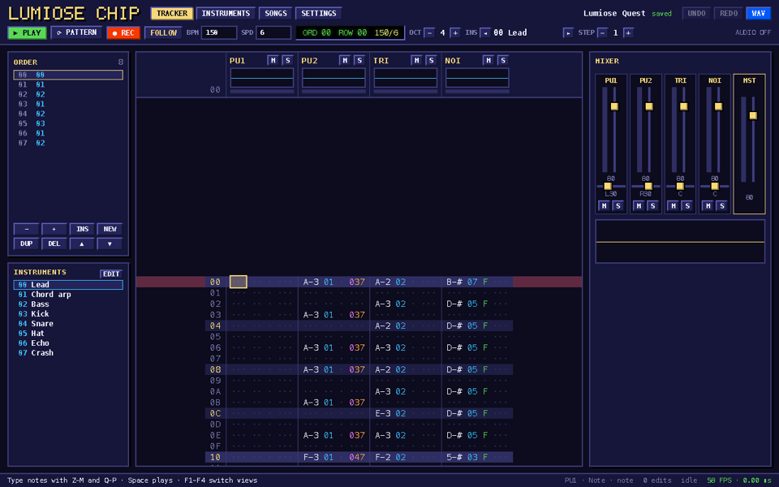
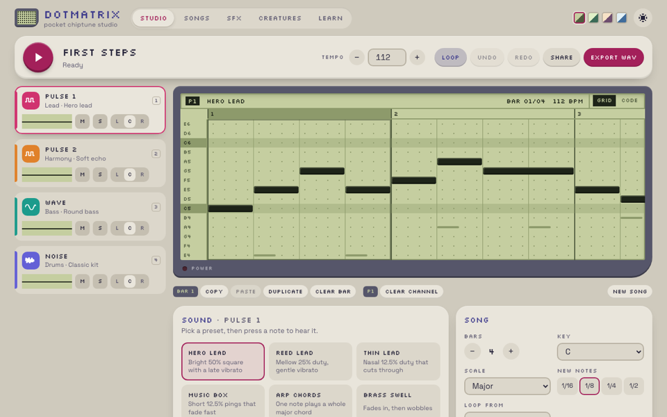
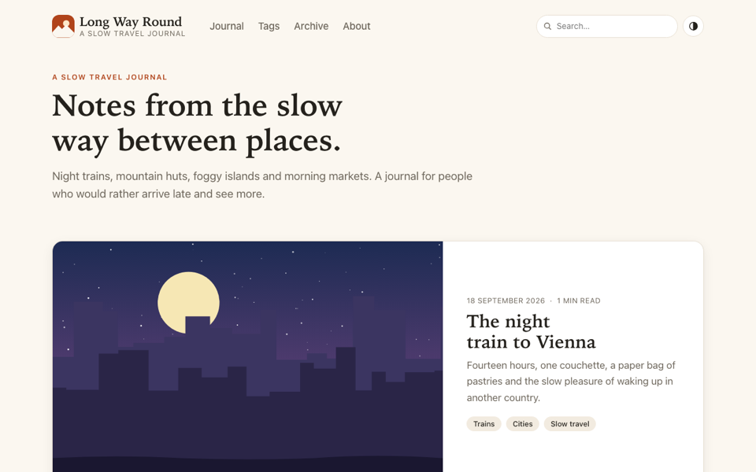
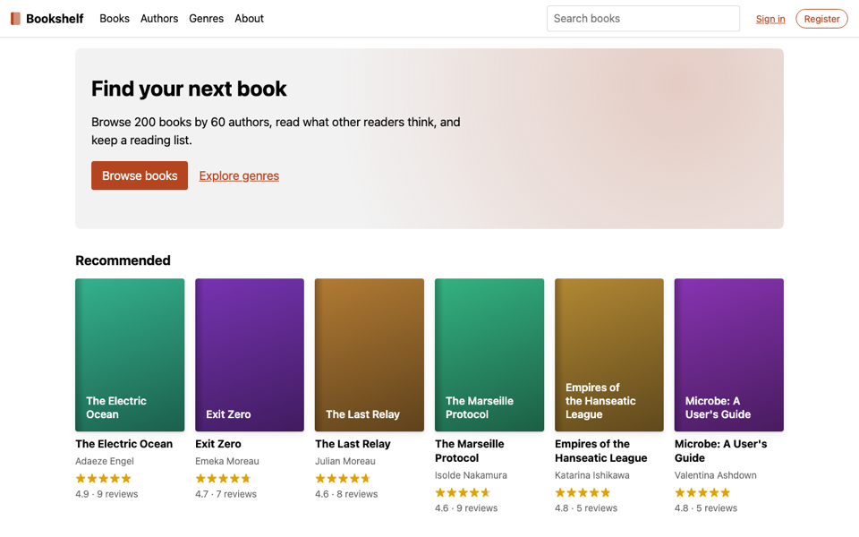

<p align="center">
  
</p>

<h1 align="center">Lumiose</h1>

<p align="center">
  <strong>Feels like React. Runs like vanilla JS.</strong><br>
  A web framework for everything from static sites and SPAs to full-stack apps: TSX with scoped CSS built in,
  signals, and 0&nbsp;kB of JavaScript until a page needs it.
</p>

<p align="center">
  <a href="https://itsjavi.com/lumiose/">Website</a> ·
  <a href="https://itsjavi.com/lumiose/docs/getting-started/">Get started</a> ·
  <a href="https://itsjavi.com/lumiose/playground/">Playground</a> ·
  <a href="https://itsjavi.com/lumiose/showcase/">Showcase</a> ·
  <a href="https://itsjavi.com/lumiose/benchmarks/">Benchmarks</a> ·
  <a href="LICENSE">MIT License</a>
</p>

<!-- generated:proof -->
<table align="center">
  <tr>
    <td align="center"><strong>1.08×</strong><br><sub>vanilla JS on js-framework-benchmark</sub></td>
    <td align="center"><strong>0 kB</strong><br><sub>JavaScript on server-rendered pages</sub></td>
    <td align="center"><strong>6.4 kB</strong><br><sub>runtime and app, compressed</sub></td>
  </tr>
</table>
<!-- /generated:proof -->

## Quick start

```bash
npm create lumiose@latest my-app
```

Pick a template (`minimal`, `static`, `ssr` or `spa`), then `pnpm dev`. Every new project starts agent-ready, with an
`AGENTS.md` and a Lumiose skill. Lumiose is pre-1.0, so APIs may still change between minor versions.

## Why Lumiose

Most stacks make you assemble the pieces: a UI library, a styling solution, a meta-framework on top, and for content
sites, a second UI framework for anything interactive.

Lumiose is one framework for all of it. You write components the way you already do in React, with their styles in the
same file. Each route picks how it renders, from static HTML to a full SPA, and a page ships no JavaScript until it has
something interactive. The compiler, written in Rust, turns components into direct DOM updates, with no virtual DOM.

```tsx
import { signal } from "lumiose";

const accent = "#5546ff";

export default function Counter() {
  const count = signal(0);

  return (
    <button class={{ pill: true, hot: count() > 9 }} onClick={() => count.update((n) => n + 1)}>
      Clicked {count()} times
    </button>
  );
}

// One <style> block scoped to this file, with JS values like $accent.
<style>
  .pill {
    padding: 8px 16px;
    border: 0;
    border-radius: 999px;
    background: $accent;
    color: white;
  }
  .hot {
    outline: 2px solid tomato;
  }
</style>
```

`Counter` runs once. Clicking updates only the text and the class that read `count()`. Try it in the
[playground](https://itsjavi.com/lumiose/playground/), which runs the compiler in your browser.

## Features

- **TSX with scoped CSS.** `.stsx` files are JSX plus raw-CSS `<style>` blocks, scoped by where you put them, with JS
  values (`$name`) and build-time math. Stock `tsc` type-checks them, with no TypeScript plugins.
- **Signals, not re-renders.** `signal`, `computed`, `effect` and `store` update exactly the DOM nodes that use them.
  The rules of hooks, dependency arrays, stale closures and memoization go away.
- **Every rendering mode, per route.** Static (prerendered HTML), server (streamed: the shell first, then each
  `<Suspense>` boundary), islands (`client:load`, `client:idle`, `client:visible`) and SPA (client routing with a
  prerendered first paint). The same components work in all four.
- **The full stack, built in.** File routes with layouts and a typed `href()`, async components, form actions that
  work without JavaScript, endpoints, middleware, cookies, i18n, and a strict Content Security Policy with nonces.
- **Content as components.** Import `.md` and `.html` files (GFM, front matter) as components, and any SVG,
  icon sets such as Lucide included, with `?component` (optimised and inlined).
- **Deploy anywhere.** Node, Docker, Cloudflare Workers, Vercel, Netlify, Bun, Deno, Fly.io, Render, Railway, AWS
  Lambda or any static host, each with a [deploy guide](https://itsjavi.com/lumiose/docs/deploy/).
- **Explicit, for you and your agent.** Client boundaries are where you write them. Every diagnostic has a `LUMxxxx`
  code, a fix and a docs page. The docs ship inside the package (`lumiose docs signals`) and are served to agents over
  MCP.
- **Tooling included.** The `lumiose` CLI (dev, build, preview, check, lint, fmt), a language server and VS Code
  extension, oxlint/ESLint and Prettier plugins, and TanStack Query bindings in `@lumiose/query`.

## How it compares

<!-- generated:compare -->
<table>
  <thead><tr><th>Stack</th><th>Full-stack layer</th><th>Styles</th><th>JS on a server page</th><th>Client speed</th><th colspan="2">Server speed</th></tr></thead>
  <tbody>
    <tr><td><strong>Lumiose</strong></td><td><strong>Built in</strong></td><td><strong>Built in</strong></td><td align="right"><strong>0&nbsp;kB</strong></td><td align="right"><strong>1.08×</strong></td><td align="right"><strong>619&nbsp;renders/s</strong></td><td align="right"><strong>1,323&nbsp;req/s</strong></td></tr>
    <tr><td>React + Next.js</td><td>Separate project</td><td>Pick a library</td><td align="right">119&nbsp;kB</td><td align="right">1.54×</td><td align="right">185&nbsp;renders/s</td><td align="right">437&nbsp;req/s</td></tr>
    <tr><td>React Router</td><td>Built in</td><td>Pick a library</td><td align="right">101&nbsp;kB</td><td align="right">1.54×</td><td align="right">185&nbsp;renders/s</td><td align="right">683&nbsp;req/s</td></tr>
    <tr><td>Preact</td><td>None official</td><td>Pick a library</td><td align="right">No full-stack layer</td><td align="right">1.52×</td><td align="right">208&nbsp;renders/s</td><td align="right">No full-stack layer</td></tr>
    <tr><td>Astro</td><td>Built in</td><td>Built in</td><td align="right">0&nbsp;kB</td><td align="right">Depends on the UI framework</td><td align="right">206&nbsp;renders/s</td><td align="right">1,247&nbsp;req/s</td></tr>
    <tr><td>Svelte + SvelteKit</td><td>Separate project</td><td>Built in</td><td align="right">38&nbsp;kB</td><td align="right">1.17×</td><td align="right">505&nbsp;renders/s</td><td align="right">1,067&nbsp;req/s</td></tr>
    <tr><td>Vue + Nuxt</td><td>Separate project</td><td>Built in</td><td align="right">76&nbsp;kB</td><td align="right">1.25×</td><td align="right">204&nbsp;renders/s</td><td align="right">608&nbsp;req/s</td></tr>
    <tr><td>Solid + SolidStart</td><td>Separate project</td><td>Pick a library</td><td align="right">33&nbsp;kB</td><td align="right">1.11×</td><td align="right">580&nbsp;renders/s</td><td align="right">999&nbsp;req/s</td></tr>
    <tr><td>Remix 3</td><td>Built in</td><td>Built in</td><td align="right">42&nbsp;kB</td><td align="right">1.57×</td><td align="right">44&nbsp;renders/s</td><td align="right">823&nbsp;req/s</td></tr>
  </tbody>
</table>
<p><sub>JS on a server page: what the fullstack comparison's issue tracker loads for its home page, brotli (2026-10-12 · Apple M1 Max (10 cores) · macOS 27.0.1 · Node 26.8.1). Client speed: js-framework-benchmark's weighted factor, where 1.00 is the fastest framework in the run and vanilla JS scores 1.00. Server speed: renders per second of the SSR benchmark's 5,000-component page to an HTML string (2026-10-12, Node v26.8.1, Apple M1 Max (10 cores, 32 GB), darwin 27.0.0 arm64), then requests per second on the fullstack comparison's home page (2026-10-12 · Apple M1 Max (10 cores) · macOS 27.0.1 · Node 26.8.1). Both React rows use React's client and rendering entries. Rows after Lumiose are ordered by npm downloads of each stack's main package (2026-09-10 to 2026-10-09). Astro's interactive islands need a second UI framework. Method and every run: <a href="https://itsjavi.com/lumiose/benchmarks/">benchmarks</a>.</sub></p>
<!-- /generated:compare -->

## Showcase

<table>
  <tr>
    <td width="50%"><a href="https://itsjavi.com/lumiose/showcase/chiptune-tracker/"></a></td>
    <td width="50%"><a href="https://itsjavi.com/lumiose/showcase/dotmatrix/"></a></td>
  </tr>
  <tr>
    <td align="center"><a href="https://itsjavi.com/lumiose/showcase/chiptune-tracker/">Lumiose Chip</a>: a chiptune tracker (SPA)</td>
    <td align="center"><a href="https://itsjavi.com/lumiose/showcase/dotmatrix/">Dotmatrix</a>: a pocket chiptune studio (SPA)</td>
  </tr>
  <tr>
    <td width="50%"><a href="https://itsjavi.com/lumiose/demos/travel-journal/"></a></td>
    <td width="50%"><a href="examples/ssr-bookshelf"></a></td>
  </tr>
  <tr>
    <td align="center"><a href="https://itsjavi.com/lumiose/demos/travel-journal/">Long Way Round</a>: a travel journal (static + islands)</td>
    <td align="center"><a href="examples/ssr-bookshelf">Bookshelf</a>: a book catalogue (server)</td>
  </tr>
</table>

The [website](https://itsjavi.com/lumiose/) itself is a static Lumiose site, with islands for the search, the
playground and the landing page's light.

## Documentation

The docs live in [`packages/lumiose/docs/`](packages/lumiose/docs/) and ship with the package, so they always match
the installed version. Read them on the [website](https://itsjavi.com/lumiose/docs/getting-started/), from the terminal
with `lumiose docs`, or through [`llms.txt`](https://itsjavi.com/lumiose/llms.txt). Good places to start:
[Getting started](https://itsjavi.com/lumiose/docs/getting-started/),
[Coming from React](https://itsjavi.com/lumiose/docs/coming-from-react/) and
[Rendering modes](https://itsjavi.com/lumiose/docs/concepts/rendering-modes/).

## Working on Lumiose

You need Node 24 or later, pnpm and Rust (`rustup` installs the toolchain in `rust-toolchain.toml` on first use).

```bash
git clone https://github.com/itsjavi/lumiose.git
cd lumiose
pnpm install
pnpm build:compiler   # the Rust compiler, as a native Node addon
pnpm demo             # pick an example, the website or a benchmark app and start it
```

`pnpm check` runs what CI runs. [CONTRIBUTING.md](CONTRIBUTING.md) covers the demo runner, building the website, CI,
the compiler binaries and releases.

| Folder                      | What's in it                                                         |
| --------------------------- | -------------------------------------------------------------------- |
| [`packages/`](packages)     | The framework, the Vite plugin, the CLI, adapters and editor tooling |
| [`crates/`](crates)         | The Rust compiler, with its CSS, SVG and content pipelines           |
| [`apps/web/`](apps/web)     | The website: landing page, docs, showcase, benchmarks and playground |
| [`examples/`](examples)     | Example apps for every rendering mode                                |
| [`benchmarks/`](benchmarks) | js-framework-benchmark, SSR and the fullstack comparison             |

## License

[MIT](LICENSE). This covers the Lumiose packages, the website and all examples, except code vendored with its own
notice: the gbapu Game Boy APU engine in `examples/spa-dotmatrix/vendor/gbapu` (by the same author, MIT release
planned) and the Remix 3 benchmark entry (Apache-2.0).
