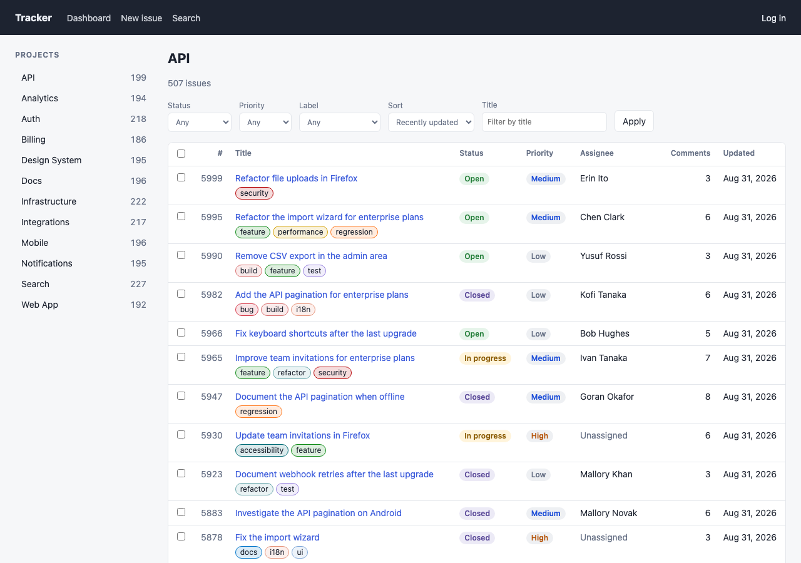

## Description

<!-- SECTION:DESCRIPTION:BEGIN -->
doc-4: the Tracker app in React Router framework mode with SSR (loaders/actions, Form/useFetcher, loader promise + Await for comments), latest stable React Router and React 19, compression off.
<!-- SECTION:DESCRIPTION:END -->

## Acceptance Criteria
<!-- AC:BEGIN -->
- [x] #1 Passes the conformance suite in production mode
- [x] #2 Versions pinned; idiomatic React Router code
<!-- AC:END -->

## Implementation Notes

<!-- SECTION:NOTES:BEGIN -->
Quasar (quasar-20261009T040841Z) started.

Quasar: app at benchmarks/fullstack/apps/react-router (e975165). react-router/@react-router/{dev,node,express} 8.4.0, react/react-dom 19.3.0, vite 8.3.4, express 5.2.1, isbot 5.2.2, typescript 7.0.2 (RR 8 supports TS 7). Default entry.client/entry.server (renderToPipeableStream, onShellReady for browsers). Production server: server.ts = Express + @react-router/express request handler + express.static (immutable /assets), i.e. react-router-serve minus compression and morgan, because react-router-serve always enables compression. Session = unsigned uid cookie parsed from the Cookie header (RR createCookie would base64-JSON encode the value, doc-4 specifies uid=<id>). 404s: catch-all route + loaders throw data(…, 404) → root ErrorBoundary renders the layout + NotFound. Bulk close = useFetcher form (revalidates); comments = unawaited listComments promise + <Suspense>/<Await>; composer = useFetcher; status/new-issue/login = <Form method=post>; filters = <Form method=get>. Conformance: pnpm --filter @bench/harness conformance --only react-router → 15/15 pass. Dev smoke-tested (200s on /, /projects/api, /issues/1; 404 on unknown). typecheck = react-router typegen && tsc.

Quasar: dev-mode fix: route components must import shared helpers from '@bench/data/format' (the DB-free entry); importing them from '@bench/data' kept node:sqlite/node:fs in the dev client graph (prod tree-shook it). Dev checked in Chromium: all pages hydrate, no console errors. Conformance (runner, prod build, COMMENTS_DELAY_MS=150): 15/15. Screenshot: backlog/assets/task-113-react-router-project.png
<!-- SECTION:NOTES:END -->

## Final Summary

<!-- SECTION:FINAL_SUMMARY:BEGIN -->
React Router 8.4.0 framework-mode SSR app (React 19.3.0, Vite 8.3.4) at benchmarks/fullstack/apps/react-router, port 4102: loaders/actions, <Form>/useFetcher, streamed comments via loader promise + <Suspense>/<Await>, root ErrorBoundary for 404s, Express production server without compression (server.ts). Scripts seed/dev/build/start/typecheck/clean. Passes the conformance suite 15/15. 
<!-- SECTION:FINAL_SUMMARY:END -->
