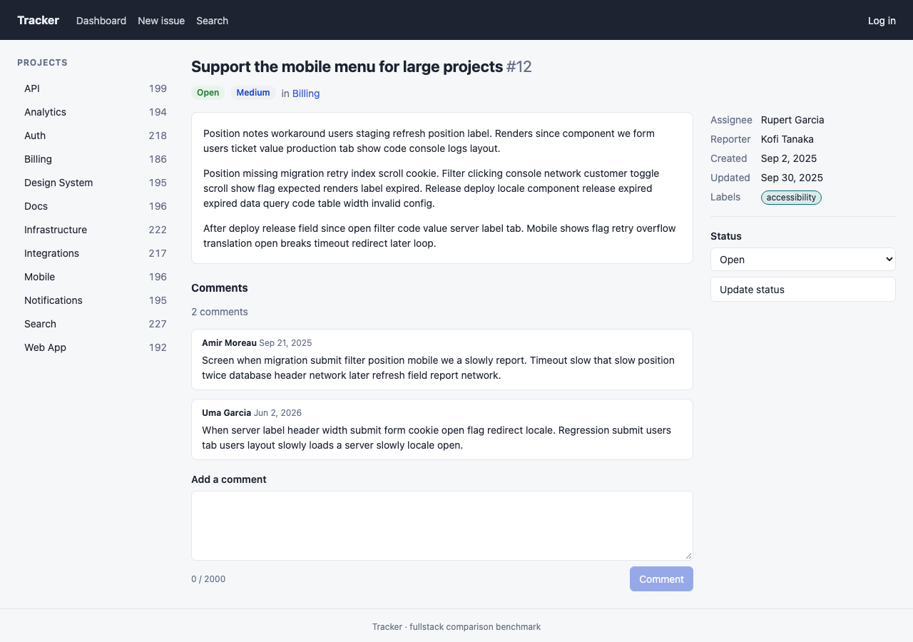

## Description

<!-- SECTION:DESCRIPTION:BEGIN -->
doc-4: the Tracker app in Next.js 16 App Router (server components, server actions, use client components, async component in Suspense for comments), dynamic rendering only, compress: false, typecheck excluded from the timed build.
<!-- SECTION:DESCRIPTION:END -->

## Acceptance Criteria
<!-- AC:BEGIN -->
- [x] #1 Passes the conformance suite in production mode
- [x] #2 Versions pinned; idiomatic Next.js code; no page or data caching
<!-- AC:END -->

## Implementation Notes

<!-- SECTION:NOTES:BEGIN -->
Quasar (quasar-20261009T040841Z) started.

Quasar: Next.js 16.4.0 (React 19.3.0 installed; the App Router uses Next's bundled React canary), typescript 7.0.2 works for next typegen + tsc and for next build (ignoreBuildErrors). All routes ƒ (dynamic) in the build output: the root layout reads cookies(); no 'use cache', no fetch caching (no fetch at all). Server actions in app/actions.ts with refresh() after mutations; client forms use useActionState (login, new issue, comment composer, bulk select); status/logout forms are plain server-component forms; filter and search forms use next/form; comments are an async server component inside <Suspense>; React cache() dedupes the issue/project lookup between generateMetadata and the page. agentRules: false (next dev otherwise writes AGENTS.md into the app when it detects an agent). Note for the harness: Next telemetry is on by default; consider NEXT_TELEMETRY_DISABLED=1 for timed runs. Logout/login are server actions, so there is no literal POST /logout endpoint (the suite drives them via the UI). Conformance 15/15; dev checked in Chromium (no console errors). Screenshot: backlog/assets/task-114-next-issue.png
<!-- SECTION:NOTES:END -->

## Final Summary

<!-- SECTION:FINAL_SUMMARY:BEGIN -->
Next.js 16.4.0 App Router app at benchmarks/fullstack/apps/next, port 4103: server components, server actions + useActionState, async comments component in <Suspense>, next/link and next/form; dynamic rendering only, compress: false, typescript.ignoreBuildErrors. Scripts seed/dev/build/start/typecheck/clean. Passes the conformance suite 15/15. 
<!-- SECTION:FINAL_SUMMARY:END -->
