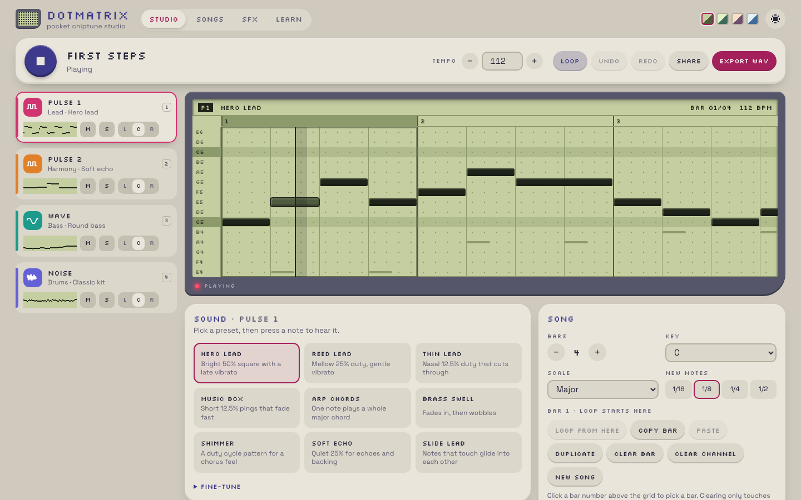
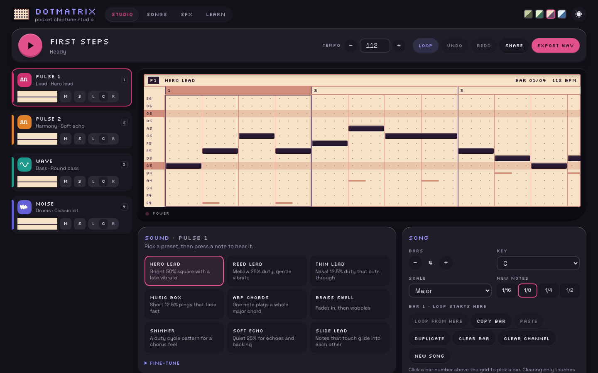
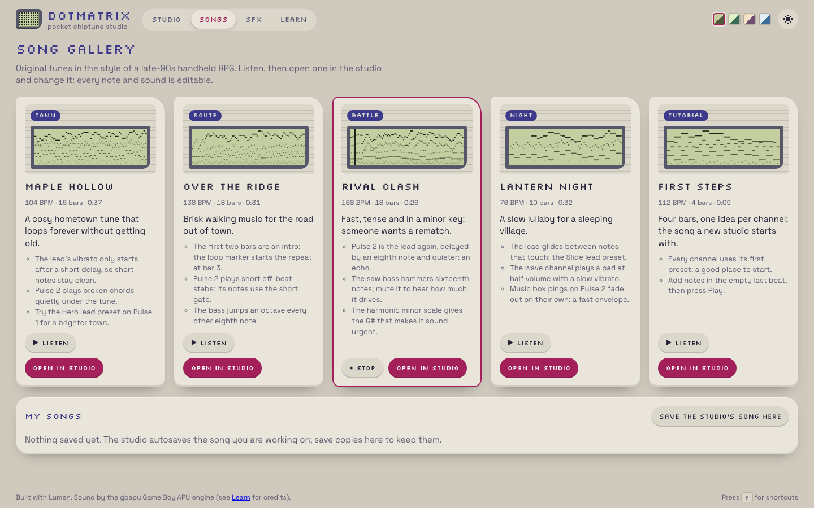
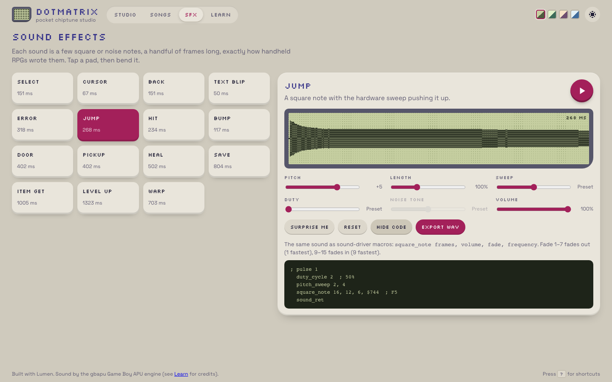
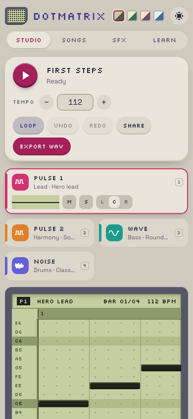
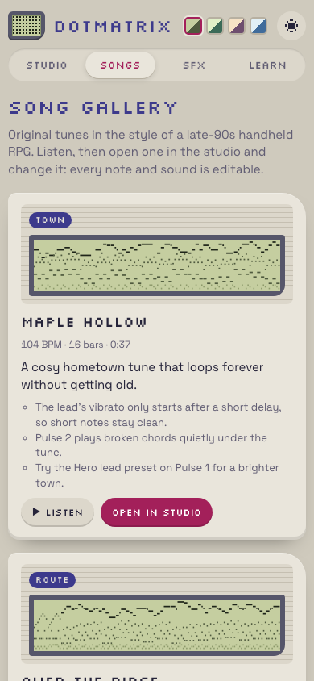
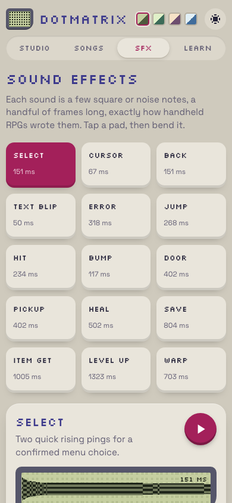

## Description

<!-- SECTION:DESCRIPTION:BEGIN -->
User request 2026-10-09: a sibling of spa-chiptune built with Lumen, using the user's Game Boy APU engine (newbark-engine's packages/gbapu, vendored with its LICENSE-NOTICE.md and PROVENANCE.json) and learning from crystal-exporter (docs/audio.md, audio/DSL.md, authored examples) how Crystal-style music and SFX are expressed. Easier for beginners than spa-chiptune, equally polished, with its own design. Demo songs and SFX must be original compositions in that style: no Pokémon Crystal songs, SFX, cries or exported game data.
<!-- SECTION:DESCRIPTION:END -->

## Acceptance Criteria
<!-- AC:BEGIN -->
- [x] #1 examples/spa-dotmatrix: a Lumen SPA where a beginner can make a short 4-channel Game Boy song (pulse 1/2, wave, noise) and simple SFX with presets, play it, and export WAV
- [x] #2 Ships several original demo songs and an SFX gallery in the Crystal style (duty cycles, envelopes, vibrato, pitch slides, noise drums)
- [x] #3 gbapu vendored with its notice and provenance unchanged; no game audio or data copied from crystal-exporter
- [x] #4 lumen check, lumen fmt --check, build, Playwright e2e green; README; screenshots in backlog/assets linked from the task
<!-- AC:END -->

## Implementation Notes

<!-- SECTION:NOTES:BEGIN -->
Chime (2026-10-09): implemented examples/spa-dotmatrix ("Dotmatrix").

Design and architecture
- Lumen SPA (mode spa, ssr false) with file routes / (studio), /songs (demo gallery + My songs), /sfx (gallery + maker), /learn (channel explainers with hear-it buttons, credits); lumen/router Links, search() for share links, store/signal state, scoped .stsx styles, tokens via $tokens.
- Own sound driver (src/audio/driver.ts) turns songs into gbapu command streams like a Crystal-era driver: notes on 16th steps, per-frame (70,224 cycles) vibrato, glide, arpeggio, duty-cycle pattern (shimmer), wave volume steps; noise drums are frame programs; SFX are square_note/noise_note-style steps with duty and hardware pitch sweep. The SFX maker shows the sound as Crystal-style macros.
- Rendering: gbapu in a module Web Worker (pool of 2). Each channel renders to its own mono stem (~0.1 s per channel for a 30 s song); Web Audio plays the stems in sync, loops after the loop bar, and applies mute/solo/pan without re-rendering. Edits re-render only changed channels and swap them in at the playing position with a short crossfade. AudioContext is created on the first click (unlock).
- Beginner UX: piano-roll lite (click to add, drag to lengthen, click to remove; arrows/Enter/Shift+arrows on the focused grid), rows from key + scale, presets per channel with a Fine-tune drawer (duty, envelope, vibrato, glide, arp, gate, wave shape, drum tone), bars/loop/copy/paste/duplicate/clear, undo/redo (snapshots, merged drags), autosave, share links (deflate-raw + base64url in ?song=, sanitized on load), WAV export (intro + loop twice with RIFF smpl loop points), shortcuts sheet (?).
- Look: handheld-inspired shell (light/dark), dot-matrix LCD piano roll with 4 selectable 4-shade palettes, power LED, cartridge-style song cards; Silkscreen + Space Grotesk (OFL, @fontsource, pinned 5.3.0).

Content (all original): 5 demo songs (Maple Hollow town, Over the Ridge route, Rival Clash battle, Lantern Night night, First Steps tutorial; 9-37 s loops, 2-bar intros on route/battle/night) written in a small notation (src/model/notation.ts); 15 SFX (select, cursor, back, text blip, error, jump, hit, bump, door, pickup, heal, save, item get, level up, warp). Own wave tables (computed) and drum kit; the gbapu drum alias tokens (source-derived) are not used. Nothing from crystal-exporter/output or game data was copied.

Vendoring: vendor/gbapu/{dist/*, LICENSE-NOTICE.md, PROVENANCE.json, CHECKSUMS.sha256} copied unchanged; src/audio/vendor.test.ts checks every dist file against CHECKSUMS.sha256. The example's .gitignore re-includes vendor/gbapu/dist/ (the root ignores dist/). README states the origin and that redistribution needs the rights holder's permission.

Validation: lumen check, lumen fmt --check, lumen lint clean; Vitest 30 tests (driver registers/loop markers, every demo channel audible on the real engine, notation, sanitize, share round trip of every demo, history, SFX mods/listing, vendor checksums); Playwright 22 tests x dev + build/preview green (playback, grid + keyboard editing, presets, gallery listen/open/undo, WAV export with smpl, share-link round trip in a fresh context, SFX maker + WAV, phone widths without sideways scroll, dark theme).

Framework feedback
- Style scope vs helper JSX: a render helper defined inside a component (const range = () => <label class="field">…) is not covered by the component's <style> block, because its JSX is not inside the root element. Documented and caught by LUM3005, but it surprised me; I moved those rules to file-level blocks. Possible DX improvement: treat JSX lexically inside the component function as in scope, or make LUM3005's help mention helpers.
- LUM2006 fires for `CHANNELS.map((info, i) => { const ch = i … })` over a constant tuple, where rows never move; worked around by mapping over a constant index array.
- Transient: lumen/vite failed to load for a few minutes (index.ts imported projectOptionsOf from options.ts mid-edit by another agent); resolved on its own.

Shared files for Lux: pnpm-lock.yaml changed (new importer examples/spa-dotmatrix: @fontsource/silkscreen 5.3.0, @fontsource-variable/space-grotesk 5.3.0); not committed by me.

Screenshots:

Correction: the Playwright suite is 10 specs run against both projects (dev, build + preview): 20 passed. Final run after the README hero shot: lumen check, fmt --check, Vitest 30/30, Playwright 20/20.
<!-- SECTION:NOTES:END -->

## Final Summary

<!-- SECTION:FINAL_SUMMARY:BEGIN -->
Dotmatrix (examples/spa-dotmatrix): a beginner-first Game Boy chiptune studio and SFX maker in Lumen on the vendored gbapu engine. Piano-roll studio for Pulse 1/2, Wave and Noise with per-channel presets and a fine-tune drawer, a Crystal-style frame driver (vibrato, glide, arpeggio, duty patterns, wave levels, noise drum programs, hardware sweep), per-channel stems rendered in a worker and mixed/looped in Web Audio with live re-render on edits, undo/redo, autosave, share links, WAV export with loop points; 5 original demo songs and 15 original SFX; learn page; light/dark and four LCD palettes; responsive to phone width. gbapu vendored unchanged with notice, provenance and checksums (verified by a test). Validated with lumen check/fmt/lint, Vitest 30, Playwright 20 (dev + build/preview). Screenshots in backlog/assets/task-133-*.png. Lockfile change left for Lux.
<!-- SECTION:FINAL_SUMMARY:END -->
