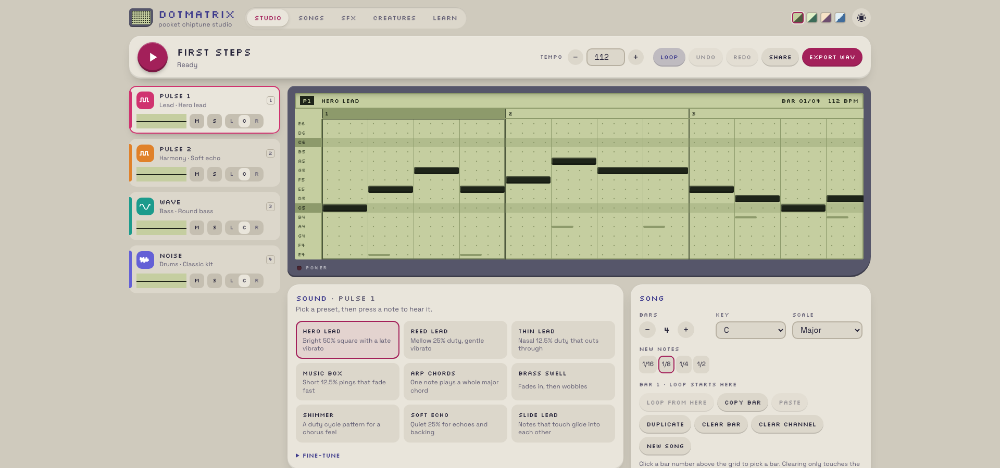
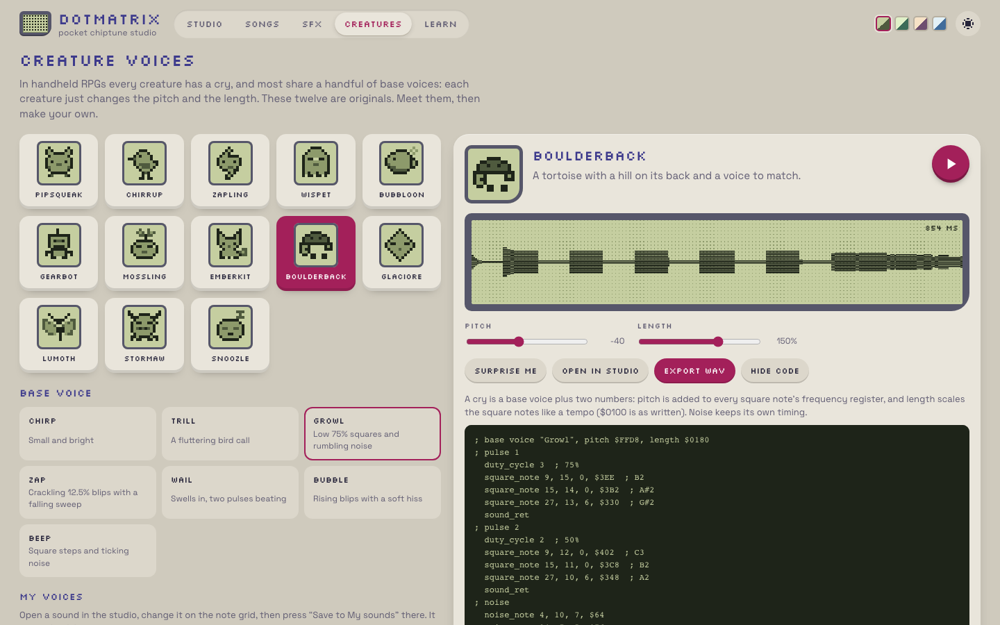
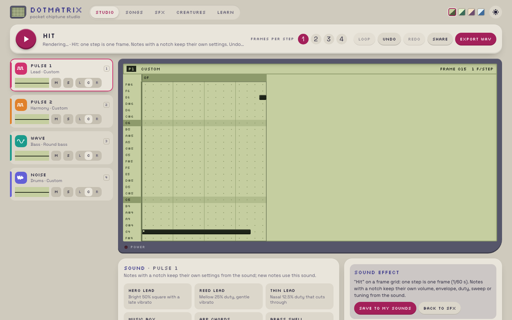
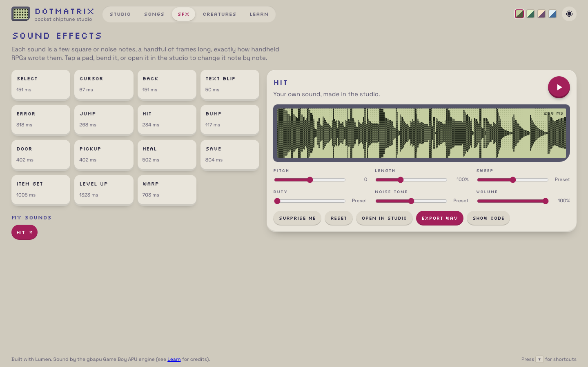
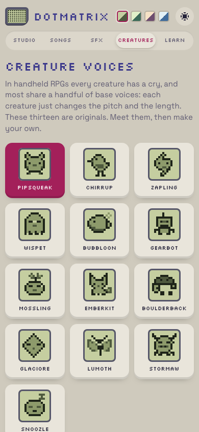
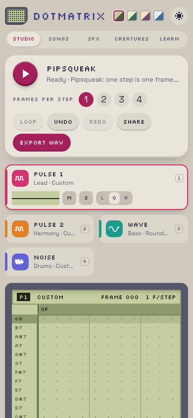

## Description

<!-- SECTION:DESCRIPTION:BEGIN -->
User feedback 2026-10-09 on spa-dotmatrix (loves the UI): (1) the Song panel overflows its card (the Scale select sticks out past the right edge at desktop width; screenshot in chat); (2) add a Creatures section next to SFX with a variety of original creature voices (cries), Crystal-style: a few base voice patterns on pulse + noise, varied by pitch and length, with a maker like the SFX one; original only, no game cry data; (3) make SFX and voices editable in the Studio editor too, where compatible (features the note grid cannot represent stay in the maker, with a clear explanation).
<!-- SECTION:DESCRIPTION:END -->

## Acceptance Criteria
<!-- AC:BEGIN -->
- [x] #1 Song panel fits its card at desktop, tablet and phone widths (no overflow), with a regression check
- [x] #2 /creatures (or a tab next to SFX) with at least 12 original creature voices, a maker (base voice, pitch, length, variation), playback and WAV export
- [x] #3 SFX and voices open in the editor when compatible and round-trip back; incompatible ones explain why; e2e tests; screenshots in backlog/assets
<!-- AC:END -->

## Implementation Notes

<!-- SECTION:NOTES:BEGIN -->
Chime (2026-10-09): done in examples/spa-dotmatrix.

1. Overflow: auto-fill grids now use minmax(min(Npx, 100%), 1fr), form controls get min-inline-size 0 / max-inline-size 100%, the Song panel fields shrink, the transport title input fills its column. Reproduced first (1920/1600 px: Key/Scale selects +18 px past the card; 360 px: title +26 px). Regression e2e: every element of every .panel/.cart/.card/.pad stays inside its card (scroll areas excluded) on /, /songs, /sfx, /creatures, /learn at 1920, 1440, 1280, 1024, 820, 390 and 360 px.

2. Creatures (/creatures, new nav tab): 13 original creatures (Pipsqueak, Chirrup, Zapling, Wispet, Bubbloon, Gearbot, Mossling, Emberkit, Boulderback, Glaciore, Lumoth, Stormaw, Snoozle) with 12x12 sprites, on 7 original base voices (chirp, trill, growl, zap, wail, bubble, beep) using pulse 1/2 + noise. Learned the mechanism from crystal-exporter's converter (cry pitch is added to the 11-bit frequency register; cry length acts as a tempo for the square notes; noise ignores length) and wrote my own patterns; no cry data used. Maker: base voice chips, pitch (register offset) and length sliders, remix naming, Surprise me, waveform, driver code with a cry header line, WAV export.

3. SFX/voices in the studio: "Open in studio" turns the current sound into a sound sheet (Song.sheet {kind, name, ticks}): a frame grid (1-4 frames per step, plays once, no loop), noise rows are raw NR43 settings, and per-note overrides (volume, envelope, duty, hardware sweep, fine tuning) keep every detail; notes carrying them show a notch. The driver honours the overrides; share links keep them. "Save to My sounds/voices" stores the sheet and returns to its gallery (?sound=id). A saved sheet goes back to the maker sliders only if it uses no studio-only features; otherwise the maker shows why (e.g. "Pulse 1 has vibrato") and keeps the sliders and code view off, while play/export/reopen still work. Open in studio is disabled with the reason if a sound cannot fit (longer than 32 bars). Unit test renders every SFX and creature voice through maker -> sheet -> maker on the real engine, channel by channel, and compares envelopes (<2%). Side fix: maker rests no longer retrigger the channel (identical sound, matches the studio).

Validation: lumen check, fmt --check, lint clean; Vitest 61/61; Playwright 15 specs x dev + build/preview = 30/30. One earlier full run had 6 dev-project tests fail at 1.1 s each in a row (dev server restarted mid-run, likely another agent's framework edit); the immediate rerun and the final run were green.

Screenshots:

<!-- SECTION:NOTES:END -->

## Final Summary

<!-- SECTION:FINAL_SUMMARY:BEGIN -->
Dotmatrix follow-up: the Song panel (and every panel) fits its card at all widths with an e2e regression check; new /creatures page with 13 original creature voices on 7 original base voices, Crystal-style pitch/length, a maker, driver code and WAV export; SFX and voices open in the studio as lossless frame-grid sound sheets and come back through My sounds, with clear reasons when studio-only features keep a sound out of the maker. Vitest 61, Playwright 30 (dev + preview), check/fmt/lint clean. No lockfile changes.
<!-- SECTION:FINAL_SUMMARY:END -->
