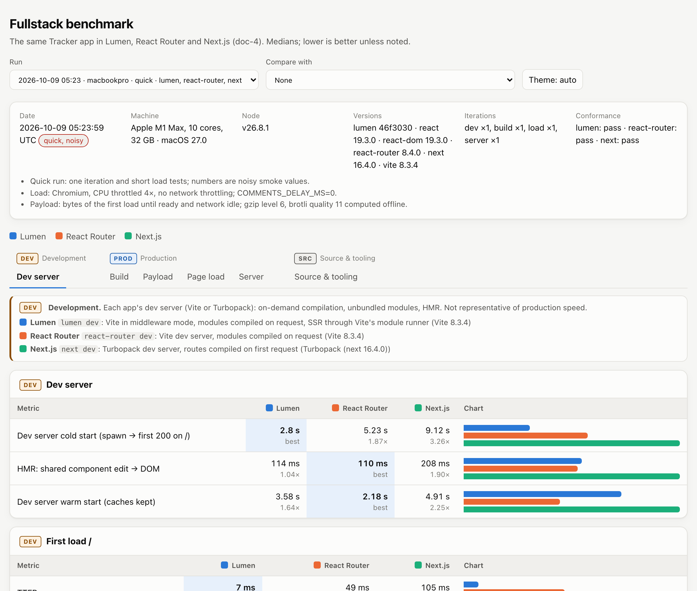
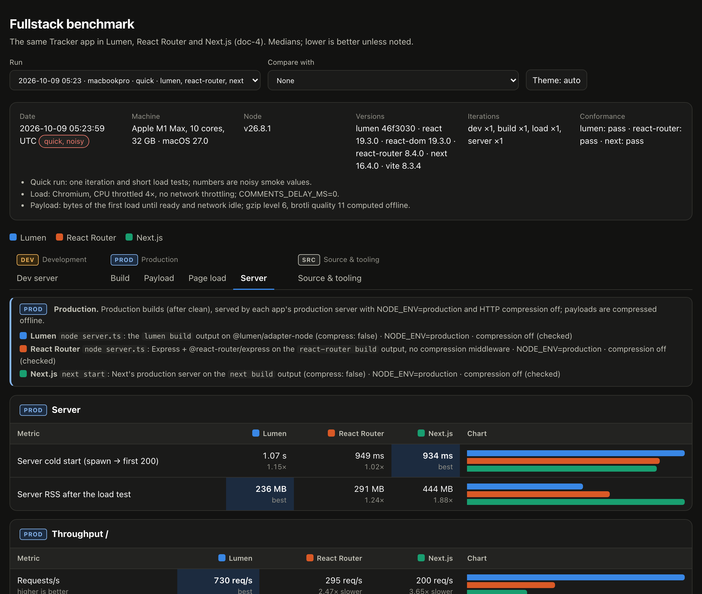

## Description

<!-- SECTION:DESCRIPTION:BEGIN -->
User 2026-10-09: 'req/s and other important things should be done on production builds; differentiate which benchmarks are for production builds and which for dev, because dev servers use Vite or Turbopack, which can differ a lot from prod servers.' The harness already runs load/server metrics against the production start scripts and dev metrics against dev servers, but results and viewer do not make the environment explicit.
<!-- SECTION:DESCRIPTION:END -->

## Acceptance Criteria
<!-- AC:BEGIN -->
- [x] #1 Every metric carries env: dev | build | prod in the results JSON (schema bumped, old files still load); the viewer groups and badges Development (dev servers: Vite / Turbopack) vs Production (built apps on their production servers), with a one-line description of how each app is served in each mode
- [x] #2 Results meta records each app's production server command, NODE_ENV and compression state, and the harness verifies NODE_ENV=production for prod runs; doc-4 updated
<!-- AC:END -->

## Implementation Notes

<!-- SECTION:NOTES:BEGIN -->
Nova 2026-10-09: every metric has env dev|build|prod (results schema 2; schema-1 files load with env derived from the group: dev -> dev, load/server/payload.* -> prod, rest -> build). meta.servers records per app the dev command + bundler (Vite 8.3.4 / Turbopack next 16.4.0) + description, the build command, and the production command + description + NODE_ENV and compression as checked. The harness now starts every production server with NODE_ENV=production and, on each app's first production start, reads NODE_ENV of the process listening on the port (ps -E; next-server hides its env behind its process title, so its parent answers) and stops if it is not 'production'; it also checks that / is not compressed. FINDING: before this, the Lumen app's start script did not set NODE_ENV (RR's script and next start do), so earlier Lumen production numbers ran with NODE_ENV unset; the Lumen start script now sets NODE_ENV=production like React Router's. Viewer: tabs grouped and badged Development (Dev server) / Production (Build, Payload, Page load, Server) / Source & tooling, each tab opening with a banner line per app on how it is served (command, bundler, NODE_ENV, compression). doc-4 §3/§4/§5/§6 updated. Quick run (schema 2, noisy, other agents active): results/2026-10-09T052359-macbookpro.json. Screenshots:  
<!-- SECTION:NOTES:END -->

## Final Summary

<!-- SECTION:FINAL_SUMMARY:BEGIN -->
Results schema 2: env dev|build|prod on every metric, meta.servers (commands, dev bundler, NODE_ENV and compression checked on the running production server; harness forces and verifies NODE_ENV=production). Viewer groups/badges Development vs Production with per-app serving lines; schema-1 files still load. doc-4 updated.
<!-- SECTION:FINAL_SUMMARY:END -->
