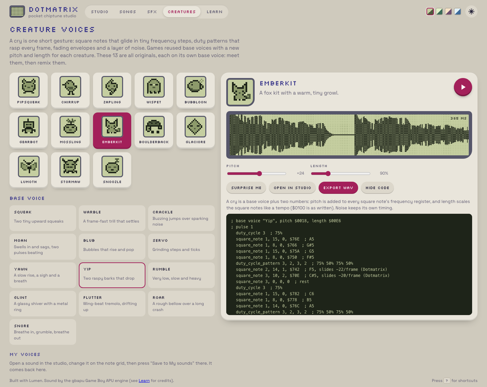
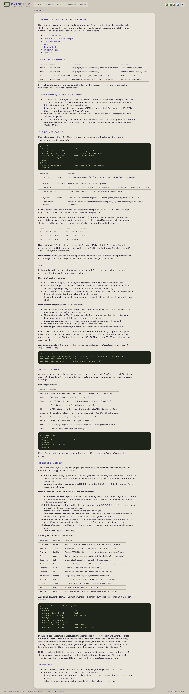

## Description

<!-- SECTION:DESCRIPTION:BEGIN -->
User feedback 2026-10-09: the creature voices sound similar to each other and like old cell phones ringing. The previous set is recorded in git at 24cd678. Learn how real cries are built from the user's audio examples and redesign the creatures. The reference is extracted game data: learn techniques and statistics only; never copy or closely transcribe any command sequence, frequency series or envelope pattern. Also write a composing guide for Dotmatrix covering SFX, cries and music.
<!-- SECTION:DESCRIPTION:END -->

## Acceptance Criteria
<!-- AC:BEGIN -->
- [x] #1 Creature voices redesigned with the techniques real cries use (per-frame duty patterns, frequency slides rather than musical steps, envelope fades, detuned/offset pulse pair, layered noise, short frame lengths, pitch/length variants); each creature clearly distinct; original patterns, with a one-off similarity check against the reference (not committed) showing no close match
- [x] #2 examples/spa-dotmatrix/docs/composing.md: how to compose SFX, cries and music in Dotmatrix and in the Crystal-style driver format, with original examples only; linked from the README and the Learn page
- [x] #3 Unit/e2e tests updated; screenshots if the UI changed
<!-- AC:END -->

## Implementation Notes

<!-- SECTION:NOTES:BEGIN -->
Chime (2026-10-09): done in examples/spa-dotmatrix.

Study (scratch: .local/agents/Chime/chime-1791524300/cry-analysis.md): statistics over the 69 base cries and 251 species programs. Cries are 3 channels (pulse 1, detuned pulse 2, noise), 2-11 notes of 2-17 frames, 20-60 frames per channel; frequencies move in small register steps (median 17 units; 0/±8/±16/±32 dominate), duty_cycle_pattern on ~60% of channels, loud attacks fading inside each note (533 down / 187 up / 18 hold), pulse 2 offset by -16..-80 units, noise layered with its own envelopes; species = base + tempo (mostly 192-384, 256 = as written) + small positive pitch offset. Old Dotmatrix voices were scale notes in even rhythm with fixed duty and held envelopes: ringtones.

Redesign: 13 new original base voices, one per creature (squeak, warble, crackle, moan, blub, servo, yawn, yip, rumble, glint, flutter, roar, snore), written as frequency-register contours with per-frame slides, duty patterns, fading envelopes, a detuned delayed pulse-2 follower and a noise layer. Names and sprites kept. Driver: per-note duty_cycle_pattern (rotates every frame across notes) and per-frame register slides in the SFX driver and the studio driver; sound sheets carry them as per-note overrides (dp, sl), share links keep them, the code view lists duty_cycle_pattern and slides. Length scaling keeps slide contours.

Similarity check (scratch script, not committed): pulse-1 frequency and volume contours resampled to 64 frames, pitch normalised (mean removed, /64 register units), compared by RMS against all 69 base and 251 species cries; plus exact 3-step runs of (frames, envelope, register delta).
reference base-vs-base nearest distance: p10 0.000 median 0.393
Pipsqueak    closest species:198.ts               d=0.428  shared 3-step runs: 0
Chirrup      closest species:11.ts                d=0.345  shared 3-step runs: 0
Zapling      closest base:raichu.ts               d=0.559  shared 3-step runs: 0
Wispet       closest base:sentret.ts              d=0.346  shared 3-step runs: 0
Bubbloon     closest base:venonat.ts              d=0.664  shared 3-step runs: 0
Gearbot      closest species:128.ts               d=1.303  shared 3-step runs: 0
Mossling     closest base:lapras.ts               d=0.397  shared 3-step runs: 0
Emberkit     closest species:38.ts                d=0.731  shared 3-step runs: 0
Boulderback  closest base:kangaskhan.ts           d=0.309  shared 3-step runs: 0
Glaciore     closest species:134.ts               d=0.270  shared 3-step runs: 0
Lumoth       closest base:blastoise.ts            d=0.310  shared 3-step runs: 0
Stormaw      closest base:kangaskhan.ts           d=0.323  shared 3-step runs: 0
Snoozle      closest species:247.ts               d=0.385  shared 3-step runs: 0
mine-vs-mine nearest: 0.45 0.39 0.64 0.34 0.63 1.17 0.34 0.84 0.37 0.33 0.33 0.37 0.53
No creature shares any 3-step command run with any reference. Closest contour distances 0.27-1.30, around the reference-to-reference nearest-neighbour median (0.39); the lowest (Glaciore 0.27) is a generic fade with a rise.

Guide: docs/composing.md (channels, frames/steps/tempo, driver format with fade/frequency/noise tables, music roles and tricks, SFX recipes, cry model and techniques, archetypes, checklist; original examples only), rendered in the app at /learn/composing via Lumen md imports, linked from README and Learn. Unit tests check its register table and notation example.

Validation: lumen check, fmt --check, lint clean; Vitest 63/63; Playwright 16 specs x dev + build/preview = 32/32. One earlier dev-only run of the creature spec failed once (first load after an edit); three reruns green.

Screenshots:

<!-- SECTION:NOTES:END -->

## Final Summary

<!-- SECTION:FINAL_SUMMARY:BEGIN -->
Creature voices rebuilt from the cry idiom (13 original base voices with register slides, duty patterns, fading envelopes, detuned twin and noise layer; driver support for duty patterns and slides end to end), similarity check against all reference cries showing no shared command runs and no unusually close contours, and a composing guide at docs/composing.md served at /learn/composing. Vitest 63, Playwright 32, check/fmt/lint clean.
<!-- SECTION:FINAL_SUMMARY:END -->
