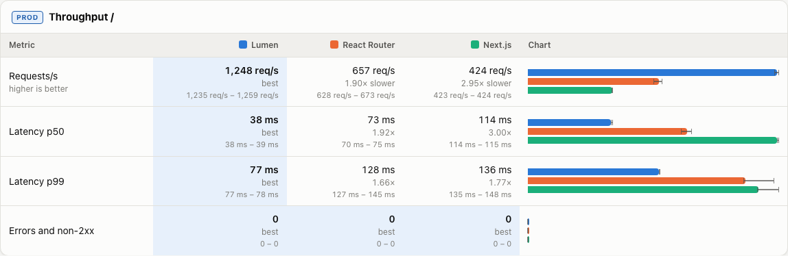

## Description

<!-- SECTION:DESCRIPTION:BEGIN -->
TASK-115: in the first full run (2026-10-09T084814) React Router's server rounds ran during a transient load spike and came out ~2x low (/issues 556 vs 1432 req/s in a server-only rerun 10 min later), while Lumen and Next were stable. The harness runs each app's 3 rounds back to back, so a spike hits one framework. Interleave rounds round-robin across apps per route (A B C A B C …), add a short cool-down and an idle check (load average) before each round, and report min/median/max so outliers are visible in the viewer.
<!-- SECTION:DESCRIPTION:END -->

## Acceptance Criteria
<!-- AC:BEGIN -->
- [x] #1 Server rounds are interleaved across apps per route, with cool-down/idle checks; results show spread; doc-4 §4 updated
<!-- AC:END -->

## Implementation Notes

<!-- SECTION:NOTES:BEGIN -->
Quasar (quasar-20261009T121332Z) started.

Quasar: bench.ts server group now starts every app's production server at once and interleaves cold starts and each route's autocannon rounds across apps, order rotated per round (A B C, B C A, C A B); waitForIdle (measure.ts) does a cool-down (3 s, quick 0.5 s) then waits up to 60 s (quick 5 s) for 1-min load average ≤ 0.5/core; rounds that still start busy are logged and listed in the results notes. Viewer: min–max whiskers on the bars (bar scale includes max), ranges wider than 25% of the median highlighted, subtitle explains it. doc-4 §4/§6/§7 updated (also: the view script needs 'pnpm --filter @bench/harness run view', 'pnpm view' is a pnpm built-in). Verified with a quick server-only run (--quick --metrics server --skip-conformance; the run file was discarded): interleaving and busy-machine notes work; the machine was busy (load 16–41 from other agents), so real runs still need a quiet machine. Screenshot: backlog/assets/task-154-viewer-spread.png
<!-- SECTION:NOTES:END -->

## Final Summary

<!-- SECTION:FINAL_SUMMARY:BEGIN -->
Server rounds are interleaved across apps per route (rotated order) with a cool-down and a load-average idle check before each round; busy rounds are reported in the run notes; the viewer shows min–max whiskers and flags wide spreads; doc-4 updated. 
<!-- SECTION:FINAL_SUMMARY:END -->
