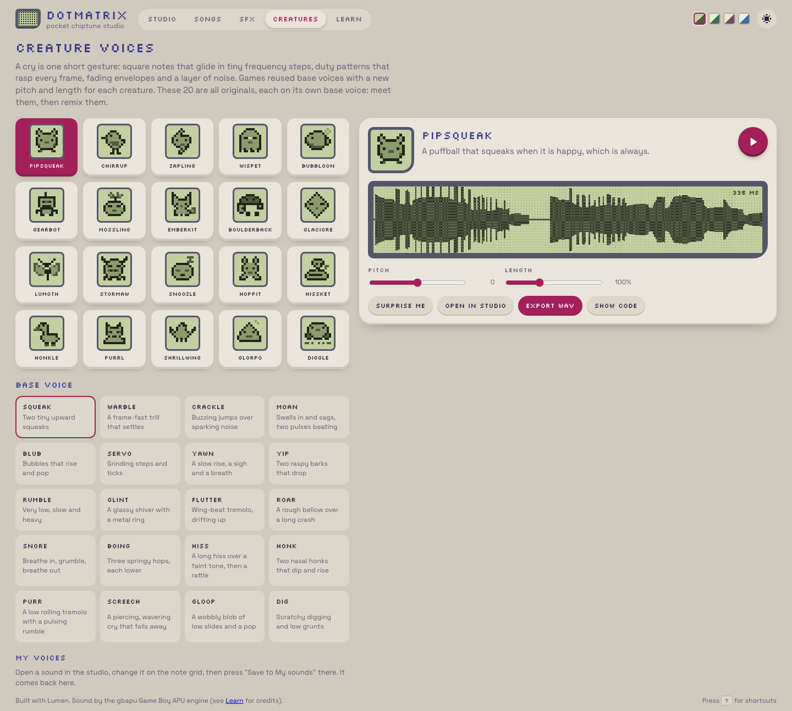
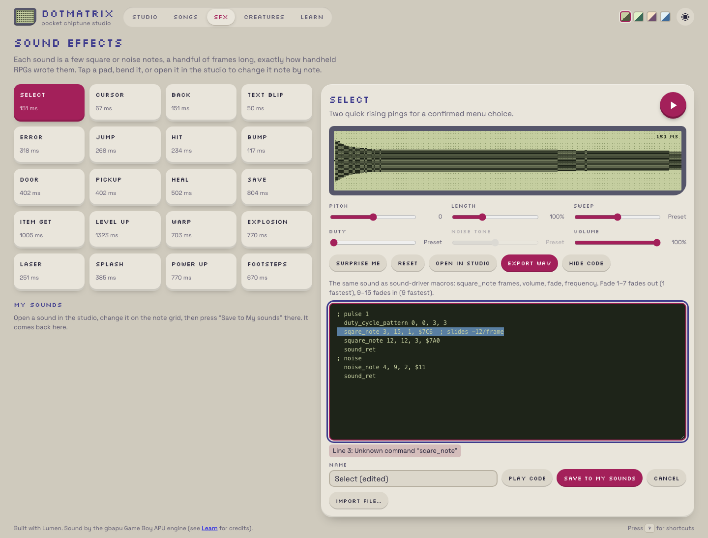

## Description

<!-- SECTION:DESCRIPTION:BEGIN -->
User 2026-10-09 ('much better'): add 7 more base voices so there are 4 complete rows (20 in total) — i.e. 7 new creatures, each on its own new original base voice, built with the cry techniques of TASK-153; grids show complete rows at desktop width. And: the app shows the driver code for SFX and voices but cannot take it back — allow pasting/editing and importing that format.
<!-- SECTION:DESCRIPTION:END -->

## Acceptance Criteria
<!-- AC:BEGIN -->
- [x] #1 20 creatures and 20 original base voices, each distinct; creature and base-voice grids show complete rows at desktop width; similarity check (scratch, not committed) against the reference cries reported
- [x] #2 The code view is editable (or has Paste/Import): driver code in the shown format (duty_cycle, duty_cycle_pattern, square_note, noise_note, pitch_sweep, slides, cry header, sound_ret…) parses back into an SFX or voice, with line-numbered errors; Import from a .txt/.asm file; the result saves to My sounds / My voices
- [x] #3 Round-trip tests: every built-in SFX and voice exports to code and imports back identically; e2e for paste, edit, error and import; composing.md documents it
<!-- AC:END -->

## Implementation Notes

<!-- SECTION:NOTES:BEGIN -->
Chime (2026-10-09): done.
- 7 new creatures on 7 new original base voices (Hoppit/boing, Hissket/hiss, Honkle/honk, Purrl/purr, Shrillwing/screech, Glorpo/gloop, Diggle/dig), each with a new 12x12 sprite: 20 creatures, 20 base voices. Creature grid is 5 columns (4 full rows) at desktop, 4 on phones; base-voice grid 4 columns (5 full rows), 2 on phones. e2e checks the column counts.
- Driver code editor (ui/CodeEditor.stsx, model/code.ts): Show code -> Edit code / Paste new code / Import file... (.txt/.asm/.s/.inc). Parser reads sections (; pulse 1/2, ; noise), duty_cycle, duty_cycle_pattern, pitch_sweep (with the list of sweeps Dotmatrix can play when one is not), square_note/noise_note (rests at volume 0), the slide annotation, sound_ret and the cry header (comment); decimal or $hex. Errors are line-numbered, listed under the editor; clicking one selects the line. Valid code plays at once (waveform updates) and saves to My sounds / My voices under a name.
- Round trip: every built-in SFX and creature voice exports to code and parses back to identical driver register writes and identical code (model/code.test.ts). composing.md has a new section 'Editing, pasting and importing code'.
- Similarity check (scratch, not committed), 20 creatures vs 69 base + 251 species cries; no shared 3-step command runs anywhere; reference base-vs-base nearest-neighbour median 0.39:
reference base-vs-base nearest distance: p10 0.000 median 0.393
Pipsqueak    closest species:198.ts               d=0.428  shared 3-step runs: 0
Chirrup      closest species:11.ts                d=0.345  shared 3-step runs: 0
Zapling      closest base:raichu.ts               d=0.559  shared 3-step runs: 0
Wispet       closest base:sentret.ts              d=0.346  shared 3-step runs: 0
Bubbloon     closest base:venonat.ts              d=0.664  shared 3-step runs: 0
Gearbot      closest species:128.ts               d=1.303  shared 3-step runs: 0
Mossling     closest base:lapras.ts               d=0.397  shared 3-step runs: 0
Emberkit     closest species:38.ts                d=0.731  shared 3-step runs: 0
Boulderback  closest base:kangaskhan.ts           d=0.309  shared 3-step runs: 0
Glaciore     closest species:134.ts               d=0.270  shared 3-step runs: 0
Lumoth       closest base:blastoise.ts            d=0.310  shared 3-step runs: 0
Stormaw      closest base:kangaskhan.ts           d=0.323  shared 3-step runs: 0
Snoozle      closest species:247.ts               d=0.385  shared 3-step runs: 0
Hoppit       closest species:181.ts               d=0.596  shared 3-step runs: 0
Hissket      closest species:227.ts               d=0.303  shared 3-step runs: 0
Honkle       closest base:natu.ts                 d=0.358  shared 3-step runs: 0
Purrl        closest species:181.ts               d=0.251  shared 3-step runs: 0
Shrillwing   closest base:kangaskhan.ts           d=0.413  shared 3-step runs: 0
Glorpo       closest base:sentret.ts              d=0.360  shared 3-step runs: 0
Diggle       closest base:spinarak.ts             d=0.474  shared 3-step runs: 0
mine-vs-mine nearest: 0.43 0.39 0.64 0.34 0.63 1.17 0.34 0.84 0.37 0.33 0.33 0.37 0.36 0.56 0.36 0.37 0.36 0.38 0.39 0.47
Validation (after the benchmark finished): lumen check, fmt, lint clean; Vitest 126/126; Playwright 20 specs x dev + preview = 40/40.

<!-- SECTION:NOTES:END -->

## Final Summary

<!-- SECTION:FINAL_SUMMARY:BEGIN -->
20 creatures on 20 original base voices in complete-row grids; editable/pasteable/importable driver code with line-numbered errors that plays and saves to My sounds/voices; every built-in sound round-trips through code identically; documented in composing.md. Vitest 126, Playwright 40.
<!-- SECTION:FINAL_SUMMARY:END -->
