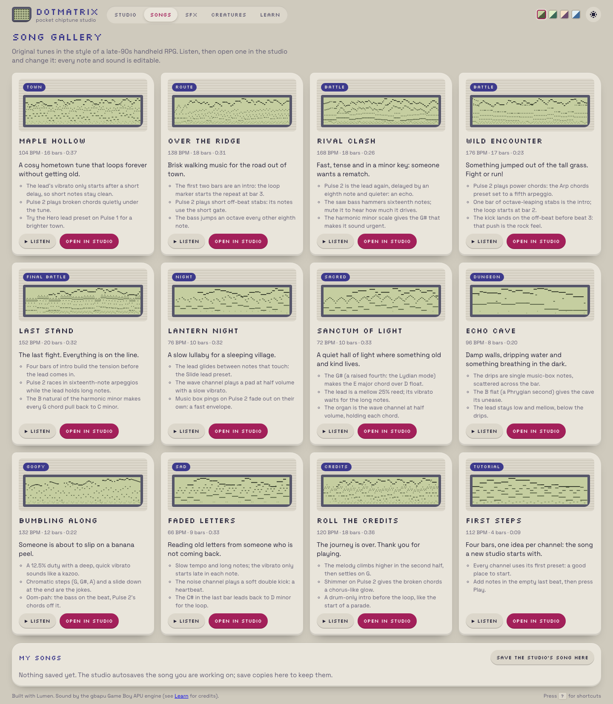
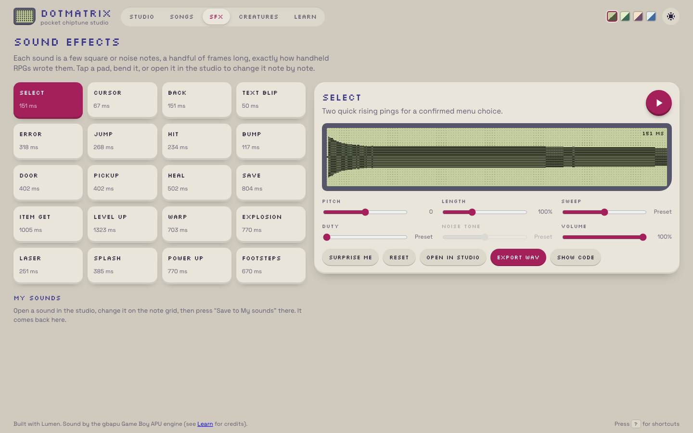

## Description

<!-- SECTION:DESCRIPTION:BEGIN -->
User 2026-10-09: add 5 more SFX and more songs: a divine theme, 2 more battle songs, a funny goofy song, a sad song, and one for the credits (the user said 5 songs but listed 6; make all 6). Original compositions in the Crystal style, as before.
<!-- SECTION:DESCRIPTION:END -->

## Acceptance Criteria
<!-- AC:BEGIN -->
- [x] #1 5 new original SFX in the gallery (new kinds not already covered), each with presets/maker support and code view
- [x] #2 6 new original demo songs: divine, battle (2, distinct from Rival Clash and each other), goofy, sad, credits; each with tips; loops/intros where fitting; galleries keep complete rows where possible
- [x] #3 Tests updated (every channel audible on the real engine, mix balanced); screenshots
<!-- AC:END -->

## Implementation Notes

<!-- SECTION:NOTES:BEGIN -->
Chime (2026-10-09): done.
- 5 new original SFX (new kinds): Explosion, Laser, Splash, Power up (duty pattern + slides), Footsteps; 20 pads = 5 full rows of 4. All work in the maker, code view (round-trip tested) and studio.
- 7 new original demo songs (6 requested + Echo Cave so the gallery has 12 = complete rows of 4/3/2/1): Wild Encounter (E minor 176 BPM, power-chord fifth arpeggio, 1-bar intro), Last Stand (C harmonic minor 152 BPM, 4-bar intro, racing 16th arps under long lead notes), Sanctum of Light (D Lydian 72 BPM, harp + organ, 2-bar intro), Echo Cave (A Phrygian 96 BPM, music-box drips), Bumbling Along (F 132 BPM, kazoo 12.5% with glide/vibrato, oom-pah, chromatic punchline), Faded Letters (D minor 66 BPM, heartbeat noise, 1-bar intro), Roll the Credits (G 120 BPM, drum intro, 16-bar loop). Each has tips.
- Mix: new unit test renders every demo channel on the real engine: every channel RMS > 0.004 and no channel above 2x the lead. Rebalanced Sanctum and Echo Cave (swelling leads were too loud) and Echo Cave's drips.
Validation: lumen check, fmt, lint clean; Vitest 126/126; Playwright 40/40 (dev + preview).

<!-- SECTION:NOTES:END -->

## Final Summary

<!-- SECTION:FINAL_SUMMARY:BEGIN -->
5 new original SFX and 7 new original demo songs (divine, wild battle, final battle, goofy, sad, credits, plus a cave theme for complete gallery rows), each with tips; mix-balance test across all demos. Vitest 126, Playwright 40.
<!-- SECTION:FINAL_SUMMARY:END -->
