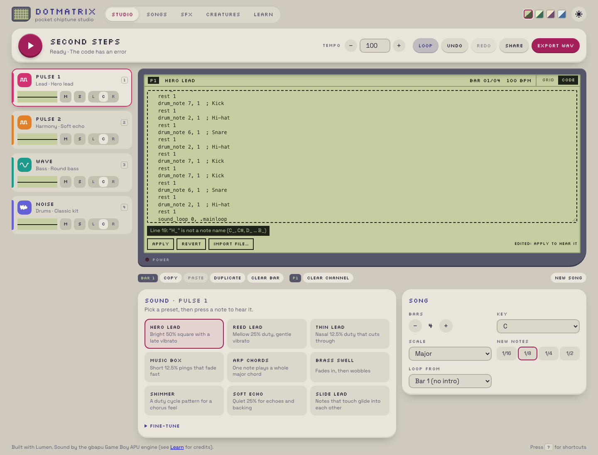
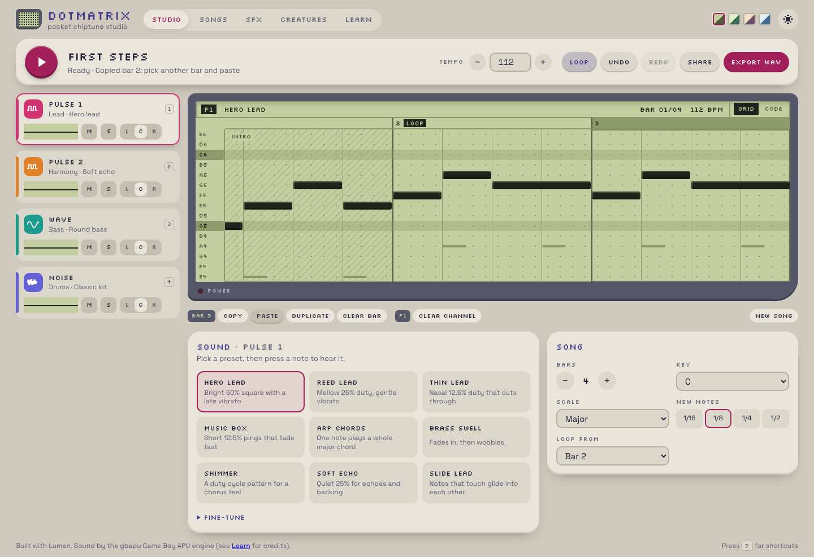
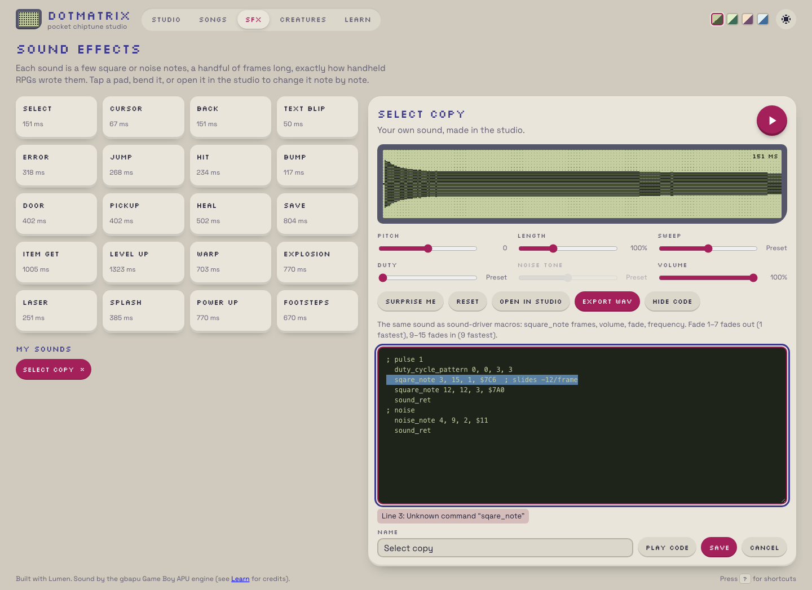

## Description

<!-- SECTION:DESCRIPTION:BEGIN -->
User 2026-10-09: the code editor belongs in the Studio and on custom saved items, not on the predefined ones. The Studio has no way to show or edit code, and the Song card is already cluttered with buttons.
<!-- SECTION:DESCRIPTION:END -->

## Acceptance Criteria
<!-- AC:BEGIN -->
- [x] #1 Predefined SFX/voices: code is read-only (learning view) with a way to copy them into My sounds/My voices; editing, paste and import live only on custom items and in the Studio
- [x] #2 Studio: a Grid | Code switch (or equivalent) on the editor area shows and edits the current song or sound sheet in the driver format, round-tripping with the grid (songs need a music-macro exporter/parser: tempo, notetype, duty, vibrato, notes, rests, loops, per channel), with line errors; import/paste available there
- [x] #3 Song card decluttered: bar/channel tools grouped (e.g. a toolbar or overflow menu) so the card holds only song settings; overflow and e2e tests updated; screenshots
<!-- AC:END -->

## Implementation Notes

<!-- SECTION:NOTES:BEGIN -->
Chime (2026-10-09): done.
- Built-in SFX/voices: code view read-only (learning view) + 'Copy to My sounds / My voices'. Edit code / Paste code / Import file only on saved sounds; Save overwrites the saved sound (updateSound).
- Studio: Grid | Code switch on the screen header (ui/StudioCode.stsx). Songs use new music macros (model/songcode.ts): song_title, song_author, tempo, bars, key K, scale; per channel instrument, note_type unit, volume, fade, duty_cycle, vibrato, pitch_glide, arpeggio, shimmer, note_length, wave_shape, drum_tone, stereo_panning, mute, solo, octave, note X_, len, rest, drum_note, .mainloop: / sound_loop 0, .mainloop; per-note settings as '; own ...' comments. Sound sheets show SFX/voice code (keeping their frames-per-step). Apply (Ctrl/Cmd Enter) replaces the song as one undoable step; Revert; Import file; line-numbered errors that select the line. While not edited, the code follows the grid.
- Round trip: every demo song exports -> parses to the identical song, identical register writes and identical code (model/songcode.test.ts); the guide's song example parses (docs.test.ts).
- Song card: only bars, key, scale, new-note length and a new 'Loop from' select. Copy/Paste/Duplicate/Clear bar/Clear channel/New song and the sound-sheet save/back banner moved to a toolbar under the screen (ui/GridTools.stsx, role=toolbar).
- composing.md: 'Songs as code' section and updated code-editing section; README updated.
Validation: lumen check, fmt, lint clean; Vitest 141/141; Playwright 25 specs x dev + preview = 50/50 (incl. overflow test).

<!-- SECTION:NOTES:END -->

## Final Summary

<!-- SECTION:FINAL_SUMMARY:BEGIN -->
Code editing moved to saved sounds and the Studio: built-in code read-only with copy; Studio Grid|Code switch with song music macros and sheet SFX code, round-trip tested over every demo; Song card reduced to settings with bar/channel tools in a toolbar under the screen. Vitest 141, Playwright 50.
<!-- SECTION:FINAL_SUMMARY:END -->
