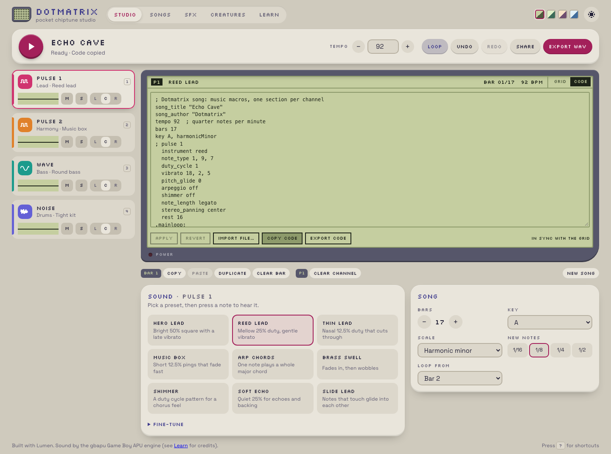

## Description

<!-- SECTION:DESCRIPTION:BEGIN -->
User 2026-10-09: there is Import file but no export anywhere except WAV. Wherever code is shown (Studio code mode, saved sounds/voices, and the read-only built-ins), offer Export code (download) and Copy code. Also (Lux): the composition check accepts a V→I turnaround into the loop as a valid ending for looping songs.
<!-- SECTION:DESCRIPTION:END -->

## Acceptance Criteria
<!-- AC:BEGIN -->
- [x] #1 Export code downloads the current song / sound sheet / SFX / voice as a .asm file (name from the title) that Import file reads back identically; Copy code copies it; available in the Studio code mode, on saved items and on built-ins
- [x] #2 Exported files round-trip in a unit test for every demo song, SFX and voice; e2e covers export → import; composing.md mentions it
- [x] #3 Composition check: for looping songs, ending on V (or the leading tone) that resolves to I at the loop start counts as a cadence; skip list updated
<!-- AC:END -->

## Implementation Notes

<!-- SECTION:NOTES:BEGIN -->
Chime (2026-10-09): done.
- files.ts: exportCode (downloads <slug>.asm with a final newline) and copyCode (clipboard). Buttons: Studio code mode (Copy code, Export code, beside Apply/Revert/Import; they take what the editor shows) and the maker code view for built-in and saved sounds/voices.
- Sheets in the Studio keep their length when code is read back (trailing silence is not code).
- Unit (model/codefile.test.ts): every demo song, SFX and creature voice exported as a file parses back identically (songs: identical Song; sounds: identical register writes, in the maker and as Studio sound sheets with identical sheet info).
- e2e: Studio Echo Cave Export code -> echo-cave.asm, Copy code matches the file, New song, Import file -> identical song JSON; maker Jump Export code -> jump.asm equals the shown code, Copy to My sounds, Import, Save -> same code.
- composing.md and README mention Copy/Export code.
- Composition check: a looping song may end on V (fifth, leading tone or second) when the loop restarts on a tonic-chord note. Still failing (known/skipped): Rival Clash (49% steps, 14-semitone leap, 20 range, 11 beat clashes), Last Stand (20 range, 3 clashes), Lantern Night (69% strong-beat chord tones, 3 clashes), Bumbling Along (14 leap, 21 range), Roll the Credits (45% steps). Now passing: Maple Hollow, Over the Ridge, Faded Letters (plus the three recomposed songs and First Steps).
Validation: check, fmt, lint clean; Vitest 201 + 5 known skipped; Playwright 27 specs x dev + preview = 54/54.

<!-- SECTION:NOTES:END -->

## Final Summary

<!-- SECTION:FINAL_SUMMARY:BEGIN -->
Copy code and Export code (.asm) in the Studio code mode and the maker code views, round-trip tested for every demo song, SFX and voice and e2e for export->import; the composition check accepts V->I turnarounds into the loop (5 older songs still fail). Vitest 201, Playwright 54.
<!-- SECTION:FINAL_SUMMARY:END -->
