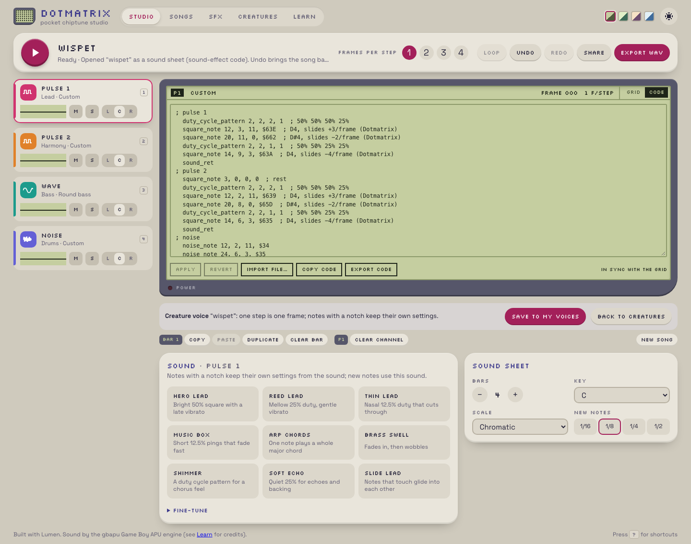

## Description

<!-- SECTION:DESCRIPTION:BEGIN -->
User 2026-10-09: importing a creature .asm in the Studio while a song is open lists 'Unknown command duty_cycle_pattern / square_note' on every line. Songs use the music dialect (note_type, octave, note, rest); SFX and cries use the sound-effect dialect (square_note, noise_note with frame lengths and raw frequency registers, duty_cycle_pattern, pitch_sweep).
<!-- SECTION:DESCRIPTION:END -->

## Acceptance Criteria
<!-- AC:BEGIN -->
- [x] #1 Studio import, paste and Code-mode Apply detect the dialect: sound-effect/cry code opens as a sound sheet (switching modes, undoable), song code as a song; mixed files get one clear error explaining the two kinds, never a list of unknown commands
- [x] #2 e2e: import a creature .asm and an SFX .asm while a song is open, and a song .asm while a sound sheet is open; composing.md explains the two dialects
<!-- AC:END -->

## Implementation Notes

<!-- SECTION:NOTES:BEGIN -->
Chime (2026-10-09): done.
- model/code.ts codeDialect(text): sound-effect commands (square_note, noise_note, duty_cycle_pattern, pitch_sweep; a cry header marks a voice) vs song commands (note, note_type, octave, rest, drum_note, tempo, instrument, …); duty_cycle and sound_ret are shared. Mixed files return one error: 'This file mixes song commands (note, note_type, …) and sound-effect commands (square_note, …); Dotmatrix opens one kind per file'.
- model/studiocode.ts readStudioCode: the code decides. SFX/cry code -> sound sheet (Apply over an open sheet keeps its kind, name and grid; a file import starts a fresh sheet named after the file, a voice when it has a cry header); song code -> song. openSong makes the switch one undoable step, and the status line says which mode it opened in.
- The makers (parseCode) answer song code with one error pointing to the Studio.
- Tests: model/dialect.test.ts (detection, cry/SFX into a song, song into a sheet, mixed); e2e: export Wispet and Laser, import both while a song is open (voice sheet, undo back to the song; SFX sheet), import a song .asm while the sheet is open, and a mixed file shows one error.
- composing.md: 'Two dialects' section.
Validation: check, fmt, lint clean; Vitest 205 + 5 known skipped; Playwright 28 specs x dev + preview = 56/56.

<!-- SECTION:NOTES:END -->

## Final Summary

<!-- SECTION:FINAL_SUMMARY:BEGIN -->
The Studio detects the code dialect on import, paste and Apply: sound-effect/cry code opens as a sound sheet, song code as a song (undoable switch), mixed files get one clear error; e2e for the three cases; composing.md explains the two dialects. Vitest 205, Playwright 56.
<!-- SECTION:FINAL_SUMMARY:END -->
