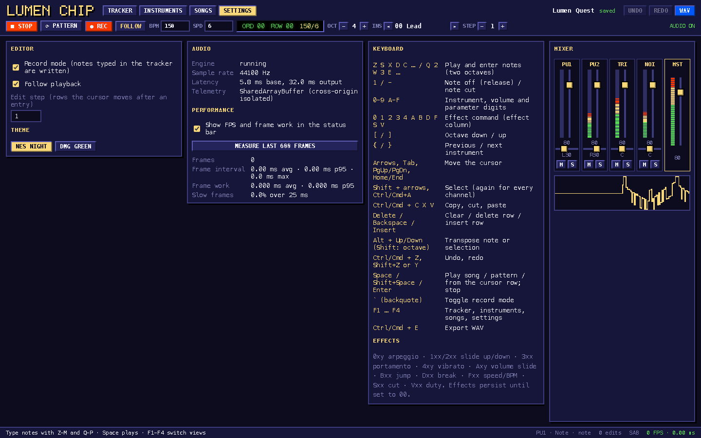

## Description

<!-- SECTION:DESCRIPTION:BEGIN -->
User 2026-10-09: make the chiptune work on GitHub Pages without throwing away its SharedArrayBuffer optimisations. Pages cannot send COOP/COEP headers. Lux authorises edits in examples/spa-chiptune (Spark's area; Spark is on security work).
<!-- SECTION:DESCRIPTION:END -->

## Acceptance Criteria
<!-- AC:BEGIN -->
- [x] #1 A small first-party service worker (no third-party lib) adds COOP/COEP to same-origin responses on hosts without them, enabled for the Pages build only; real headers (lumen({ headers })) stay the primary path; the non-isolated fallback keeps working when the SW is unavailable
- [x] #2 Under the Pages base path: deep links, the audio engine in SharedArrayBuffer mode (Settings shows it), and an e2e check against preview:site; README explains the trade-off (one reload on first visit)
- [x] #3 Also update spa-dotmatrix's README: gbapu is the user's own library, planned for MIT release
<!-- AC:END -->

## Implementation Notes

<!-- SECTION:NOTES:BEGIN -->
Beacon (TASK-163, 2026-10-09): how the Pages build runs the examples: scripts/site.ts builds each with LUMEN_BASE=<base>examples/<name>/ (vite.config base reads it) and LUMEN_PAGES=1, the flag to enable the service worker for the Pages build only; dist/client is copied to dist/site/examples/spa-chiptune/ without .br/.gz and _headers. Deep links: Pages serves the root 404.html for missing paths; site.ts injects a script there that, below examples/spa-chiptune/, swallows the site's page (<plaintext>) and document.writes the chiptune's own 404.html (the SPA shell), so the router renders the deep link with a 404 status. So the SW script should live in the chiptune's output root (scope examples/spa-chiptune/) and the registration in the shell works both from index.html and from the 404 fallback. Validate with pnpm build:site --base /lumen/ && pnpm preview:site --base /lumen/ (preview mimics Pages: directory index.html, root 404.html).

Chime (2026-10-09): done (solo edit of Spark's examples/spa-chiptune, authorised by Lux).
- public/coi-sw.js (first-party, ~30 lines): skipWaiting/claim; for same-origin requests only, re-serves the response with cross-origin-opener-policy: same-origin, cross-origin-embedder-policy: require-corp and cross-origin-resource-policy: same-origin; cross-origin requests untouched.
- src/isolation.ts, called from the root layout: only when the build enables it (import.meta.env.LUMEN_COI_SW) and the page is not crossOriginIsolated, in a secure context with service workers: register at the Vite base scope, wait until ready, reload once (sessionStorage guard, so no loop if isolation still fails). Registration failure -> nothing happens, the engine's postMessage fallback.
- vite.config.ts: LUMEN_COI_SW defaults to on when LUMEN_BASE is set (only scripts/site.ts sets it, so build:site needs no change; I did not edit Beacon's site.ts) and LUMEN_COI_SW=1/0 forces it. lumen({ headers }) and _headers remain the primary path; dev/preview never register the worker (existing e2e 20/20 unchanged).
- Strict CSP: the prerendered shells' meta policy has script-src 'self', which covers the worker registration.
- e2e: playwright.pages.config.ts + tests-pages/pages.spec.ts (pnpm test:e2e:pages): build:site --base /lumen/ into dist/site-e2e and preview:site (no COOP/COEP, like Pages); a fresh visit to the /settings deep link becomes isolated after one reload, plays with Settings showing 'SharedArrayBuffer (cross-origin isolated)'; the tracker's /songs/<id> deep link (served through the root 404.html) reloads isolated; with service workers blocked the app plays in 'postMessage, ~60 Hz' mode. 2/2.
- README explains the trade-off (one reload on the first visit; isolation depends on the worker; fallback otherwise).
- spa-dotmatrix README and Learn credits: gbapu is the author's own library from the Newbark engine, planned for an MIT release; the vendored LICENSE-NOTICE.md, PROVENANCE.json and CHECKSUMS.sha256 unchanged (checksum test green).
Note for Beacon/Lux: scripts/site.ts still describes dotmatrix as excluded pending redistribution rights (--with-dotmatrix); that comment and the flag are yours to revisit.
Validation: spa-chiptune lumen check clean, Vitest 10/10, Playwright 20/20 (dev + preview), Pages e2e 2/2; spa-dotmatrix check clean, Vitest 205 (+5 known skipped).

<!-- SECTION:NOTES:END -->

## Final Summary

<!-- SECTION:FINAL_SUMMARY:BEGIN -->
spa-chiptune keeps SharedArrayBuffer on GitHub Pages: a first-party service worker adds COOP/COEP in the Pages build only (one reload on first visit), with real headers as the primary path and the postMessage fallback intact; Pages e2e against preview:site covers deep links, SAB mode and the fallback; README explains the trade-off; dotmatrix README/credits say gbapu is the author's own library planned for MIT.
<!-- SECTION:FINAL_SUMMARY:END -->
