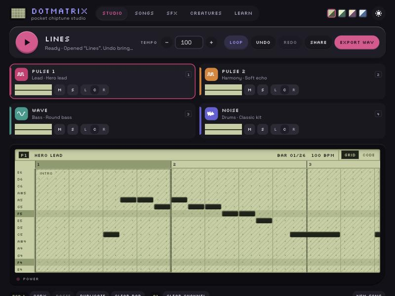

## Description

<!-- SECTION:DESCRIPTION:BEGIN -->
The user composed a 26-bar piano piece (Lines.svg: F major, 4/4, quarter = 100, intro bars 1-10, repeat sign at bar 11) and asked for it in the style of the Dotmatrix demo songs. Transcribe the score and arrange it for the four Game Boy channels as a gallery demo.
<!-- SECTION:DESCRIPTION:END -->

## Acceptance Criteria
<!-- AC:BEGIN -->
- [ ] #1 The lead plays the right hand note for note; the wave bass plays the left hand's lowest line
- [ ] #2 Bars 1-10 are the intro and bar 11 (the score's repeat sign) is the loop marker
- [ ] #3 The song is in the Songs gallery with tips, and passes the demo tests (composition, engine render, balance, code round trip)
<!-- AC:END -->

## Implementation Notes

<!-- SECTION:NOTES:BEGIN -->
Solo takeover by Lux (standalone session), in Chime's area. Score read from the SVG via a QuickLook render; pitches confirmed by notehead detection against staff lines. Arrangement: Pulse 1 hero lead; Pulse 2 breaks the left hand's chords (its own voicings) into eighths in the intro, off-beat stabs in bars 11-18, thirds below the lead from bar 19 (bar 24 stays lead alone); wave round bass holds the lowest chord note an octave down in the intro, then plays the left hand literally; classic kit with shaker intro, backbeat loop and fills. Test changes: the composition check's turnaround now also accepts the fourth over a dominant bass (the seventh of V7), since the score ends on Bb4 over C leading back to F; the demo length guard is 65 s (the song is 62.4 s at the written 100 BPM). E2E gallery count 12 -> 13.

Screenshot: 
<!-- SECTION:NOTES:END -->

## Final Summary

<!-- SECTION:FINAL_SUMMARY:BEGIN -->
Added src/model/songs/lines.ts ("Lines", author Javi Aguilar) and registered it in the gallery. Vitest: 209 passed, 5 skipped. Verified in lumen dev: gallery shows it, it opens in the studio (26 bars, 100 BPM) with no console errors.
<!-- SECTION:FINAL_SUMMARY:END -->
