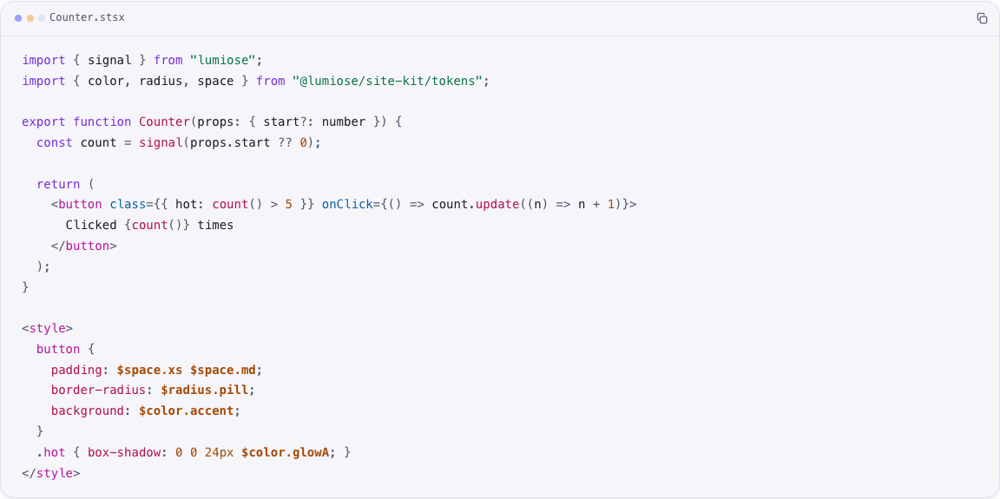
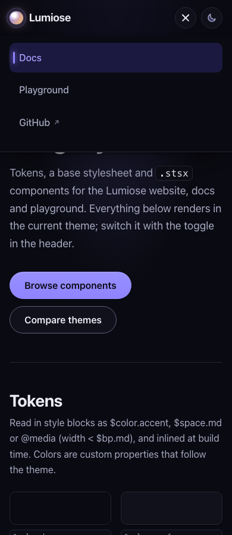

## Description

<!-- SECTION:DESCRIPTION:BEGIN -->
decision-40 (user 2026-10-11): teach and use one top-level <style> at the end of the file by default, shared by every component in it; nested blocks only to scope one element's subtree or to read a component-local $constant. The docs show and explain both placements. Apply it to packages/site-kit/src (13 files with <style>, 11 nested). The showcase must look the same.
<!-- SECTION:DESCRIPTION:END -->

## Acceptance Criteria
<!-- AC:BEGIN -->
- [x] #1 Each .stsx file uses one top-level <style> at the end of the file by default; every remaining nested block scopes an element subtree or reads a component-local constant
- [x] #2 Rendering is unchanged: tests and e2e pass, and before/after screenshots of the main pages match (watch for selectors that now reach other components in the same file)
<!-- AC:END -->

## Implementation Notes

<!-- SECTION:NOTES:BEGIN -->
Halo (2026-10-11): moved the 11 nested blocks (Callout, Card, CodeBlock, CopyButton, Footer, GitHubLink, Logo, SiteHeader, SiteNav, Tabs, ThemeToggle) to one top-level <style> at the end of each file (commit 0e13461). Button already had one; Base is <style global>. No block kept nested: every file holds a single component, so file scope equals the root-subtree scope, and no block reads a component-local constant (all $refs are imported tokens). Selector reach: no file has a second template, so no selector widened; specificity is unchanged (one scope attribute per selector).

Evidence: the website's bundled CSS is identical before/after once scope token hashes are normalised. Byte-identical full-page screenshots, light and dark, 1280px and 390px (plus the open phone menu): site-kit showcase and website /, /docs/, /docs/concepts/styles/, /examples/, /benchmarks/, /errors/ and the 404 page (48 shots). Both builds were made back to back from the same website source, because TASK-212 changed the landing page mid-session.

Teaching samples moved to the convention too: README layout sample and the showcase's Counter code sample (only the sample text changes; see , ).

Checks: site-kit vitest 6/6, typecheck (lumiose check, src and showcase) clean, oxlint clean, showcase e2e 14 passed (8 screenshot specs skipped by design), website vitest 8/8, website e2e 9 passed.
<!-- SECTION:NOTES:END -->

## Final Summary

<!-- SECTION:FINAL_SUMMARY:BEGIN -->
@lumiose/site-kit follows decision-40: every component file ends with one top-level <style>; none stays nested. Rendering unchanged (identical CSS modulo scope hashes, byte-identical screenshots of the showcase and the website pages). README and showcase samples teach the file-level block. Tests, typecheck, lint and both e2e suites green.
<!-- SECTION:FINAL_SUMMARY:END -->
