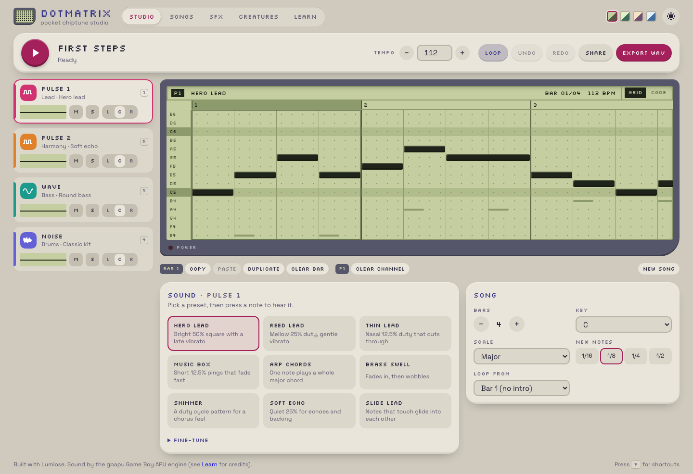
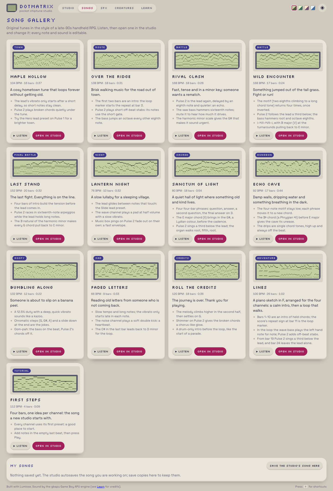

## Description

<!-- SECTION:DESCRIPTION:BEGIN -->
decision-40 (user 2026-10-11): teach and use one top-level <style> at the end of the file by default, shared by every component in it; nested blocks only to scope one element's subtree or to read a component-local $constant. The docs show and explain both placements. Apply it to examples/spa-dotmatrix (21 files with <style>, 19 nested). Dotmatrix's prerender work (TASK-218) touches the same files: do this first, or in the same session.
<!-- SECTION:DESCRIPTION:END -->

## Acceptance Criteria
<!-- AC:BEGIN -->
- [x] #1 Each .stsx file uses one top-level <style> at the end of the file by default; every remaining nested block scopes an element subtree or reads a component-local constant
- [x] #2 Rendering is unchanged: tests and e2e pass, and before/after screenshots of the main pages match (watch for selectors that now reach other components in the same file)
<!-- AC:END -->

## Implementation Notes

<!-- SECTION:NOTES:BEGIN -->
Chime, 2026-10-11 (commit d252be6):
- All 19 nested blocks sat directly under their component's root element and read only imported tokens (`$tokens`), no component-local constants. All 19 were hoisted to one top-level <style> at the end of the file; none kept nested. _layout.stsx and Sprite.stsx were already file-level.
- songs.stsx and InstrumentPanel.stsx already had a file-level block: the component rules were appended after its rules, so cascade order is unchanged.
- Widened-scope audit: only three files have a second template (songs Thumb, InstrumentPanel range(), ChannelRack Scope). Songs and InstrumentPanel have no selector collision. ChannelRack's `.scope` rule never matched (the canvas is in Scope's own template; verified computed border-radius 0, no box-shadow) and would have started matching at file level, so it was removed to keep rendering identical. Enabling that styling would be a visible change, left to a separate decision.
- Verification: Playwright capture of 9 states (studio, studio code view, shortcuts dialog, songs, SFX, creatures, learn, learn/composing, 404) at 1440 and 400 px wide. Full-page screenshots are byte-identical before/after, and a computed-style dump of every element (29 properties) is identical (baseline captured twice to confirm it is deterministic).
- Checks: pnpm test (221 passed, 5 skipped), lumiose check (no problems), lumiose build (ok), pnpm test:e2e (56 passed, dev + preview), oxfmt --check (clean).
- Screenshots:  
<!-- SECTION:NOTES:END -->

## Final Summary

<!-- SECTION:FINAL_SUMMARY:BEGIN -->
Dotmatrix follows decision-40: every .stsx file with styles has one top-level <style> at the end (plus _layout's <style global>); no nested blocks remain, since none scoped a sub-subtree or read a component-local constant. ChannelRack's dead `.scope` rule was dropped because file-level scope would have activated it. Rendering verified unchanged with byte-identical screenshots and computed styles across 9 states at two widths; unit tests, typecheck, build and e2e green. Commit d252be6.
<!-- SECTION:FINAL_SUMMARY:END -->
