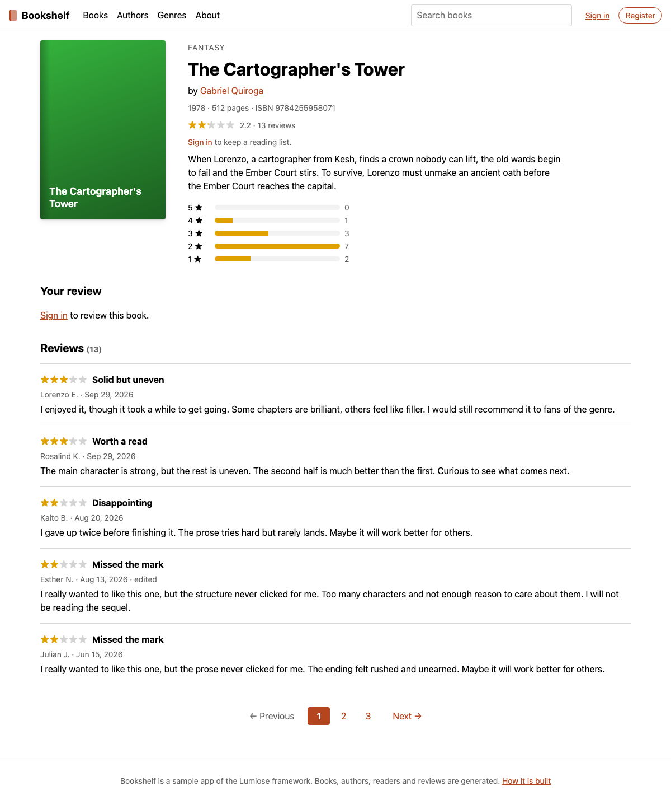
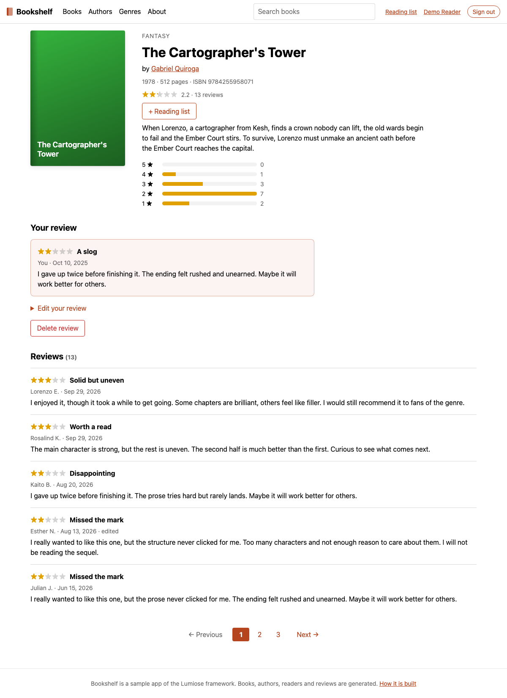
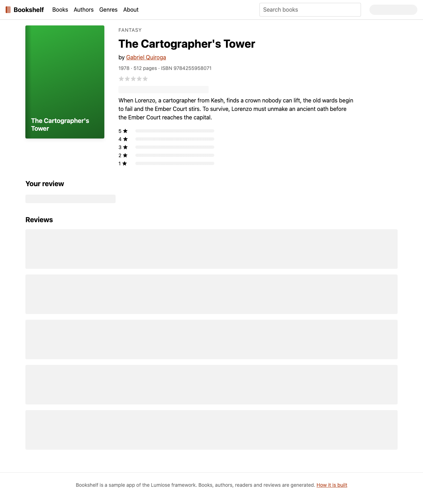

## Description

<!-- SECTION:DESCRIPTION:BEGIN -->
Make `examples/ssr-bookshelf` show, page by page, the patterns that get close to partial prerendering today, with the book page (`/books/[isbn]`) as the explicit "shell + holes" example and the test bed of draft-2 (PPR spike).

User decision (2026-10-11): holes stay no-JS. Each hole is its own `<Suspense>` boundary, but its data stays synchronous (node:sqlite), so it resolves inside the first response and is folded into the shell: no `$swap` scripts, every form keeps working without JavaScript, nothing visibly streams. Do not make the lookups async to force streaming.

Book page split:
- Shell (reads nothing per reader or per request, beyond the route param): `<Title>`/`<Meta>`, cover, genre, title, subtitle, authors, byline, description. `findBook()` and its `notFound()` stay in the shell, so the status is decided before anything streams.
- Per-reader holes: the header account area (in the `(app)` layout, so every server page gets it), the reading-list toggle, and "Your review".
- Fresh holes (same for every reader but change between deploys, or read the request): the rating summary and histogram (derived from reviews), and the reviews list with its pager (`?page=`, and the `own` marker).
Each hole is a component that reads `locals()`/`url()` itself instead of taking a `user` prop from the shell, with a fallback of stable size.

Elsewhere, keep and label the two existing patterns: `/about` and `/genres` (static + the `AccountMenu` client:idle island over `/api/me`), and the home page (server + `<Suspense>` recommendations that really stream).
<!-- SECTION:DESCRIPTION:END -->

## Acceptance Criteria
<!-- AC:BEGIN -->
- [x] #1 On /books/[isbn], nothing outside a <Suspense> boundary reads locals(), url().searchParams or reader-specific queries; the shell is the book's metadata and description
- [x] #2 The header account area, reading-list toggle, Your review, rating summary/histogram and reviews list are each a <Suspense> hole with a size-stable fallback
- [x] #3 The book page response contains no streamed chunks (no <template for> or $swap) for signed-in and signed-out readers, asserted in the e2e suite
- [x] #4 Existing unit and e2e tests pass, including the without-JavaScript suite and the strict CSP checks
- [x] #5 The About page and README explain the three patterns (static + island, server + streamed Suspense, shell + holes) and which page shows each, linking to the rendering-modes docs
<!-- AC:END -->

## Implementation Notes

<!-- SECTION:NOTES:BEGIN -->
Nova (session nova-20261012T214704Z-t236), plan:
- Shell (page default export): findBook()/notFound(), Title/Meta, cover, genre, title, subtitle, authors, byline, description, and the section headings/anchors of Your review and Reviews.
- Data split: getBook() returns the catalog data only (no rating join, no histogram); new getBookRatings(bookId) derives the summary and histogram from the reviews, for the rating holes. Book loses rating/ratingHistogram; BookRatings is new.
- Holes, each a <Suspense> whose content reads locals()/url()/actionData() itself: rating summary, reading-list toggle, histogram, Your review, reviews list + pager; in the (app) layout, the header account area (Header gets an account slot; its default stays the AccountMenu island for static/error pages).
- Fallbacks with a fixed size (skeleton blocks sized from the base styles, or the same structure with no data).
- e2e: signed-out and signed-in book page responses (and the fail(400) re-render) have no <template for>, $swap or <?start placeholder.
- About page + README: the three patterns and their pages, linking to the rendering-modes docs.

Nova, done (commits c118855, 5d231de0):
- AC1: the page's default export (the shell) calls only findBook(params.isbn) (getBook() no longer joins ratings or reads reviews) and renders Title/Meta, cover, genre, title, subtitle, authors, byline, description and the section headings. locals(), url(), actionData() and the reader/fresh queries are only called in hole components: BookRating, RatingsByStars (getBookRatings), ReadingList, YourReview, Reviews in the page; ReaderAccount in (app)/layout.stsx. Header gets an account slot (default: the AccountMenu island, kept for the static layout and the error pages).
- AC2: each is its own <Suspense>. Fallbacks keep the signed-out size: RatingPlaceholder (same line, unlit stars), the histogram's own rows without data, one-line blocks for the toggle and Your review, an AccountLinks-sized pill, and five review-sized blocks under the Reviews heading. Measured with a temporary 2.5 s delay in every hole (reverted): signed out, nothing above the reviews moves (header 56 px, description, Your review and Reviews tops unchanged) and the footer moves 22 px; signed in, the toggle and the review form are taller, as expected. Evidence: backlog/assets/task-236-fallbacks.png.
- AC3: e2e 'the book page folds its per-reader holes into the first response' asserts no <?start, <template for= or $swap in the signed-out response and the signed-in one (?page=2 of the most reviewed book), plus in the fail(400) re-render of the no-JS review form.
- AC4: unit tests (69), lumiose check, oxlint, lumiose fmt; Playwright 17/17 (build + dev, incl. strict CSP and without JavaScript) on ports 5391/5389 (playwright.config.ts now reads BOOKSHELF_E2E_PORT / BOOKSHELF_E2E_DEV_PORT). pnpm check: build:compiler, typecheck, lint, fmt:examples green; pnpm test fails only in packages/vite build.test.ts 'names route modules chunks ... (TASK-260)', another worker's uncommitted in-progress change; scripts tests and the size check pass after it; no Rust changed, so no cargo run.
- AC5: About page section 'Three ways to render a page' (links: genres, home, a book page, https://lumiose.dev/docs/concepts/rendering-modes); README 'Rendering patterns' (table + the book page's shell/holes) linking packages/lumiose/docs/concepts/rendering-modes.md.
- No framework change needed: a <Suspense> whose content renders synchronously is folded inline (server/components.ts foldUnit). For TASK-237: the About page links the rendering-modes page; it could deep-link the 'Close to partial prerendering' subsection once it exists.
Screenshots:    
<!-- SECTION:NOTES:END -->

## Final Summary

<!-- SECTION:FINAL_SUMMARY:BEGIN -->
The bookshelf book page is now a reader-independent shell (head tags, cover, metadata, description; only the route param and getBook()) with <Suspense> holes for the header account area, reading-list toggle, Your review, rating summary, histogram and reviews list. Each hole reads locals()/url()/actionData() itself and has a fixed-size fallback; the data is synchronous, so the holes fold into the first response and the e2e suite asserts no streamed chunks for signed-in and signed-out readers and for a failed no-JS form post. getBook() no longer reads reviews; getBookRatings() serves the rating holes. The About page and README explain the three rendering patterns with their pages and link the rendering-modes docs.
<!-- SECTION:FINAL_SUMMARY:END -->
