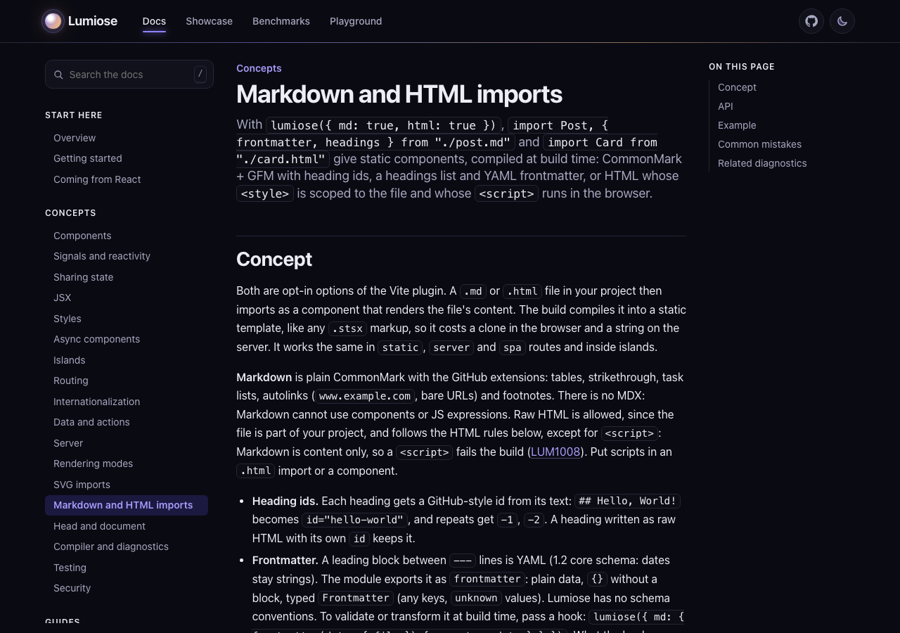
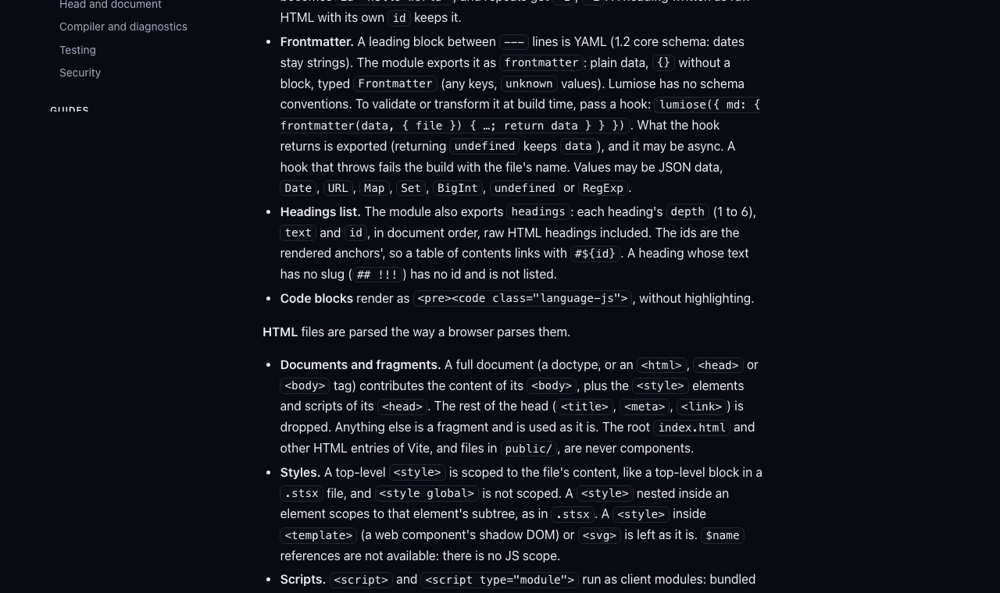
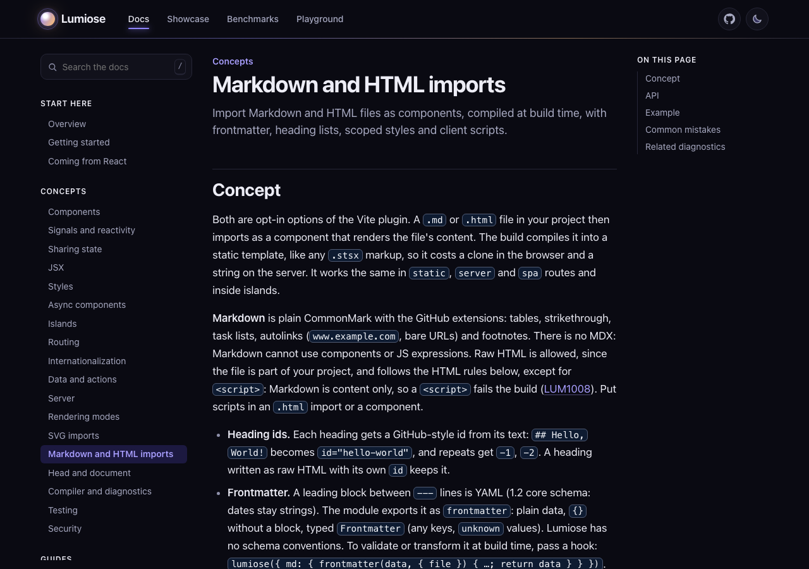
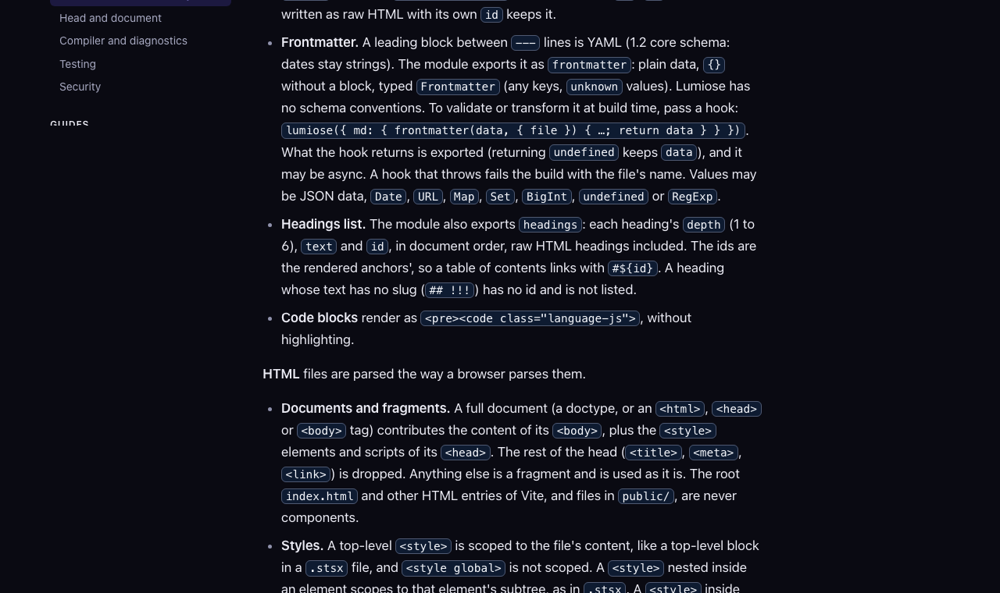
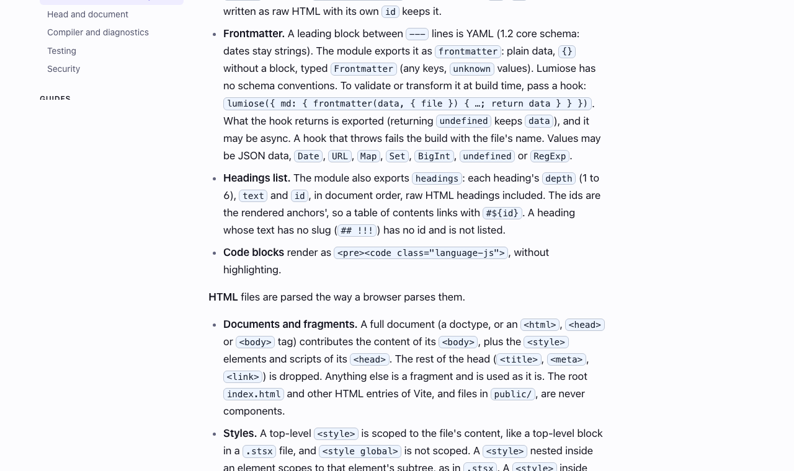

## Description

<!-- SECTION:DESCRIPTION:BEGIN -->
User request 2026-10-14 (screenshots of concepts/content): page subtitles are long blocks of text and code; inline code is hard to notice; docs should be easier to read. Rewrite every page summary (the > line, also the meta description, search and lumiose docs listings) as one short plain sentence; give inline code a distinct tint; loosen dense lists and the line length.
<!-- SECTION:DESCRIPTION:END -->

## Acceptance Criteria
<!-- AC:BEGIN -->
- [x] #1 Every docs page summary is one sentence of at most ~150 characters with at most two short code spans
- [x] #2 Inline code is clearly distinct from body text and links in light and dark themes, with WCAG AA contrast
- [x] #3 The lead renders without boxed code chips; lists and line length read comfortably; before/after screenshots in backlog/assets
<!-- AC:END -->

## Implementation Notes

<!-- SECTION:NOTES:BEGIN -->
Lux: 50 page summaries rewritten as one plain sentence (<=150 chars, <=2 code spans; the docs index keeps the TASK-212 positioning line, errors index and getting-started were already short); they are also the meta description, search entries and lumiose docs listings. Inline code: new site-kit tokens inlineCodeFg/Bg/Border; after the user's feedback the amber tint became a neutral slate chip at about GitHub's strength (dark chip/page 1.85, text/chip 9.8:1; light text/chip 12.9:1), 0.85em, box-decoration-break: clone, code in links takes the link colour. Docs page: lead without chips (code font only), prose 1.0625rem in a 46rem column (~75 ch), list items spaced like paragraphs, muted markers. Also fixed (user report): BarChart's 4px minimum made Lumiose's 0 kB bar a sliver while Astro's 0 was empty. Checks: apps/web + cli docs + site-kit tests (50), lumiose check for web and site-kit, docs:check, oxlint, oxfmt, a11y e2e suite 31/31 after each colour change. Screenshots:     

Lux (follow-up, user feedback): inline code background is the info background (--lm-info-bg), with the slate text and border kept (text/chip 15:1 in both themes). a11y e2e 31/31; after-screenshots in backlog/assets updated.
<!-- SECTION:NOTES:END -->
