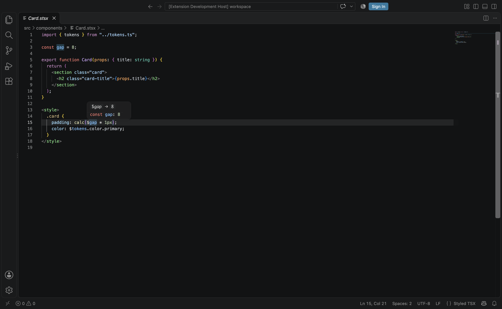

## Description

<!-- SECTION:DESCRIPTION:BEGIN -->
VS Code is the primary editor target: it needs the stsx language, a grammar, the LSP client and takeover setup.
<!-- SECTION:DESCRIPTION:END -->

## Acceptance Criteria
<!-- AC:BEGIN -->
- [x] #1 stsx language with TSX + embedded CSS grammar and $ref highlighting; LSP client; snippets; a prompt that offers takeover mode
- [x] #2 Packaged .vsix built locally and verified in VS Code on a sample file
<!-- AC:END -->

## Implementation Plan

<!-- SECTION:PLAN:BEGIN -->
1. Switch @lumen/language-server to the lumen/tooling export (dep lumen: workspace:*).
2. packages/vscode (lumen-vscode): stsx language + language-configuration (TS config + ).
- language-configuration.json: VS Code's TS config + autoClosingPairs , folding markers for blocks.
- src/workspace.ts (vscode-free, unit-tested): resolveServerEntry, usesLumen, takeover decisions. Package lookup walks node_modules from the real path (require.resolve leaked NODE_PATH from pnpm shims in tests).
- src/extension.ts: LanguageClient over stdio (file scheme only: TS 7 has no project for untitled docs and logged errors), document selector stsx (+ ts/tsx/js/jsx in takeover), restart on lumen.* config change or TS-extension enable/disable, takeover prompt (Enable -> opens Extensions view @builtin typescript with Disable (Workspace) steps + reload; Don't Ask Again -> lumen.takeover=auto in workspace settings), missing-server warning with Open Settings.
- Build: scripts/build.ts (rolldown, vscode external) -> dist/extension.cjs (435 KB min); pnpm --filter lumen-vscode package -> lumen-vscode.vsix (7 files, 95.6 KB). @vscode/vsce-sign build script set to false in pnpm-workspace.yaml allowBuilds (pnpm 11 required a decision; signing is only for publishing). New devDeps: @types/vscode ~1.100.0, @vscode/vsce ^4, rolldown ^1.2.12, tm-grammars, vscode-languageclient ^10.1.2, vscode-oniguruma, vscode-textmate.

Evidence:
- pnpm --filter lumen-vscode test: 18/18 (test/grammar.test.ts: 3 token snapshots in test/__snapshots__ + assertions for JSX/top-level/global blocks, single-line blocks, return to TSX after </style>, no blocks in comments/strings/templates/JSX attrs, $ref in values/calc()/@media, not in CSS strings/comments/url()/$= ; test/workspace.test.ts: server resolution order, usesLumen, takeover/prompt decisions).
- Real VS Code 1.141.0: pnpm --filter lumen-vscode test:vscode packages the .vsix, unpacks it and runs test/vscode/suite.cjs in an isolated instance (temp user-data/extensions dirs, built-in TS disabled) on a temp sample workspace with lumen + @lumen/language-server linked: activation, languageId stsx, _workbench.captureSyntaxTokens scopes (style tag, CSS class, $gap ref, $tokens.color.primary member, TSX function), hover on $gap -> folded value 8 and on Card (TS 7 through the LS), takeover hover in main.tsx, Component snippet insertion, typing . PASSED.
- code --extensions-dir <tmp> --install-extension lumen-vscode.vsix -> lumen.lumen-vscode@0.0.0 installed.
- Screenshot (VS Code window via CDP, --screenshot flag): backlog/assets/task-30-vscode-stsx.png (Card.stsx highlighted, $gap hover '$gap -> 8 / const gap: 8', status bar 'Styled TSX', 0 problems).
- pnpm typecheck OK; pnpm lint: 0 errors, only the pre-existing warning in packages/lumen/src/app/router/index.ts.

Limitations: the .vsix does not bundle the language server (it resolves @lumen/language-server from the workspace or lumen.server.path; a bundled server/bin.js is looked up but not produced) -> follow-up task. The TS JSDoc injection grammar (injectTo source.tsx) does not apply to source.stsx. Unterminated CSS blocks can swallow </style> (TextMate limitation, same as HTML). In this monorepo the LS is not resolvable from the root, so set lumen.server.path to packages/language-server/src/bin.ts when dogfooding.
<!-- SECTION:NOTES:END -->

## Final Summary

<!-- SECTION:FINAL_SUMMARY:BEGIN -->
Built packages/vscode (lumen-vscode): the stsx language ("Styled TSX", .stsx) with a TextMate grammar that includes VS Code's source.tsx and injects <style> blocks (embedded source.css, incl. <style global> and single-line blocks) and $ref highlighting ($name / $a.b as variable tokens, not in CSS strings/comments/url()); a language configuration based on VS Code's TS one plus <style> auto-closing and block folding; snippets comp/acomp/island/route; an LSP client (vscode-languageclient 10, stdio, node runtime) for @lumen/language-server resolved from lumen.server.path, the workspace (directly or via lumen), or a bundled server/ dir; takeover mode (serves .ts/.tsx/.js/.jsx when the built-in TS / TS native preview extension is disabled) with a Vue-style prompt honoring lumen.takeover (prompt|auto|off). Bundled with rolldown; pnpm --filter lumen-vscode package builds lumen-vscode.vsix (95.6 KB). The language server now imports from lumen/tooling.

Evidence: 18 vitest tests (grammar snapshots + assertions via vscode-textmate/oniguruma over tm-grammars' tsx/css; resolution/takeover logic); real VS Code 1.141 smoke test on the unpacked .vsix (test:vscode) passing: activation, VS Code-captured token scopes, $ref + TS hovers through the LS, takeover hover in .tsx, snippet insertion, <style> auto-close; vsix installs as lumen.lumen-vscode@0.0.0. Screenshot: 

Follow-up: TASK-51 (ship the language server inside the extension).
<!-- SECTION:FINAL_SUMMARY:END -->
