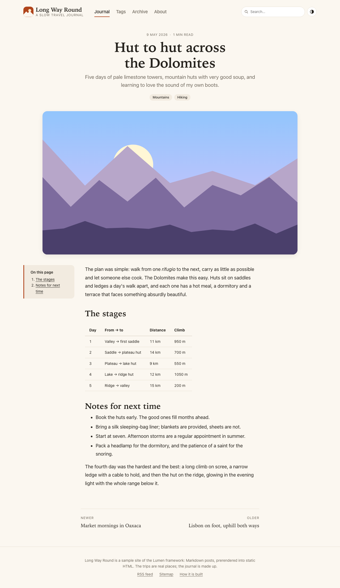
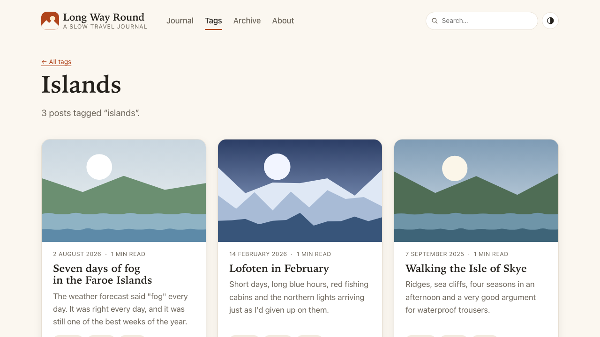
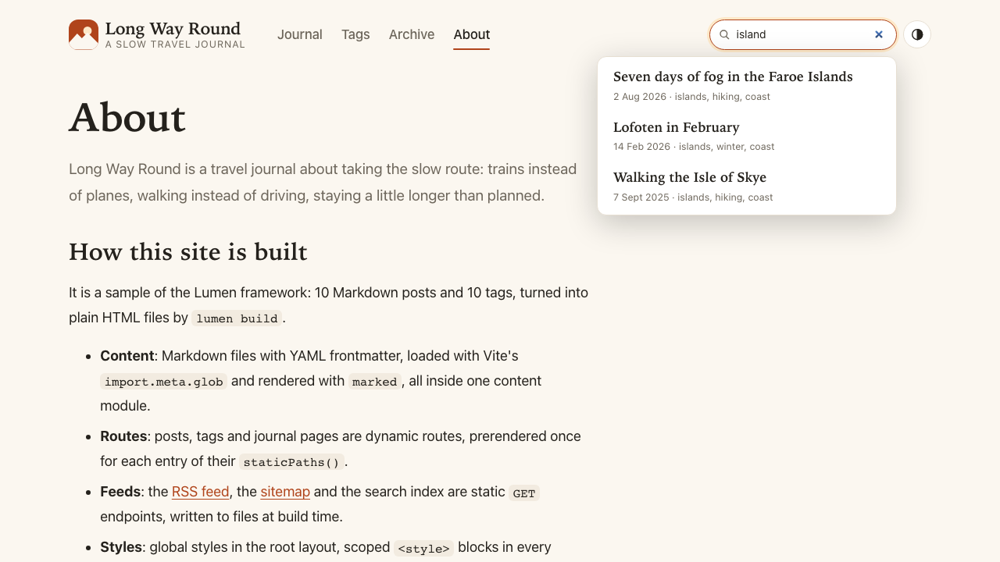
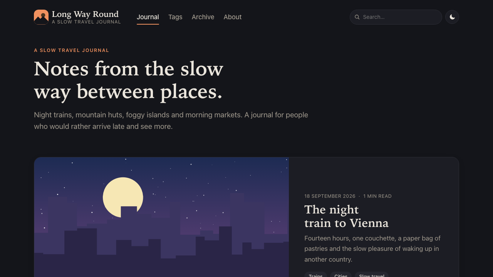
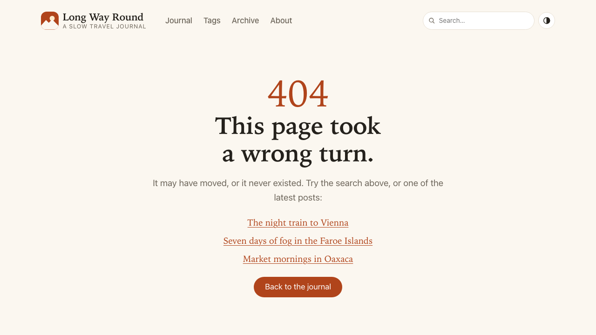
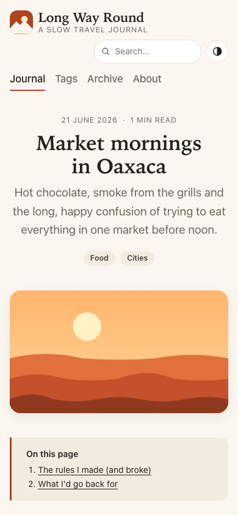

## Description

<!-- SECTION:DESCRIPTION:BEGIN -->
The user wants to see a static, multi-page site built with Lumen.
<!-- SECTION:DESCRIPTION:END -->

## Acceptance Criteria
<!-- AC:BEGIN -->
- [x] #1 examples/ contains a static site (for example docs or a blog) from Markdown content with dynamic routes via staticPaths, tags, RSS and sitemap endpoints, global and scoped styles, $tokens, and one or two islands
- [x] #2 lumen build outputs static HTML in dist/client that works when served statically; type-checks; README; screenshots in backlog/assets
<!-- AC:END -->

## Implementation Plan

<!-- SECTION:PLAN:BEGIN -->
1. examples/ssg-travel-journal (travel journal 'Long Way Round'), lumen({ mode: "static" }); deps marked + yaml under the deps lock.
2. src/content.ts: the only Markdown-aware module (import.meta.glob ?raw eager + yaml frontmatter + marked, validated, heading ids + TOC); swapping to native .md imports (TASK-69) touches only it.
3. Routes: index + page/[page] (pagination, /page/1 redirect), posts/[slug], tags/index + tags/[tag], archive, about, _404; static GET endpoints rss.xml, sitemap.xml, search.json; src/document.tsx.
4. Styles: <style global> in the root layout, scoped blocks per component, :deep() for the Markdown body, $theme tokens (light-dark() colors).
5. Islands: Search (client:idle, over /search.json) and ThemeToggle (client:load); View Transitions via CSS opt-in (lumen option not built).
6. Verify: Vitest for content/lib, Playwright e2e against lumen build served as plain files by serve.ts, lumen check, README, screenshots.
<!-- SECTION:PLAN:END -->

## Implementation Notes

<!-- SECTION:NOTES:BEGIN -->
Lux: reassigned to Nova (owner of prerender/build). examples/ssg-* ownership moves to Nova. .md imports (TASK-69) aren't built yet: load the Markdown content with import.meta.glob(…, { query: '?raw', import: 'default' }) plus a Markdown library for now, behind one small content module, so switching to native .md imports later is a one-file change.

Nova (2026-10-08): built examples/ssg-travel-journal.
- Content: 10 posts (content/posts/*.md, frontmatter title/date/tags/summary/cover), generated SVG covers in public/covers. src/content.ts loads them with import.meta.glob('../content/posts/*.md', { query: '?raw', import: 'default', eager: true }), parses frontmatter with yaml 2.9.1 and renders with marked 18.1.0 (both zero-dependency, build-time only). Invalid frontmatter fails the build with the file and the field. Markdown edits reload in lumen dev.
- Routes (all static): /, /page/[page] (staticPaths 1..3; /page/1 prerenders as a redirect page to /), /posts/[slug], /tags, /tags/[tag], /archive, /about, _404 → 404.html; endpoints rss.xml (RSS 2.0 + content:encoded), sitemap.xml (26 URLs), search.json. lumen build prerenders 31 files.
- Styles: global block in routes/_layout.stsx; scoped blocks everywhere; .prose :deep(...) for the innerHTML body; $theme tokens incl. light-dark() pairs (Vite's minifier lowers them with --lightningcss-light/dark vars and rewrites the [data-theme] color-scheme rules correctly).
- Islands: Search (client:idle) and ThemeToggle (client:load), hydrate through the build's loader with no LUM4006. JS shipped per page: loader 7.4 kB + dom 2.8 kB + islands 2.2 kB brotli (runtime size is TASK-91).
- View Transitions: lumen({ viewTransitions/prefetch }) are designed but not built, so the site opts in with @view-transition { navigation: auto } and a speculationrules script in document.tsx; cover images share view-transition-name between card and post (verified in Chromium). Filed TASK-93 (options + docs that describe them as built in).
- Filed TASK-94 (low): empty '/* empty css */' JS chunk per island in client builds.
- Not committed by me: pnpm-lock.yaml (shared, Lux) now has the ssg-travel-journal importer (marked, yaml; yaml also shifts vite's peer snapshot keys) together with Spark's spa-router-e2e importer.
Validation: pnpm --filter … test (10 Vitest tests), lumen check (no problems), Playwright e2e 14/14 against lumen build + serve.ts (plain static server), root pnpm typecheck / pnpm lint / pnpm test (955 passed) green.

Screenshots (JOURNAL_SCREENSHOTS=1 pnpm test:e2e):       
<!-- SECTION:NOTES:END -->

## Final Summary

<!-- SECTION:FINAL_SUMMARY:BEGIN -->
examples/ssg-travel-journal: a static, multi-page travel journal built with lumen({ mode: "static" }). Ten Markdown posts behind one content module (import.meta.glob ?raw + yaml + marked; TASK-69 swap is one file), staticPaths() routes for posts, tags and journal pages, RSS/sitemap/search-index static endpoints, 404.html, global + scoped styles with $theme tokens and :deep() for the Markdown body, Search and ThemeToggle islands, cross-document View Transitions via CSS. lumen build writes 31 files to dist/client; serve.ts serves them as plain files; Playwright e2e (navigation, pagination, tags, posts, search island, theme island, RSS, sitemap, search index, 404, no-JS, mobile) 14/14; lumen check, Vitest, root typecheck/lint/test green. README in the example; screenshots backlog/assets/task-37-{home,post,tag,search,dark,404,mobile}.png. Follow-ups: TASK-93 (viewTransitions/prefetch options), TASK-94 (empty CSS chunks).
<!-- SECTION:FINAL_SUMMARY:END -->
