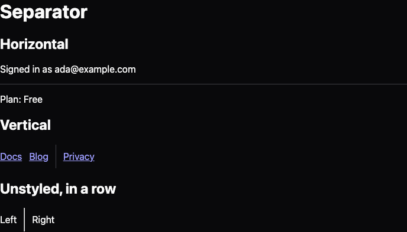

## Description

<!-- SECTION:DESCRIPTION:BEGIN -->
User decision 2026-10-15: @lumiose/ui reaches parity with Base UI's components before 1.0 (Base UI 1.9.0), unstyled, and verified against Base UI and Zag/Ark. Contract: decision-62. Separator (role and orientation) and Avatar (image with fallback and load state).
<!-- SECTION:DESCRIPTION:END -->

## Acceptance Criteria
<!-- AC:BEGIN -->
- [x] #1 Parts, props and events follow Base UI's anatomy within decision-62 (lu- tags, lowercase events, bind: by convention)
- [x] #2 Unstyled: the package ships only the CSS the primitive needs to work (display, positioning, CSS variables), in one low-priority layer
- [x] #3 Passes every item of the "UI primitives pitfall checklist" backlog doc (from Base UI and Zag/Ark) that applies, plus keyboard-contract and axe tests
- [x] #4 A docs page with a type-checked example
- [x] #5 Meets WCAG 2.2 AA (doc-9 section 17): axe with the WCAG A and AA tags passes closed and open, with the default theme, in light and dark, and the manual criteria that apply are checked and recorded
- [x] #6 Its docs page in packages/ui/docs follows the component template (decision-64) and is listed in @lumiose/ui's llms.txt
<!-- AC:END -->

## Implementation Notes

<!-- SECTION:NOTES:BEGIN -->
2026-10-15: the pitfall checklist is doc-9. The component gets its rules in the optional default theme (@lumiose/ui/themes/default.css, decision-62); the component itself stays unstyled.

2026-10-15 (user): @lumiose/ui meets WCAG 2.2 AA (decision-62, doc-9 section 17).

2026-10-15 (user): @lumiose/ui is agent-ready like lumiose (decision-64). The component's docs page lives in packages/ui/docs/<component>.md, follows dialog.md's sections (Anatomy, API, Example, Styling, Keyboard and focus, Without JavaScript, Browser support, Related) and is listed in the UI llms.txt.

2026-10-16 (Lux, orchestrator): reassigned to Beacon for batch 6. New sessions cannot start from an automated turn, so the idle Beacon session takes it; it may edit the files the fix needs.

2026-10-16 (Beacon, branch claude/beacon-m12b-ee0e55, solo takeover in batch 6): implemented.

Design (orchestrator-delegated):

- **Separator** is a native `
`, implicitly a `separator`. It carries `data-orientation`; a vertical one adds `aria-orientation="vertical"`, and a horizontal one leaves out the default. No script.
  - separator.css (lu.core) gives a vertical `
` `margin: 0`, because the UA's `margin: auto` pushed a flex row's items apart, and `align-self: stretch`, so it fills a row that centres its items.
  - The docs say an `
` cannot go inside `
`, `` or `<button>`.
- **Avatar** follows Base UI's anatomy (Root, Image, Fallback) with the behaviour of its `keepMounted` image: the `` is in the server HTML, starts loading before hydration, works with `loading="lazy"`, and shows without JavaScript.
  - `<lu-avatar>` (avatar.script.ts, 0.49 kB brotli) reads the image's state on connect, so a cached image shows at once. It then follows `load` and `error`, caught on the root in the capture phase, and changes to `src` and `srcset` or to the image itself, through a MutationObserver.
  - It sets Base UI's `data-loading` and `data-error` on the image and `data-loaded` on the root, exposes a `status` property, and dispatches `loadingstatuschange` on the image.
  - A complete image with `naturalWidth` 0 (an SVG without a size, or a broken image) is told apart with `decode()`, guarded against a later src.
  - avatar.css (lu.core) puts the parts in one grid cell (`inline-grid`, `grid-area: 1/1`), so showing one never moves the other, with the image on top (`z-index`). It hides the parts with `visibility`, which keeps lazy loading working:
    - the image while `data-loading`, only under `@media (scripting: enabled)`, so pages without JavaScript show it;
    - the image when `data-error`;
    - the fallback under `[data-loaded]`.
  - Server HTML marks the image `data-loading`.
  - Fallback `delay` is a zero-length `lu-avatar-delay` animation with `backwards` fill and `animation-delay: var(--lu-avatar-delay)`. It works with no script and no timer. The docs warn that the user's own animation on the fallback must list it.
  - Avatar.Image `onLoadingStatusChange(status)` dedupes. In a hydrated island, `onMount` reports the status the image already had.
- Theme: `.lu-separator` is a 1px `--lu-border` line, which is decorative. `.lu-avatar` is a 40px circle on `--lu-muted`, with `--lu-muted-foreground` initials (5.1 / 5.8:1) and the image `object-fit: cover`.

Against Base UI and Zag/Ark:

- Base UI Separator: `orientation` and `data-orientation`. Ours is an `
` instead of `
`, with no `render`.
- Base UI Avatar:
  - `onLoadingStatusChange` and Fallback `delay` match.
  - Statuses: ours are loading, loaded and error. A missing `src` is `error`, where Base UI has `idle`.
  - Image data attributes match (`data-loading`, `data-error`). The transition attributes are left out: a theme can fade with `transition` on `visibility`.
  - `keepMounted` is the only mode.
- Zag avatar:
  - It too keeps the image hidden until it loads and handles an image already complete on mount and src changes (MutationObserver). Both covered.
  - Zag's `data-state` attributes are replaced by Base UI's.

doc-9:

- §1 (ids and server rendering): no ids, deterministic server HTML; the server's fallback and image hydrate (island e2e, no LUM warnings).
- §1 (animations): the delay restarts on mount, and no enter animation for an image that is already loaded.
- No section covers Separator or Avatar.

WCAG 2.2 AA:

- Automated (ui-e2e, dev and build):
  - axe A/AA in light and dark on /separator, /avatar (images loaded and failed) and the island (loaded and broken);
  - 320px reflow with text spacing;
  - no focus;
  - no layout shift while the image loads.
- Manual:
  - 1.1.1: the docs name the avatar once: next to the name, `alt=""` plus an `aria-hidden` fallback; alone, the image's `alt` plus `role="img"` and `aria-label` on the fallback, because only one shows at a time.
  - 1.4.3: initials at 5.1 / 5.8:1.
  - 1.4.11: separators are decorative, not needed to understand the content.

Public names (proposals, TASK-400):

- Exports `Separator` (prop `orientation`; types `SeparatorProps`, `SeparatorOrientation`) and `Avatar` (Root, Image, Fallback; types `Avatar{Root,Image,Fallback}Props`, `AvatarLoadingStatus`).
- Entries `@lumiose/ui/separator`, `/separator.css`, `/avatar`, `/avatar.css`.
- Element `lu-avatar` with its `status` property; event `loadingstatuschange` (`detail.status`).
- Attributes `data-orientation`, `data-loading`, `data-error`, `data-loaded`, `data-fallback`.
- Variable `--lu-avatar-delay`; keyframes `lu-avatar-delay`.
- Theme classes `lu-separator`, `lu-avatar`.

Screenshots:  
<!-- SECTION:NOTES:END -->

## Final Summary

<!-- SECTION:FINAL_SUMMARY:BEGIN -->
Separator (native 
, orientation) and Avatar (Root, Image, Fallback; <lu-avatar> follows the image's loading status, CSS fallback delay, no layout shift, works without JS) with docs, theme classes, site demos and ui-e2e suites (b1f87f00). Checks: pnpm check (2295 tests), cargo fmt/clippy/test, pack:check --smoke --skip-npm, ui-e2e 519 passed (15 skipped), apps/web 159 passed (4 skipped).
<!-- SECTION:FINAL_SUMMARY:END -->
