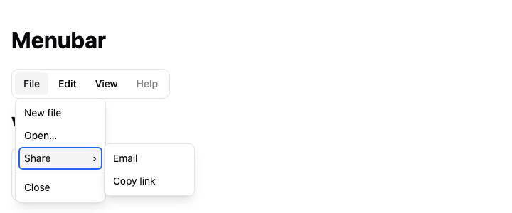

## Description

<!-- SECTION:DESCRIPTION:BEGIN -->
User decision 2026-10-15: @lumiose/ui reaches parity with Base UI's components before 1.0 (Base UI 1.9.0), unstyled, and verified against Base UI and Zag/Ark. Contract: decision-62. Menubar of Menus with roving focus across menus and hover switching.
<!-- SECTION:DESCRIPTION:END -->

## Acceptance Criteria
<!-- AC:BEGIN -->
- [x] #1 Parts, props and events follow Base UI's anatomy within decision-62 (lu- tags, lowercase events, bind: by convention)
- [x] #2 Unstyled: the package ships only the CSS the primitive needs to work (display, positioning, CSS variables), in one low-priority layer
- [x] #3 Passes every item of the "UI primitives pitfall checklist" backlog doc (from Base UI and Zag/Ark) that applies, plus keyboard-contract and axe tests
- [x] #4 A docs page with a type-checked example
- [x] #5 Meets WCAG 2.2 AA (doc-9 section 17): axe with the WCAG A and AA tags passes closed and open, with the default theme, in light and dark, and the manual criteria that apply are checked and recorded
- [x] #6 Its docs page in packages/ui/docs follows the component template (decision-64) and is listed in @lumiose/ui's llms.txt
<!-- AC:END -->

## Implementation Notes

<!-- SECTION:NOTES:BEGIN -->
2026-10-15: the pitfall checklist is doc-9. The component gets its rules in the optional default theme (@lumiose/ui/themes/default.css, decision-62); the component itself stays unstyled.

2026-10-15 (user): @lumiose/ui meets WCAG 2.2 AA (decision-62, doc-9 section 17).

2026-10-15 (user): @lumiose/ui is agent-ready like lumiose (decision-64). The component's docs page lives in packages/ui/docs/<component>.md, follows dialog.md's sections (Anatomy, API, Example, Styling, Keyboard and focus, Without JavaScript, Browser support, Related) and is listed in the UI llms.txt.

2026-10-16 (Lux, orchestrator): reassigned to Beacon for batch 7 (the idle Beacon session takes it; it may edit the files the task needs).

2026-10-16 (Beacon, branch claude/beacon-m12b-ee0e55, batch 7): implemented in e89cc8ce.

Design (orchestrator-delegated):

- **Structure.** `Menubar`, one component as in Base UI, renders `<lu-menubar role="menubar" aria-orientation data-orientation>` around `Menu.Root`s.
  - menu.tsx gains an additive, exported `MenubarContext`. A top-level `Menu.Root` inside it (not a submenu, not inside another menu) renders `<lu-menu role="none">`, its `Menu.Trigger` gets `role="menuitem"`, and in a vertical bar its Popup defaults to `side="inline-end"`.
  - This is the APG example's structure: menubar > li[role=none] > (menuitem, menu). axe passes.
- **Script.** menubar.script.ts, 0.6 kB of its own and 4.0 kB brotli with Menu's.
  - **One tab stop:** roving tabindex, set once the document has loaded. The element can connect mid-parse before its items, which the first e2e run caught.
  - **Keys on an item:** Arrow Right and Left (Down and Up when vertical, RTL-swapped), looping unless `loopFocus={false}`; Home, End and typeahead. An open menu follows to the next item.
  - **Keys in an open menu:** Right and Left on an item that opens no submenu close it and open the next or previous one on its first item, also from inside a submenu. In a vertical bar, the arrow pointing back closes the menu.
  - **Pointer:** once a menu is open, hovering another item opens its menu.
  - **State:** `data-has-submenu-open` follows the open menu.
- **Menu's script** (additive): a root menu in a vertical menubar opens with the arrow toward its popup instead of Down and Up. Menu runs everything else: keys, items, submenus, dismissal, focus return.
- **CSS.** menubar.css (lu.core) imports menu.css and makes the bar a flex row, a column when vertical.
- **Theme.** `.lu-menubar`: a bordered bar, triggers as 32px targets, the open one filled, a focus ring.

Against Base UI and Zag/Ark:

- Base UI Menubar: `orientation` and `loopFocus` match, as do `data-orientation` and `data-has-submenu-open`.
- Left out: `modal` (the page stays usable and scrollable), `disabled` on the bar (disable each trigger instead), `render`.
- Zag has no menubar. The APG menubar pattern was followed for the keys.

doc-9:

- §5 comes with Menu, whose e2e suite still passes.
- §1: dismissal stacks, because another root menu opening closes the open one through the shared layer model. Focus returns on Escape. IME composition is ignored.

WCAG 2.2 AA:

- **Automated** (ui-e2e, dev and build): axe A/AA closed and open (menu plus submenu), light and dark, on the page and the island; 24px targets; focus ring; 320px reflow with text spacing.
- **Manual:**
  - 2.1.1: every action works from the keyboard, and Tab leaves the bar.
  - 2.4.3: focus returns to the item.
  - 4.1.2: roles and `aria-expanded` follow APG.

Public names (proposals, TASK-400):

- Export `Menubar` (props `orientation`, `loopFocus`); types `MenubarProps`, `MenubarOrientation`.
- Entries `@lumiose/ui/menubar` and `/menubar.css`.
- Element `lu-menubar`, with attributes `data-orientation`, `data-loop-focus` and `data-has-submenu-open`.
- Theme class `lu-menubar`.
- Menu's new exports `MenubarContext` and `MenubarContextValue`.

Screenshot: 
<!-- SECTION:NOTES:END -->

## Final Summary

<!-- SECTION:FINAL_SUMMARY:BEGIN -->
Menubar: Menus in a role=menubar with one tab stop, arrows between items and open menus, a vertical orientation and hover switching; docs, theme, demos, ui-e2e (e89cc8ce). Checks: pnpm check (2334 tests), pack:check --smoke --skip-npm (@lumiose/ui 128 files), ui-e2e 646 passed (18 skipped), apps/web 171 passed (4 skipped).
<!-- SECTION:FINAL_SUMMARY:END -->
