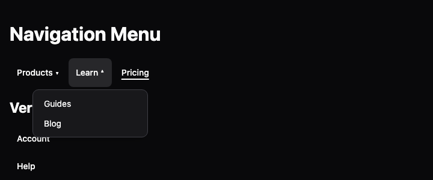

## Description

<!-- SECTION:DESCRIPTION:BEGIN -->
User decision 2026-10-15: @lumiose/ui reaches parity with Base UI's components before 1.0 (Base UI 1.9.0), unstyled, and verified against Base UI and Zag/Ark. Contract: decision-62. Navigation Menu: site navigation with flyout content, hover intent and an animated viewport.
<!-- SECTION:DESCRIPTION:END -->

## Acceptance Criteria
<!-- AC:BEGIN -->
- [x] #1 Parts, props and events follow Base UI's anatomy within decision-62 (lu- tags, lowercase events, bind: by convention)
- [x] #2 Unstyled: the package ships only the CSS the primitive needs to work (display, positioning, CSS variables), in one low-priority layer
- [x] #3 Passes every item of the "UI primitives pitfall checklist" backlog doc (from Base UI and Zag/Ark) that applies, plus keyboard-contract and axe tests
- [x] #4 A docs page with a type-checked example
- [x] #5 Meets WCAG 2.2 AA (doc-9 section 17): axe with the WCAG A and AA tags passes closed and open, with the default theme, in light and dark, and the manual criteria that apply are checked and recorded
- [x] #6 Its docs page in packages/ui/docs follows the component template (decision-64) and is listed in @lumiose/ui's llms.txt
<!-- AC:END -->

## Implementation Notes

<!-- SECTION:NOTES:BEGIN -->
2026-10-15: the pitfall checklist is doc-9. The component gets its rules in the optional default theme (@lumiose/ui/themes/default.css, decision-62); the component itself stays unstyled.

2026-10-15 (user): @lumiose/ui meets WCAG 2.2 AA (decision-62, doc-9 section 17).

2026-10-15 (user): @lumiose/ui is agent-ready like lumiose (decision-64). The component's docs page lives in packages/ui/docs/<component>.md, follows dialog.md's sections (Anatomy, API, Example, Styling, Keyboard and focus, Without JavaScript, Browser support, Related) and is listed in the UI llms.txt.

2026-10-16 (Lux, orchestrator): reassigned to Beacon for batch 7 (the idle Beacon session takes it; it may edit the files the task needs).

2026-10-16 (Beacon, branch claude/beacon-m12b-ee0e55, batch 7): implemented in e89cc8ce.

Design (orchestrator-delegated: "decide what the viewport/animation needs"):

- **Structure.**
  - Root renders `<nav>` inside `<lu-navigation-menu>` (display: contents), so it stays a navigation landmark.
  - List is a `<ul>`. Item is an `<li data-value>`.
  - Trigger is a `<button popovertarget>` with an anchor name. Icon is a ``.
  - Content is a `
` placed with the shared placement rules: bottom/center by default, inline-end/start when vertical.
  - Link is an `<a>`, with `active` giving `aria-current="page"` plus `data-active`, and `closeOnClick`.
- **Without JavaScript:**
  - the links work;
  - a click opens a panel;
  - auto popovers allow one at a time;
  - Escape and a click outside close it.
- **The Viewport decision.**
  - Base UI's shared Viewport, Popup, Positioner, Portal, Backdrop and Arrow are left out. Without a portal the contents cannot be moved into one box, and moving nodes Lumiose owns would be fragile.
  - Each content is its own popover, anchored to its trigger in the top layer.
  - The animation hook is `data-activation-direction` (left, right, up or down: where the new trigger is from the previously open one, from their rects, so it works in RTL and vertical too).
  - The theme fades contents and slides them in from that side, with `@starting-style` and `overlay`, under `prefers-reduced-motion: no-preference`.
- **Script.** navigation-menu.script.ts, 2.1 kB brotli including the shared place.ts fallback.
  - **Hover intent** (mouse and pen): open after `delay` (50ms), at once while another content is open; close `closeDelay` (50ms) after leaving the item, or 300ms when leaving the trigger through the edge facing the content.
  - **Click:** the element handles the trigger's click. It keeps a content opened by hover open and sticky; a second click closes it.
  - **Keys:** the APG disclosure-nav optional keys. Left and Right (Up and Down when vertical) move between top-level triggers and links, with Home and End. Down (Right when vertical) opens a content on its first link. Up and Down move within a content. Escape closes it and returns to its trigger. Every trigger and link stays a tab stop (no roving, as in the disclosure pattern).
  - **Focus:** focus leaving an open item closes it.
  - **State:** `aria-expanded`; `value` (with a setter, per TASK-411) and `valuechange`; place.ts placement where anchor positioning is missing.
- **Root props.** `value`, `defaultValue`, `onValueChange`, `bind:value`, `delay`, `closeDelay`, `orientation`.
- **Nested menus.** A nested Root renders `<nav role="none">` instead of Base UI's `
`. Switching tags with `Dynamic` made `useId` differ between the server and the client (filed as TASK-412), and rendering children in both branches warns LUM2005.
- **Children.** List, Item and Icon render their children explicitly (TASK-347: spreads drop children).

doc-9:

- §1 (layers): auto popovers stack by DOM ancestry, so a menu nested in a content keeps its parent open.
- §1 (focus): Escape returns focus to the trigger; a click outside keeps focus where it landed.
- §3 (popover): an anchored native popover, with light dismiss that ignores clicks inside.

WCAG 2.2 AA:

- **Automated** (ui-e2e, dev and build): axe A/AA closed and open, light and dark, on the page and the island; 36px targets; focus ring; 320px reflow with text spacing. The site's a11y suite also opens the hero demo.
- **Manual:**
  - 1.4.13: hover-opened content is hoverable (travel grace), dismissible with Escape, and stays while hovered.
  - 2.1.1: keyboard access throughout.
  - 2.4.3: focus order follows the DOM, and the content comes after its trigger.
  - 1.4.1: the current page is underlined, not only coloured.

Public names (proposals, TASK-400):

- Export `NavigationMenu` (Root, List, Item, Trigger, Icon, Content, Link).
- Types `NavigationMenu{Root,List,Item,Trigger,Icon,Content,Link}Props` and `NavigationMenuOrientation`.
- Entries `@lumiose/ui/navigation-menu` and `/navigation-menu.css`.
- Element `lu-navigation-menu`, with property `value` and event `valuechange` (`detail.value`).
- Attributes `data-delay`, `data-close-delay`, `data-orientation`, `data-value`, `data-active`, `data-close-on-click` and `data-activation-direction`.
- Theme class `lu-navigation-menu`.

Screenshot: 
<!-- SECTION:NOTES:END -->

## Final Summary

<!-- SECTION:FINAL_SUMMARY:BEGIN -->
Navigation Menu: a nav landmark whose triggers open anchored auto popovers (links and panels work without JavaScript), with hover intent, keys, focus-out closing, value and activation direction; docs, theme, demos, ui-e2e (e89cc8ce). Checks: pnpm check (2334 tests), pack:check --smoke --skip-npm (@lumiose/ui 128 files), ui-e2e 646 passed (18 skipped), apps/web 171 passed (4 skipped).
<!-- SECTION:FINAL_SUMMARY:END -->
