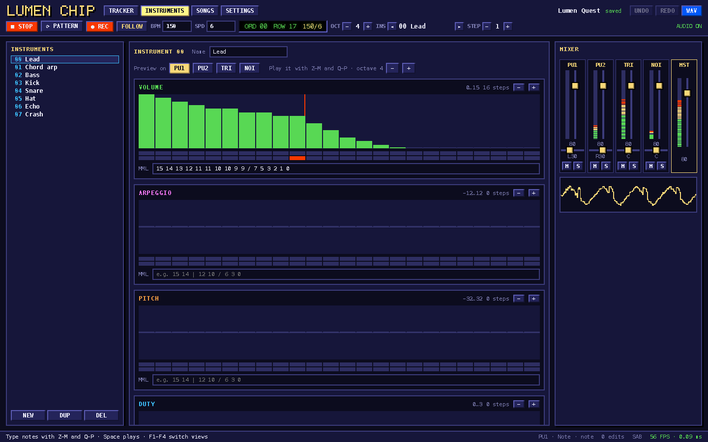
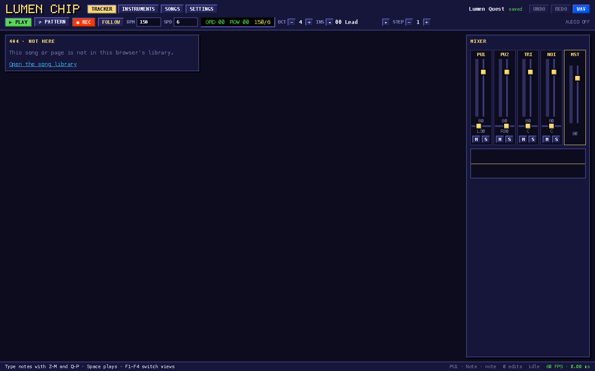

## Description

<!-- SECTION:DESCRIPTION:BEGIN -->
TASK-35 ships the chiptune app as a client-only app switching views via state. Once the SPA router exists, it should use lumen({ mode: 'spa', ssr: false }) with file routes, as the sample is meant to show.
<!-- SECTION:DESCRIPTION:END -->

## Acceptance Criteria
<!-- AC:BEGIN -->
- [x] #1 Views become src/routes/* with a persistent root _layout (transport + mixer stay mounted and keep playing across navigation); deep links to songs; lumen dev/build in spa mode; README updated
<!-- AC:END -->

## Implementation Plan

<!-- SECTION:PLAN:BEGIN -->
1. Views → src/routes (tracker at /songs/[id], /instruments, /songs, /settings; / redirects to the open song), root _layout = old App shell + mixer.
2. nav.ts maps views to URLs (tabs as <Link>, F1-F4 via navigate()); keys route by the URL's view.
3. document.stsx for the head, middleware.ts for COOP/COEP; lumen dev/build/preview with @lumen/adapter-node; remove index.html/main.tsx.
4. e2e on lumen dev and lumen build + preview, plus a spec for persistence across views and deep links; README.
<!-- SECTION:PLAN:END -->

## Implementation Notes

<!-- SECTION:NOTES:BEGIN -->
Spark (2026-10-08): done in b409f58 (app) and 44dc831 (router fix found here: a level that throws while first created — the / redirect — now starts empty and the redirect/error page follows; unit-tested).
- lumen({ mode: "spa", ssr: false }); routes: _layout.stsx (header/transport, mixer, status bar — persistent), index.stsx (redirect to /songs/<id>), songs/[id].stsx (opens the song the URL names; notFound() when the library has none → _404.stsx), songs/index.stsx, instruments.stsx, settings.stsx. Loading a song from the library navigates to its tracker URL.
- The mixer moved from TrackerView into the layout (right column on every view), so it stays mounted with its meters/scope while playing.
- COOP/COEP: Vite's server.headers do not reach lumen dev's handler responses, so src/middleware.ts sets them (dev and per-request pages under lumen preview). lumen preview serves the prerendered shells (dist/client/index.html, songs/index.html, …) as static files without them, so entering at / under preview is not isolated (postMessage fallback). Possible follow-up for Nova: header config for static files in adapter-node/lumen preview.
- pnpm-lock.yaml: examples/spa-chiptune gained @lumen/adapter-node (installed under deps.lock); lockfile left for Lux.
- Size: 114 kB JS (41 kB gzip) vs 82/29 kB as a single client bundle: the router/SPA entry (~16 kB raw) — it also pulls the hydrator (dom/hydrate.ts) through the island loader even for ssr=false-only apps, and actions/client.ts (submit, decodeData) through setClientNavigation — plus per-route chunking (many ~60-byte CSS stub chunks). Follow-ups: a CSR-only boot path without the hydrator; move ClientNavigation into a tiny module (Nova); CSS stub chunks (Photon).
- Seen in passing (Nova): with a custom src/document.stsx, the shell's island records script lands after </html> (renderToStream appends records to the shell body, which is the whole custom document). Browsers move it into the body, so it works, but the HTML is invalid.
Validation: lumen check clean; vitest 10/10; Playwright 14/14 (7 on lumen dev, 7 on lumen build + lumen preview); perf unchanged (300 frames at 60 FPS, p95 frame work 0.14 ms dev / 0.20 ms build). Screenshots: backlog/assets/task-72-instruments-while-playing.png, backlog/assets/task-72-song-not-found.png.
<!-- SECTION:NOTES:END -->

## Final Summary

<!-- SECTION:FINAL_SUMMARY:BEGIN -->
The chiptune runs on lumen({ mode: "spa", ssr: false }) with file routes and lumen/router: a persistent root _layout (header/transport, mixer, status bar keep playing and animating across views), views at /songs/[id] (deep links open songs; _404 for unknown ones), /instruments, /songs and /settings, tabs as <Link> and F1-F4 via navigate(). lumen dev/build/preview replace vite; e2e green on both (14/14), README updated. Screenshots:  
<!-- SECTION:FINAL_SUMMARY:END -->
