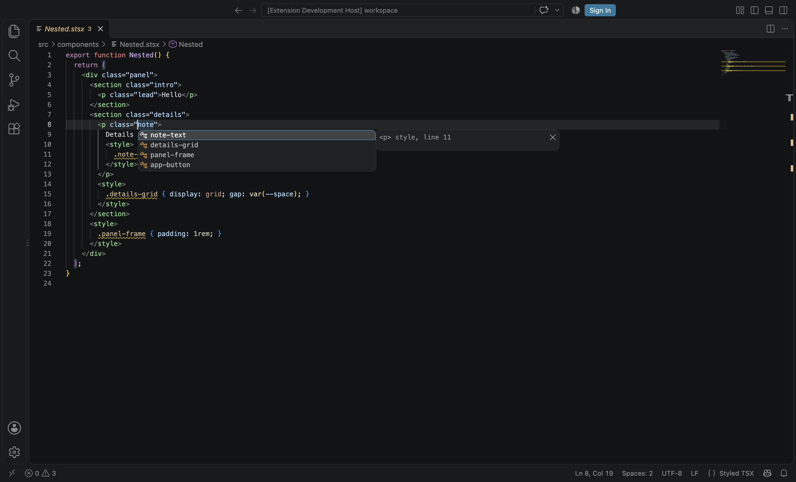

## Description

<!-- SECTION:DESCRIPTION:BEGIN -->
The user tried authoring .stsx in VS Code and reported issues (2026-10-08): <style global> classes from other files are not offered; class completion offers classes from any style in the component regardless of tree position (decision-23 now scopes nested styles to their enclosing subtree); custom properties (--x) from the project's styles are only partially offered; attribute completion inside <style …> shows the snippets (acomp, comp, island, route) instead of 'global'; Lumen attributes (client:*, bind:*, on:*, attach, <style global>) have no descriptions. The installed .vsix also predates TASK-48/66.
<!-- SECTION:DESCRIPTION:END -->

## Acceptance Criteria
<!-- AC:BEGIN -->
- [x] #1 Class completion and go-to-definition include every class from <style global> blocks across the workspace's .stsx files and from imported global .css files, plus file-level classes, plus enclosing-subtree classes per decision-23 (not sibling subtrees); ranked local first
- [x] #2 var(--…) and custom property completion lists all custom properties declared anywhere in the project's styles (global, file, component, .css), with their declared values as detail; local first
- [x] #3 Inside <style …> the only attribute completion is 'global' with a description; snippets are offered only in TS statement/JSX contexts (move them to LSP-provided completions with context checks, or otherwise scope them)
- [x] #4 Descriptions (hover and completion docs) for client:load|idle|visible|media|only, bind:value|checked, on:x, attach, ref, key and <style global>, via JSDoc in the JSX types plus LSP hovers; a rebuilt .vsix with reinstall instructions in packages/vscode/README.md; protocol tests
<!-- AC:END -->

## Implementation Plan

<!-- SECTION:PLAN:BEGIN -->
1. LSP: read JSX element extents from the masked TSX (jsx.ts) and scope nested blocks to their enclosing element's subtree (decision-23) for class completion/definition/rename; rank innermost subtree, file, global, project.
2. Project style index (project-styles.ts): <style global> classes of all .stsx files plus classes of global .css files imported by project modules (with @import); custom properties declared in any block or imported .css, with values.
3. CSS completion: custom properties in var(--…) and at declaration names (local first, value as detail, declarations as docs).
4. <style …> open tag: only 'global' completion + hovers for <style>/global; move snippets from the VS Code contribution into the LSP with context checks (top-level statements; JSX children).
5. JSDoc for client:*, bind:*, ref, attach, key, on:x in jsx-runtime.ts; LSP fallback docs where TS cannot show JSDoc (on:x mapped members, key).
6. Protocol tests per item; VS Code smoke test update; rebuild .vsix; README reinstall instructions.
<!-- SECTION:PLAN:END -->

## Implementation Notes

<!-- SECTION:NOTES:BEGIN -->
2026-10-08 Beacon: claimed (.local/coordination/claims/TASK-80). Committed d9bad9e (JSX JSDoc) and 8d2a13c (LSP: jsx.ts, project-styles.ts, properties.ts, snippets.ts, descriptions.ts + protocol tests; 53/53 language-server tests). Note: the working-tree lumen_css (another agent's in-progress change) panics at crates/lumen_css/src/values.rs:226 ('byte range starts at 73 but ends at 72') on '.oops { color: ; }' (fixture Broken.stsx), killing the language server; LSP tests were validated with a clean HEAD binding (worktree build, loaded only into the server process).

Evidence:
- AC1: packages/language-server/src/jsx.ts reads element extents from the masked TSX; StsxSnapshot.scopes maps each nested block to its enclosing element's subtree (decision-23). Completion/definition/rename use it; ranking innermost subtree → file → global → project (<style global> of other files + classes of global .css imported by project modules, incl. @import). Tests: server.test.ts 'scopes class completion to the enclosing subtrees', 'defines and renames classes within their subtree'; jsx.test.ts. Verified on a copy of examples/spa-chiptune with the user's Header.stsx edit: .numberx is offered in 
 but not in the sibling 
.
- AC2: project-styles.ts + properties.ts; var(--…) and declaration-name completion, local first, declared value as detail, declarations listed in docs. Test 'completes custom properties of the whole project with their values'; properties.test.ts.
- AC3: <style …> completes only 'global' (with GLOBAL_DOC); snippets moved from packages/vscode/snippets to the LSP (snippets.ts): comp/acomp/route at top-level statement starts, island in JSX children. Tests: 'offers only global inside a <style> open tag', 'offers snippets at a top-level statement and in JSX children only'; VS Code smoke asserts the <style > list is exactly ['global'].
- AC4: JSDoc in packages/lumen/src/jsx/jsx-runtime.ts (client:*, bind:*, ref, attach, key, on:x); LSP adds docs TypeScript cannot show (on:x mapped members, key on intrinsics) in hovers and completion resolve, plus <style>/global hovers. Test 'describes Lumen attributes and <style> tags'. .vsix rebuilt: packages/vscode/lumen-vscode-darwin-arm64.vsix (bundles a compiler built from HEAD a903843+, without the uncommitted lumen_css panic); reinstall steps in packages/vscode/README.md 'Installing a local build'.
Validation: language-server 53/53 (with a clean HEAD binding; the shared working-tree binding aborts on Broken.stsx because of the lumen_css values.rs panic reported on TASK-76), vscode unit 20/20, pnpm test test:vscode both modes passed (workspace + bundled), pnpm typecheck and pnpm lint clean. Screenshot: backlog/assets/task-80-scoped-class-completion.png.
Commits: d9bad9e, 8d2a13c, 25458c7, 82ac528.
<!-- SECTION:NOTES:END -->

## Final Summary

<!-- SECTION:FINAL_SUMMARY:BEGIN -->
IDE feedback fixed (TASK-80). The language server now scopes class completion, definitions and rename per decision-23 (nested <style> → enclosing element's lexical subtree, never sibling subtrees), indexes the project's global classes (<style global> in any .stsx and imported global .css, following @import) and custom properties (any block or .css, completed in var(--…) and declaration names with their values), offers only 'global' inside <style …>, serves the .stsx snippets itself only at top-level statements and in JSX children, and documents Lumen attributes (JSDoc in the JSX types plus LSP fallbacks for on:x and key) and <style>/<style global> in hovers. VS Code: contributed snippets removed, smoke suite extended (both server modes pass), server bundle fixed (Vite external), .vsix rebuilt for darwin-arm64 with reinstall steps in packages/vscode/README.md; docs updated (getting-started Editor, styles.md editor note, llms). Screenshot: 
<!-- SECTION:FINAL_SUMMARY:END -->
