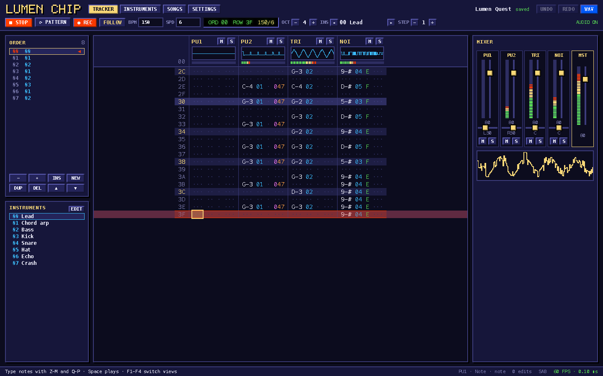

# Lumen Chip

A chiptune tracker, composer and mixer built with Lumen as a client-rendered SPA:
`lumen({ mode: "spa", ssr: false })`, file routes and [`lumen/router`](../../packages/lumen/docs/reference/router.md).
It has four NES-style voices synthesized in an AudioWorklet: two pulses, a triangle and noise. It
ships with a demo song, "Lumen Quest".



## Run it

From the repository root, once:

```sh
pnpm install
pnpm build:compiler
```

Then:

```sh
cd examples/spa-chiptune
pnpm dev        # lumen dev; open the printed URL and press PLAY (or Space)
pnpm build      # lumen build: dist/client (static shells and assets) and dist/server
pnpm preview    # lumen preview: serves the build with @lumen/adapter-node
```

`src/middleware.ts` adds COOP/COEP headers to the pages the server renders, so they are
cross-origin isolated. The engine then publishes the playing row, the levels and the scope samples
through a `SharedArrayBuffer`. Without isolation it falls back to `postMessage`, at about 60 Hz.
`lumen build` also writes each route's shell as a static file (`dist/client/index.html`,
`songs/index.html`, … and `404.html`, which serves deep links on a static host); `lumen preview`
serves those files without the headers, and a static host needs its own header configuration.

Checks:

```sh
pnpm typecheck  # lumen check (.stsx through shadow TSX)
pnpm test       # Vitest: synth, sequencer, history
pnpm test:e2e   # Playwright against `lumen dev` and against `lumen build` + `lumen preview`
```

To save the e2e screenshots, set `CHIPTUNE_SHOTS=<dir>`. The task screenshots are made with
`CHIPTUNE_SHOTS=$PWD/../../backlog/assets`.

## Using it

- **F1–F4** (or the tabs) switch views, which are pages: the tracker at `/songs/<id>`, then
  `/instruments`, `/songs` and `/settings`. Playback, the transport and the mixer carry on across
  them, and back/forward work. A song URL opens that song from the library. **Space** plays the
  song.
- Type notes with the two piano rows, **Z–M** and **Q–P**. **1** writes a note off and **-** a
  note cut.
- Hex digits fill the instrument, volume and effect columns. Shift with the arrow keys selects.
  **Ctrl/Cmd + C/X/V** copies, cuts and pastes. **Alt + Up/Down** transposes. **Ctrl/Cmd + Z**
  undoes.
- Effects: `0xy` arpeggio, `1xx`/`2xx` slide, `3xx` portamento, `4xy` vibrato, `Axy` volume slide,
  `Bxx` jump, `Dxx` break, `Fxx` speed/BPM, `Sxx` cut, `Vxx` duty.
- Instruments have volume, arpeggio, pitch and duty macros. Draw them with the mouse, or type them
  as MML, such as `15 14 | 12 10 / 6 3 0` (`|` comes before the loop, `/` after the release).
- Songs autosave to a library in `localStorage`. A reload reopens the last song. The songs view
  exports and imports JSON song files. **WAV** in the header (or **Ctrl/Cmd + E**) renders the
  whole song offline.

The settings view lists every shortcut.

## How it is built

| Part       | Files                                            | Notes                                                                                                                                                                                                                                                                                                                                       |
| ---------- | ------------------------------------------------ | ------------------------------------------------------------------------------------------------------------------------------------------------------------------------------------------------------------------------------------------------------------------------------------------------------------------------------------------- |
| Routes     | `src/routes/`, `src/nav.ts`, `src/document.stsx` | `_layout.stsx` is the app shell (header and transport, the mixer, the status bar), mounted once; each view is a route rendered in its outlet. `/` redirects to the open song's tracker, `songs/[id].stsx` opens the song a URL names (a `_404` when the library has no such song). `nav.ts` maps views to URLs for the tabs and the F-keys. |
| State      | `src/state.ts`, `src/model/`                     | The open song is one deep `store()`. Every edit is a list of path patches (`{ path, before, after }`). Undo and redo replay these patches, and the same writes keep the audio engine and the autosave in sync.                                                                                                                              |
| Synth      | `src/audio/synth.ts`                             | Plain TypeScript with no Web Audio. It has PolyBLEP pulses with four duty cycles, a 4-bit stepped triangle and LFSR noise in long and short modes. It runs a per-tick sequencer, the effects, and the instrument macros with loop and release points. The same code runs in the worklet, in the WAV export and in the unit tests.           |
| Engine     | `src/audio/engine.ts`, `worklet.ts`, `wav.ts`    | The worklet hosts the synth. The UI thread forwards song patches and transport commands to it. The WAV export renders through an `OfflineAudioContext` into 16-bit PCM.                                                                                                                                                                     |
| Frame loop | `src/frame.ts`                                   | A single `requestAnimationFrame` loop reads the telemetry once per frame and sets the transport and meter signals. It also draws every oscilloscope canvas directly.                                                                                                                                                                        |
| UI         | `src/ui/*.stsx`                                  | Components with scoped `<style>` blocks and `$tokens` (`src/tokens.ts`). Colors are CSS custom properties, so the NES and DMG themes switch at runtime. In the pattern editor, the cursor, the selection and the playing row are one style binding each, and the sheet moves with a transform.                                              |

## Performance

Measured by `pnpm test:e2e`. The test plays the demo song for 5 s, with the follow mode scrolling,
every VU meter animating (one style binding each) and five canvas scopes redrawing every frame.
The setup was headless Chromium 153 on an Apple M1 Max, at 1440 × 900.

| Build                           | Frames | FPS  | Frame interval p95 | Frame work avg / p95     | Slow frames (> 25 ms) |
| ------------------------------- | ------ | ---- | ------------------ | ------------------------ | --------------------- |
| `lumen dev`                     | 300    | 60.0 | 16.67 ms           | 0.10–0.12 / 0.14–0.20 ms | 0                     |
| `lumen build` + `lumen preview` | 300    | 60.0 | 16.67–16.70 ms     | 0.11–0.13 / 0.16–0.26 ms | 0                     |

The ranges cover three or four runs of each.

"Frame work" is the time the frame loop spends in its callback. That covers reading the
telemetry, updating the signals and the DOM bindings they drive, and drawing the scopes. It stays well under 1% of the 16.7 ms frame budget, and the audio runs on its own thread.
You can check it live in the status bar, or with **Measure last 600 frames** in the settings
view.

The production build is 114 kB of JS (41 kB gzip) for the app, the Lumen runtime and the router,
split into a chunk per route, plus a 9 kB worklet bundle and 19 kB of CSS (4.3 kB gzip).
