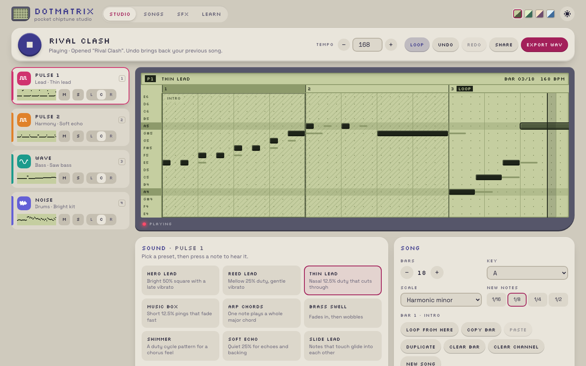

# Dotmatrix

A pocket chiptune studio built with Lumen as a client-rendered SPA: `lumen({ mode: "spa", ssr: false })`,
file routes and [`lumen/router`](../../packages/lumen/docs/reference/router.md). It makes music and sound
effects for the four channels of the Game Boy sound chip, rendered by the gbapu APU engine in a Web Worker.
It is the beginner-friendly sibling of [Lumen Chip](../spa-chiptune): a piano roll and presets instead
of a tracker and hex effect columns.



> The sound engine in `vendor/gbapu/` comes from the Newbark engine (`packages/gbapu`) and is vendored
> unchanged; it is not openly licensed, so redistributing it needs the rights holder's permission (see
> [its notice](vendor/gbapu/LICENSE-NOTICE.md)).

## Run it

From the repository root, once:

```sh
pnpm install
pnpm build:compiler
```

Then:

```sh
cd examples/spa-dotmatrix
pnpm dev        # lumen dev; open the printed URL and press Play (or Space)
pnpm build      # lumen build: static shells in dist/client, plus dist/server
pnpm preview    # lumen preview: serves the build with @lumen/adapter-node
```

Checks:

```sh
pnpm typecheck  # lumen check
pnpm test       # Vitest: the driver, the demo songs on the real engine, the vendored files' checksums
pnpm test:e2e   # Playwright against `lumen dev` and against `lumen build` + `lumen preview`
```

To save the e2e screenshots, set `DOTMATRIX_SHOTS=<dir>`. The task screenshots are made with
`DOTMATRIX_SHOTS=$PWD/../../backlog/assets`.

## Using it

- **Studio** (`/`): pick a channel on the left (or press **1–4**), then click the grid to add a note
  and drag to make it longer; click a note to remove it. With the grid focused, the arrow keys move a
  cursor, **Enter** adds or removes a note and **Shift + ←/→** changes its length. **Space** plays,
  **L** toggles the loop, **Ctrl/⌘ Z** undoes, **?** lists every shortcut.
- Each channel has presets (Hero lead, Music box, Arp chords, Round bass, Night pad, Classic kit…);
  **Fine-tune** opens the hardware controls: duty cycle, envelope, vibrato, glide, arpeggio, wave
  shape, drum tone.
- The key and scale decide the grid's rows, so every note fits; pick Chromatic for all semitones.
  Bars before the loop bar are an intro that plays once, as in a game. Pick a bar (click its number)
  to copy, paste, duplicate or clear it.
- **Share** copies a link that carries the whole song in its URL (`/?song=…`, deflated and
  base64url-encoded); nothing is uploaded. **Export WAV** saves the intro and the loop twice, with
  RIFF `smpl` loop points on the second pass. The open song autosaves to `localStorage`.
- **Songs** (`/songs`): twelve original demos (a town, a route, three battles: a rival, a wild
  encounter and a final battle, a night theme, a sacred hall, a cave, a goofy tune, a sad theme, the
  credits and the four-bar starter) to listen to and open in the studio, and the songs you saved.
- **SFX** (`/sfx`): twenty original sound effects (select, cursor, back, text blip, error, jump,
  hit, bump, door, pickup, heal, save, item get, level up, warp, explosion, laser, splash, power
  up, footsteps). Bend one with the pitch, length,
  sweep, duty, noise tone and volume sliders, read it as sound-driver macros (`square_note`,
  `noise_note`, `pitch_sweep`) and export it as WAV.
- **Creatures** (`/creatures`): twenty original creatures and their voices ("cries"), built
  the way handheld RPGs built them: a base voice on the two pulses and the noise channel (twenty
  base voices, one per creature: register glides, duty patterns, fades, a detuned twin and noise),
  and each creature adds a pitch (added to every square note's frequency register) and a length (a
  tempo for the square notes; noise keeps its timing). Change the base voice, pitch and length, roll
  a new creature with "Surprise me", read the driver code and export a WAV.
- **Driver code**: in SFX and Creatures, "Show code" shows a sound in the sound-driver format
  (read-only for built-ins, with "Copy to My sounds"); saved sounds can be edited, pasted over or
  imported from a `.txt`/`.asm` file. In the Studio, the screen's **Grid | Code** switch shows the
  song as music macros (or a sound sheet as SFX code) and applies edits, pastes and imports as one
  undoable step. Errors are listed by line. Copy code and Export code (a `.asm` file that imports
  back identically) work everywhere code is shown. See the [composing guide](docs/composing.md#songs-as-code).
- **Open in studio** (SFX and Creatures): the sound opens in the studio as a _sound sheet_, a
  song on a frame grid (one step per video frame, played once). Per-note settings the grid does not
  draw (volume, envelope, duty, hardware sweep, fine tuning) travel with each note, shown by a
  notch, so nothing is lost; on the noise channel the rows are raw noise settings. "Save to My
  sounds" brings it back to its gallery. If the sheet uses studio-only features (vibrato, glide,
  arpeggio, shimmer, short notes, the wave channel), the maker says which and keeps its sliders off;
  the sound still plays, exports and reopens in the studio.
- **Learn** (`/learn`): the four channels, each trick with a button to hear it, and the credits.

## Composing

[docs/composing.md](docs/composing.md) is a guide to writing music, sound effects and creature
voices for the four channels, in the app and in the sound-driver format of its code view, with
recipes and original examples.

## How it works

- `src/audio/driver.ts` is the sound driver. It turns a song into gbapu command streams (register
  writes and waits in CPU cycles) the way a handheld RPG's driver does: notes start on 16th-note
  steps, and once per video frame (70,224 cycles) it updates vibrato, glides, arpeggios, duty cycle
  patterns and the wave channel's volume steps. Noise drums are short programs of noise settings
  (`src/audio/tables.ts`), and SFX are runs of `square_note`/`noise_note`-style steps.
- `src/model/sheet.ts` converts sounds to sound sheets and back; `src/model/sheet.test.ts` renders
  every SFX and creature voice both ways on the real engine and compares them.
- `src/audio/render.worker.ts` runs the vendored engine offline. Each channel renders to its own
  mono stem; `src/audio/player.ts` plays the four stems in sync with Web Audio, loops the part after
  the loop bar, and mixes mute, solo and panning without re-rendering. An edit re-renders only the
  channels it changed (a channel of a 30-second song takes about 0.1 s) and swaps them in at the
  playing position, so playback continues while you edit.
- Songs are plain JSON (`src/model/types.ts`). `src/state.ts` keeps the open song in a Lumen
  `store`, with snapshot undo/redo and autosave; every incoming song (share links, storage) passes
  through `sanitizeSong`.
- The demo songs are written in a small text notation (`src/model/notation.ts`), such as
  `melody("C5:4 E5:2 G5:6 | …")` and `chords("F Am Bb C", "1:2 5 3' 5", 3)`.

## Credits

- Sound engine: gbapu (Newbark), vendored unchanged with `LICENSE-NOTICE.md`, `PROVENANCE.json` and
  `CHECKSUMS.sha256`; `src/audio/vendor.test.ts` checks the files against the checksums.
- The driver, presets, wave tables, drum kit, demo songs and sound effects are original work for
  this sample, written in the style of late-90s handheld RPG soundtracks. No game music, sound
  effects or data are included.
- Fonts: [Silkscreen](https://fonts.google.com/specimen/Silkscreen) and
  [Space Grotesk](https://fonts.google.com/specimen/Space+Grotesk), SIL Open Font License, bundled
  from `@fontsource`.

## License

The app code is [MIT](../../LICENSE). The vendored gbapu engine in `vendor/gbapu` is not covered: it keeps its own notice.
