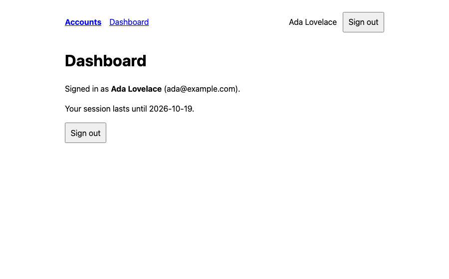

# Accounts: Better Auth and Prisma

Email and password accounts in a server-rendered Lumiose app, with
[Better Auth](https://www.better-auth.com) and [Prisma](https://www.prisma.io) on a SQLite file
(the libsql driver adapter, so no database server). It follows the
[authentication guide](../../packages/lumiose/docs/guides/auth.md):

- Better Auth's HTTP API as an endpoint, `src/routes/api/auth/[...all]/route.ts`.
- `src/middleware.ts` puts the session on `ctx.locals`.
- `/dashboard` is protected: `requireSession()` redirects to `/sign-in?next=/dashboard`.
- Sign-up, sign-in and sign-out are form actions, so they work without JavaScript. Sign-in and
  sign-up post on to Better Auth's handler, so its rate limiter counts every attempt (3 per 10 s
  per client in production), keyed by the client's address (`src/server/client-address.server.ts`).
- The account menu in the header is an island that uses Better Auth's browser client; the home
  page is prerendered, so only the browser knows who is signed in there.
- Prisma lives in `src/server/`, server-only: importing it from client code fails the build
  (LUM4003).

## Run it

Node 24 or later.

```sh
pnpm --filter @lumiose-examples/ssr-auth dev        # generate, migrate data/auth.db, lumiose dev
pnpm --filter @lumiose-examples/ssr-auth typecheck  # lumiose check
pnpm --filter @lumiose-examples/ssr-auth build      # lumiose build: dist/client + dist/server/entry.js
pnpm --filter @lumiose-examples/ssr-auth db:migrate # prisma migrate deploy
pnpm --filter @lumiose-examples/ssr-auth start      # node server.ts: @lumiose/adapter-node on $PORT (3000)
pnpm --filter @lumiose-examples/ssr-auth test:e2e   # Playwright, against the production build
```

`prisma generate` writes the client to `src/server/generated/prisma` (gitignored). It reads
`tsconfig.json`, which extends `.lumiose/tsconfig.generated.json`, so the scripts run
`lumiose typegen` first (`db:generate`).

| Env variable         | Default (dev)          | Purpose                                                                                                                                                                        |
| -------------------- | ---------------------- | ------------------------------------------------------------------------------------------------------------------------------------------------------------------------------ |
| `BETTER_AUTH_SECRET` | `.env.development`     | Signs Better Auth's cookies and tokens. In production a random value: `openssl rand -base64 32`.                                                                               |
| `BETTER_AUTH_URL`    | (the request's origin) | The public URL, such as `https://example.com`. Set it in production: Better Auth checks origins against it.                                                                    |
| `DATABASE_URL`       | `file:./data/auth.db`  | The SQLite file, relative to the working directory. `prisma.config.ts` and `db.server.ts` share the default.                                                                   |
| `TRUSTED_PROXIES`    | (none)                 | Behind a proxy, its address (`127.0.0.1`, or comma-separated addresses and CIDR ranges): the rate limiter then reads each client's address from the proxy's `X-Forwarded-For`. |

The e2e tests (`e2e/auth.e2e.ts`) build the app, migrate a fresh `data/e2e.db` and run `server.ts`.
They cover the redirect from the protected page, sign-up, sign-out with the form and with the
island, sign-in back to the page the visitor asked for, Better Auth's errors on the forms, the
same flow without JavaScript, and the rate limit: a fourth sign-in from one client within 10 s gets
`429`, while another client still signs in. Each test has its own client address (the server
trusts `127.0.0.1` as a proxy). `src/server/client-address.test.ts` (Vitest) checks that a
client's own `X-Forwarded-For` is ignored without trusted proxies.


