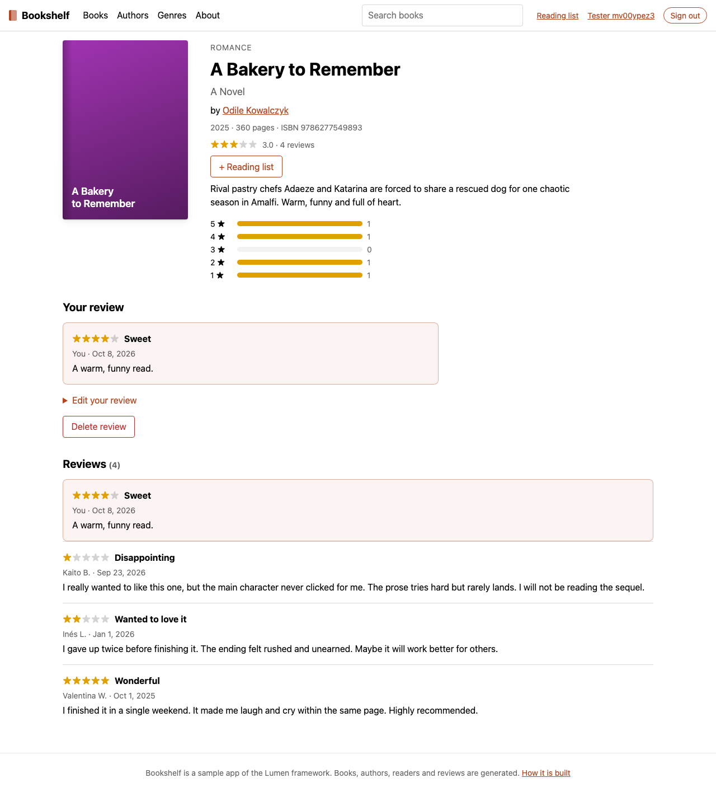
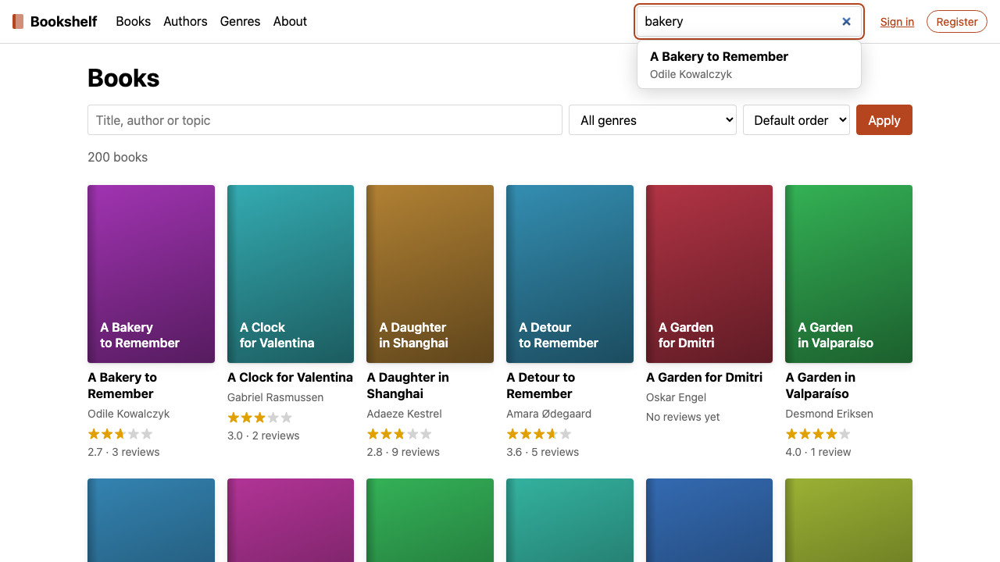

# Bookshelf: a server-rendered Lumen sample

A multi-page book catalog with search, reviews, reading lists and accounts, backed by
`node:sqlite`. It shows Lumen's `server` and `static` route modes, form actions, cookie sessions,
islands and `<Suspense>` streaming.

Every page works without JavaScript; four islands enhance the search box, the reading-list
buttons, the star rating input and the account menu of prerendered pages. It runs on `lumen dev`
and in production with `lumen build` and `@lumen/adapter-node`.



## Run it

Node 24 or later; `node:sqlite` is built in.

```sh
pnpm --filter @lumen-examples/ssr-bookshelf dev        # seeds if empty, then lumen dev on :5173
pnpm --filter @lumen-examples/ssr-bookshelf seed       # (re)creates data/bookshelf.db
pnpm --filter @lumen-examples/ssr-bookshelf test       # Vitest, in-memory databases
pnpm --filter @lumen-examples/ssr-bookshelf typecheck  # lumen check: .ts and .stsx
pnpm --filter @lumen-examples/ssr-bookshelf build      # lumen build: dist/client + dist/server/entry.js
pnpm --filter @lumen-examples/ssr-bookshelf preview    # lumen preview on :4173 (LUMEN_SECRET from the env)
pnpm --filter @lumen-examples/ssr-bookshelf start      # node server.ts: @lumen/adapter-node on $PORT (3000)
pnpm --filter @lumen-examples/ssr-bookshelf test:e2e   # Playwright, against the production build
```

`lumen build` prerenders the `static` routes (`/about`, `/genres`, one page per genre and
`404.html`) into `dist/client`; the rest render per request through `dist/server/entry.js`.
`server.ts` serves both: static files first, then the handler. In production, set
`LUMEN_SECRET` (and `ORIGIN` behind a TLS proxy).

The e2e tests (`e2e/bookshelf.e2e.ts`) build the app and run `server.ts` on a freshly seeded
database of their own (`data/e2e.db`). They cover browsing, filters and paging, the static
pages, streaming, sign-in, registration, private pages, review create/edit/delete and the
forbidden case, the reading list, each island (and that hydration reports no `LUM4006`), and the
same forms with JavaScript disabled. `BOOKSHELF_SCREENSHOTS=1` also saves the screenshots in
`backlog/assets/task-36-*.png`.

`node src/server/seed.server.ts --if-empty` keeps an already seeded database; `dev` runs it first.
In dev, `LUMEN_SECRET` comes from `.env.development` (a development-only value).

Every seeded user has the password `bookshelf`. `reader@example.com` has reviews and a reading
list, so it gets personal recommendations.

| Env variable        | Default                   | Purpose                                                              |
| ------------------- | ------------------------- | -------------------------------------------------------------------- |
| `LUMEN_SECRET`      | (required)                | HMAC secret of the session cookie, read by Lumen's `signedCookie()`. |
| `BOOKSHELF_DB`      | `data/bookshelf.db` (cwd) | Database file. `data/` is gitignored.                                |
| `BOOKSHELF_SLOW_MS` | `1500`                    | Artificial delay of the recommendations, to make streaming visible.  |

## Data

The seed is deterministic: a fixed PRNG seed always produces the same catalog. Only password
salts are random. It creates:

- 12 genres;
- 60 authors with bios;
- 200 books with ISBN-13s, made-up titles and descriptions;
- 40 users and 600 reviews, rated 1 to 5;
- about 260 reading-list entries.

Activity ends on 2026-09-30, so the data does not depend on when you seed.

| Table          | Notes                                                                                |
| -------------- | ------------------------------------------------------------------------------------ |
| `genres`       | `slug` is the public id.                                                             |
| `authors`      | `slug` is the public id.                                                             |
| `books`        | `isbn` is the public id; one genre each; `cover_hue` drives a generated cover.       |
| `book_authors` | Ordered authors per book (about 7% are co-written).                                  |
| `book_search`  | FTS5 index over title, author names and description, kept in sync by triggers.       |
| `users`        | Email is unique and case-insensitive; `password_hash` is scrypt with its parameters. |
| `sessions`     | SHA-256 of the session token, with the user and expiry. Deleting a row revokes it.   |
| `reviews`      | One per user and book, with `CHECK (rating BETWEEN 1 AND 5)`.                        |
| `book_ratings` | View: review count and average rating per book.                                      |
| `reading_list` | `(user, book)` with the time it was added.                                           |

Migrations live in `db.server.ts` and are tracked with `PRAGMA user_version`. File databases use
WAL and foreign keys.

## Modules

Server-only code lives in `src/server/*.server.ts`. `lumen dev` and `lumen build` reject imports
of it from client code, with the importer chain, and `lumen check` reports them (LUM4003).

| Module               | Exports                                                                                            |
| -------------------- | -------------------------------------------------------------------------------------------------- |
| `db.server.ts`       | `openDatabase(file?)`, `getDatabase()` (shared), `migrate`, `statement` (cached), `transaction`    |
| `queries.server.ts`  | `queries()` / `createQueries(db)`: books, authors, genres, reviews, reading list and users (below) |
| `auth.server.ts`     | `auth()` / `createAuth(db)`, `requireUser(ctx?)`, `loginHref(url)`, `safeRedirectPath(next)`       |
| `password.server.ts` | `hashPassword`, `verifyPassword` (scrypt, `node:crypto`)                                           |
| `seed.server.ts`     | `seed(db)`, `generateCatalog()`, CLI                                                               |

The modules in `src/types.ts` and `src/lib/` have no server imports, so islands can use them too:

- `src/types.ts`: domain types, all plain serializable data.
- `src/lib/pagination.ts`: page math and `pageWindow()` for pagers.
- `src/lib/search-params.ts`: `?q=&genre=&sort=&page=` to and from `BookFilters`.
- `src/lib/validation.ts`: form validators for reviews, registration and login.

These are the queries:

- **Books:**
  - `listBooks({ q, genre, author, sort, page, pageSize })` returns a `Page<BookSummary>` with
    totals. `q` is an FTS5 prefix search ranked by bm25, with title matches above author matches
    above description matches. `sort` is one of `title`, `newest`, `oldest`, `rating` or
    `relevance`. `rating` uses a Bayesian average, and unreviewed books come last.
  - `getBook(isbn)` adds the description, the authors and a rating histogram.
- **Home page:**
  - `featuredBooks(limit)`.
  - `trendingBooks({ days, limit })`: the most reviewed books in the last 30 days of activity.
  - `recommendationsFor(userId | null, { delayMs, signal })`: async and deliberately slow.
- **Authors and genres:** `listAuthors({ q, page })`, `getAuthor(slug)`, `listGenres()` and
  `getGenre(slug)`.
- **Reviews:**
  - `listReviews(bookId, paging)`, `listUserReviews(userId, paging)`, `getReview(id)` and
    `getUserReview(userId, bookId)`.
  - `createReview`, `updateReview` and `deleteReview` return `{ ok, value }` or
    `{ ok: false, reason: "not-found" | "forbidden" | "conflict" }`. Only the author may edit or
    delete a review.
- **Reading list:** `addToReadingList`, `removeFromReadingList`, `isOnReadingList`,
  `readingListIds(userId, bookIds)` (the initial state of a page's toggles) and
  `readingList(userId, paging)`.
- **Users:** `getUserById(id)` and `getUserByEmail(email)`. Neither returns the password hash.

### Sessions

`login(cookies, userId)` creates a random 256-bit token. It stores the token's SHA-256 in
`sessions` and sets an HMAC-signed, HttpOnly, `SameSite=Lax` cookie (`bookshelf_session`) with
Lumen's `signedCookie()`. Logging in also revokes any previous session in the cookie.

`currentUser(cookies)` checks the signature, then the session row:

- An expired, revoked or forged session clears the cookie.
- Past half of its 30-day lifetime, a session is extended and the cookie is re-sent.

Because `currentUser` can write cookies, call it in the middleware, never inside `<Suspense>`
(LUM5004).

`logout`, `revokeSession` and `revokeUserSessions` end sessions server-side, even if the cookie
was copied.

`requireUser(ctx?)` returns `locals.user`, falling back to the cookie. With no user, it throws
`redirect("/login?next=…")`. Pages can call it without `ctx`.

## Site

`src/middleware.ts` sets `ctx.locals.user = await auth().currentUser(ctx.cookies)`. The
`Locals.user` type is declared in `auth.server.ts`.

Most routes are `server`, because they show the signed-in user or read the query string. The
`static` routes are prerendered at build time and get the account menu from an island.

| Route                 | Mode   | Content                                                                                                                 |
| --------------------- | ------ | ----------------------------------------------------------------------------------------------------------------------- |
| `/`                   | server | Featured and trending books; **`<Suspense>` streams `recommendationsFor(user)`**                                        |
| `/books`              | server | `listBooks(parseBookFilters(url().searchParams))`; search, genre and sort form; pager                                   |
| `/books/[isbn]`       | server | Book detail, rating histogram, reading-list toggle, your review (create, edit, delete), reviews paginated with `?page=` |
| `/authors`            | server | Paginated author index with a name filter                                                                               |
| `/authors/[slug]`     | server | Bio, rating, and `listBooks({ author })` with a pager                                                                   |
| `/genres`             | static | Genre index with book counts                                                                                            |
| `/genres/[slug]`      | static | `staticPaths()` from `listGenres()`; top-rated books, with a link to `/books?genre=`                                    |
| `/about`              | static | About the sample                                                                                                        |
| `/login`, `/register` | server | Forms with an `action`; `fail(400, { errors })` re-renders with field errors; `?next=`                                  |
| `/logout`             | server | `POST` endpoint: `auth().logout(ctx.cookies)`, then `redirect("/")`                                                     |
| `/reading-list`       | server | `requireUser()`; your list, plus the `toggle` named action used by every toggle                                         |
| `/profile`            | server | `requireUser()`; your reviews, paginated                                                                                |
| `/api/search`         | server | `GET` endpoint: top 8 `listBooks({ q })` results, for the search island                                                 |
| `/api/me`             | server | `GET` endpoint: `{ user }` for the account menu on static pages                                                         |
| `_404`, `_error`      | n/a    | Error pages (a forbidden review change renders `_error` with 403)                                                       |

Layouts:

- `(app)/_layout.stsx` holds the server routes. It sets `mode = "server"` and renders the header
  with the user from `locals()`.
- `(static)/_layout.stsx` holds the static routes. Its header renders `<AccountMenu client:idle>`.

Pages read the request (`url()`, `locals()`, `params`) and run their queries in the default export,
then pass the results to a component as props. node:sqlite is synchronous, so pages need no
`await`; the slow recommendations are an async component inside `<Suspense>`.

### Styles

Each component has a `<style>` block directly under its root element, and pages have a file-level
block at the end of the file, so their scope is the same whether a nested block covers the whole
component or only its element's subtree (decision-23). Design tokens live in `src/theme.ts` and are
read as `$theme.color.accent`, `$theme.space.md` and so on: the compiler inlines them, so the
module never reaches the browser. `src/styles.css` holds the few base styles for plain elements
(body, links, form controls, `.byline`, `.error`, `.form`).

### Form actions

`/login` and `/register` have a default `action`; the others are named actions posted to `?/name`.
The Origin/CSRF check is on for all of them.

- `/books/[isbn]?/createReview`, `?/updateReview` and `?/deleteReview`:
  1. `requireUser(ctx)`.
  2. `validateReview(await ctx.formData())`.
  3. Map the query result: `forbidden` becomes `error(403)`, `not-found` becomes `notFound()`,
     and `conflict` becomes `fail(409)`.
  4. `redirect("/books/:isbn#your-review")`.
- `/reading-list?/toggle`: add or remove `bookId`. A plain form post sends `next` and is
  redirected back there; the island leaves `next` out and reads the returned `{ onList }`.
- `/login`:
  1. `validateLogin`.
  2. `auth().authenticate`.
  3. `auth().login(ctx.cookies, user.id)`.
  4. `redirect(safeRedirectPath(next))`.
- `/register`:
  1. `auth().register(form)`.
  2. `login`.
  3. `redirect`.

### Islands

Islands live in `src/islands/`. Each one renders a working form or link on the server, and the
loader hydrates it when its trigger fires.

| Island              | Directive        | Behavior                                                                                                                                                      |
| ------------------- | ---------------- | ------------------------------------------------------------------------------------------------------------------------------------------------------------- |
| `SearchBox`         | `client:load`    | In the header. Debounced live suggestions from `/api/search` (older requests aborted); arrow keys and Enter open a book; Enter alone submits `GET /books?q=`. |
| `ReadingListToggle` | `client:visible` | A `<form method="post" action="/reading-list?/toggle">` enhanced with `submit()`; stays on the page. Initial state comes from `readingListIds()`.             |
| `StarRatingInput`   | `client:visible` | Radio-group star picker in the review form; lights stars on hover and runs `validateReview()` on submit, so a missing rating is a hint, not a round trip.     |
| `AccountMenu`       | `client:idle`    | Prerendered pages only: renders the sign-in links, then fetches `/api/me` and shows the reader's links.                                                       |

Without JavaScript, every island falls back to a plain link or form.


