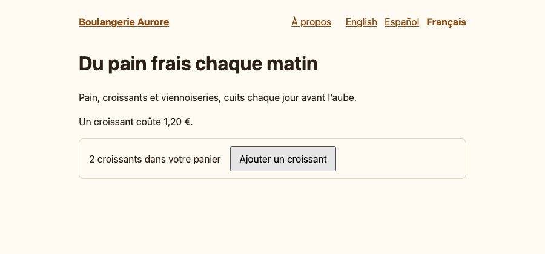

# i18n: Paraglide JS

A small bakery site in English, Spanish and French, with Lumiose's locale routing and
[Paraglide JS](https://paraglidejs.com) compile-time messages. It follows the
[i18n guide](../../packages/lumiose/docs/guides/i18n.md); the
[i18next sample](../ssr-i18n-i18next) is the same site with i18next.

- `vite.config.ts`: `lumiose({ i18n })` with `missing: "404"` and detection on entry (a `locale`
  cookie and `Accept-Language`), plus Paraglide's Vite plugin, which compiles `messages/*.json`
  into `src/paraglide/` (gitignored).
- `src/lib/i18n.ts` points Paraglide's `getLocale()` at Lumiose's `locale()`, per request on the
  server and the page's in the browser, and re-exports the messages (`m`).
- `/` exists in every locale; `/about` only in English and Spanish, so `/fr/about` is a 404 and its
  `hreflang` links list two locales. `/about` is prerendered per locale, with absolute URLs from
  `lumiose({ site })`.
- `src/islands/Basket.stsx` is an island with messages (a plural and a click counter); its chunk
  holds only the messages it uses.
- `src/islands/LocaleSwitcher.stsx` links to `alternates()` and updates the detection cookie.
- `src/routes/layout.stsx` links to `/about` in the current locale when `alternates("/about")`
  lists it, else in English.

## Run it

Node 24 or later.

```sh
pnpm --filter @lumiose-examples/ssr-i18n-paraglide dev        # lumiose dev (Paraglide compiles on start)
pnpm --filter @lumiose-examples/ssr-i18n-paraglide typecheck  # compile the messages, then lumiose check
pnpm --filter @lumiose-examples/ssr-i18n-paraglide build      # lumiose build: dist/client + dist/server/entry.js
pnpm --filter @lumiose-examples/ssr-i18n-paraglide start      # node server.ts: @lumiose/adapter-node on $PORT (3000)
pnpm --filter @lumiose-examples/ssr-i18n-paraglide test:e2e   # Playwright, against the production build
```

`project.inlang/settings.json` loads the message format plugin from `node_modules` (the
`@inlang/plugin-message-format` dev dependency) instead of a CDN URL, so builds need no network.

The root `pnpm typecheck` runs this example's typecheck on its own, before the parallel run of the
other packages. Paraglide's compiler gives up when the inlang project does not open within 30
seconds, which happened on a busy CI runner.

The e2e tests (`e2e/i18n.e2e.ts`) cover localized pages with their `hreflang` and canonical links,
the 404 for an undeclared locale, the language switcher and the cookie it sets, detection on a
first visit, and the island's messages.


