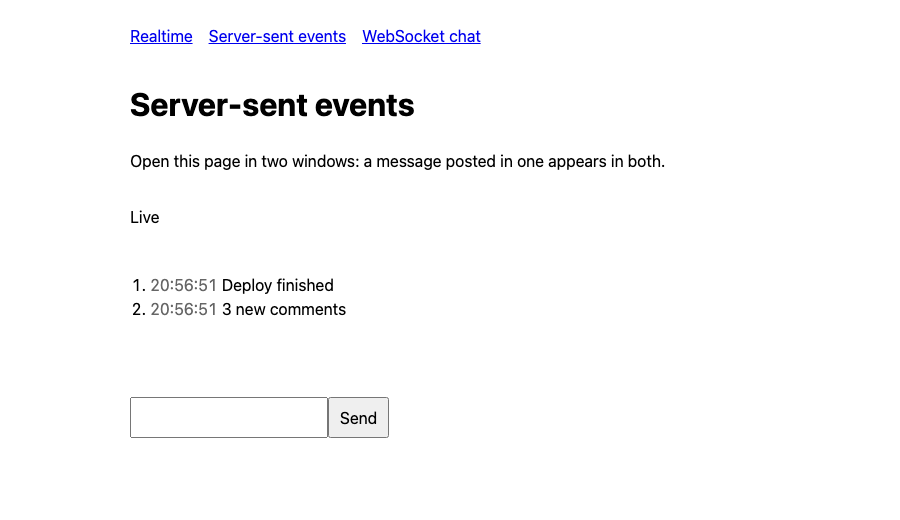

# Realtime: server-sent events and WebSockets

Two ways to push updates to the browser from a Lumiose app on `@lumiose/adapter-node`, as in the
[realtime guide](../../packages/lumiose/docs/guides/realtime.md):

- **Server-sent events** (`/events`): `src/routes/api/events/route.ts` streams every message
  published on an in-process bus (`src/server/bus.server.ts`) through `eventStream()`
  (`src/server/event-stream.server.ts`), which cleans up when the client disconnects. The
  `LiveFeed` island reads it with `EventSource` into a signal and closes it in `onCleanup`; its
  form posts to the page's action with `submit()`, so the stream stays open.
- **WebSockets** (`/chat`): `ws` attaches to the Node server's `upgrade` event in `server.ts`
  (and to Vite's server in dev, through a plugin in `vite.config.ts`). The handshake's `Origin`
  must be this site's. The `Chat` island broadcasts to every open window.

## Run it

Node 24 or later.

```sh
pnpm --filter @lumiose-examples/ssr-realtime dev        # lumiose dev, WebSockets included
pnpm --filter @lumiose-examples/ssr-realtime test       # Vitest: the event stream and the bus
pnpm --filter @lumiose-examples/ssr-realtime typecheck  # lumiose check
pnpm --filter @lumiose-examples/ssr-realtime build      # lumiose build
pnpm --filter @lumiose-examples/ssr-realtime start      # node server.ts on $PORT (3000)
pnpm --filter @lumiose-examples/ssr-realtime test:e2e   # Playwright, against the production build
```

`lumiose preview` does not run `server.ts`, so it serves no WebSockets: use `build` and `start`.

The e2e tests (`e2e/realtime.e2e.ts`) open two pages of the feed, post from one and check both
receive the message, then close them and check through `/api/stats` that each stream
unsubscribed. They also check the chat between two windows, and that handshakes from another
origin (`403`) or to another path are refused.


